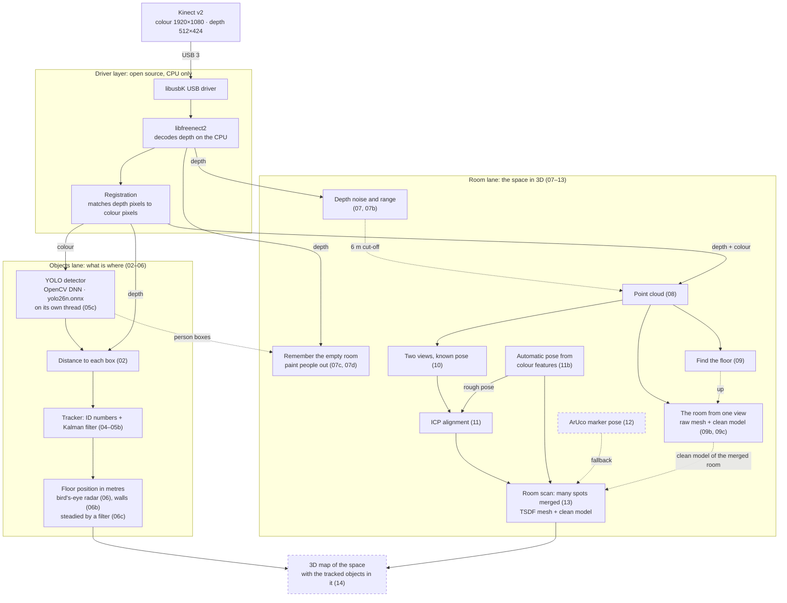

# Spotter

Spotter is a hands-on project for learning object detection, recognition and tracking. The current
work uses a **Kinect v2**, a camera that sees both colour and *depth* (how far away each pixel
is). The examples find objects in the colour image and use depth to measure how far away they
are.

- **How we work:** small, runnable examples. Each one teaches one idea and builds on the
  previous one.
- **Long-term goal:** a 3D map of a space.
- **Final hardware:** a Raspberry Pi.

---

## How it fits together

The Kinect's colour and depth come in through an open-source driver, then split into two lanes.
The **objects lane** finds things in the colour image and uses depth to place them; the **room
lane** turns depth into 3D points of the room itself. The goal is where they meet: a 3D map with
the tracked objects in it. Solid boxes are built, dashed boxes are planned, and the numbers are
the example folders in `exercises/cpp/`. Everything runs on the CPU, so the same code can move
from the Windows PC to the Raspberry Pi.

How each example works, and what it adds to the one before, is drawn in
[exercises/cpp/EXAMPLES.md](exercises/cpp/EXAMPLES.md).

---

## What's in this repository

| Folder | What it is | Needs |
|---|---|---|
| `exercises/python/` | Beginner exercises with a normal webcam: drawing, motion, YOLO detection, tracking | Any webcam, Python |
| `exercises/cpp/` | **The current work.** Kinect v2 examples in C++ | Kinect v2, see below |
| `exercises/csharp/` | An earlier version of the Kinect examples, on Microsoft's Kinect SDK. Kept as a reference, no longer developed | Windows + Microsoft Kinect SDK |
| `docs/` | `decisions.md` records why things are built the way they are. `ideas.md` holds researched ideas for later | — |
| `kinect_rgbd_fusion_guide.md` | Background reading: the method behind the Kinect examples | — |
| `yolo26n.pt`, `yolo26n.onnx`, `yolo26n_320.onnx` | The object detector (YOLO), already trained. Python uses `.pt`; C++ uses `.onnx` (640 px input, or the faster 320 px one) | — |

### Words you'll see

| Term | Meaning |
|---|---|
| **Kinect v2** | A Microsoft camera from 2014 with a colour camera (1920×1080) and a depth camera (512×424, about 0.5–4.5 m). |
| **Depth image** | An image where each pixel holds a distance in millimetres instead of a colour. |
| **YOLO** | A neural network that draws boxes around objects (people, chairs, cups…) and labels them. |
| **OpenCV** | The standard open-source library for images, windows and running YOLO. |
| **libfreenect2** | An open-source driver that talks to the Kinect. We use it instead of Microsoft's SDK. |
| **CMake** | Turns our build description (`CMakeLists.txt`) into a compiled program. |
| **vcpkg** | Downloads and builds the libraries we depend on, at the exact versions pinned in `vcpkg.json`. |

---

## Getting started: the Kinect examples (Windows)

### What you need

**Hardware**
- A **Kinect v2** (the Xbox One Kinect) plus the **Kinect Adapter for Windows**, which provides
  power and the USB connection.
- A **USB 3.0** port. These are often blue, or marked "SS". USB 2.0 will not work.

**Software** (all free)
- [Git](https://git-scm.com/download/win), to download this repository.
- [Build Tools for Visual Studio 2026](https://visualstudio.microsoft.com/downloads/), the C++
  compiler. Under "Tools for Visual Studio", download *Build Tools*. In the installer, tick the
  workload **"Desktop development with C++"**. That also installs CMake and vcpkg; you don't
  install them separately.

### Step 1: download the repository

Open a terminal (Command Prompt or PowerShell) and clone to a **short path**. vcpkg's build
folders nest deeply, and Windows can't handle paths over 260 characters.

    cd E:\
    git clone <this repository's URL> Spotter

### Step 2: give the Kinect an open-source USB driver (once per PC)

Windows attaches Microsoft's driver to the Kinect. libfreenect2 needs a generic USB driver
called **libusbK** instead. You swap it once with a small tool called Zadig:

1. Plug in the Kinect (adapter powered, USB in a 3.0 port).
2. Download and run [Zadig](https://zadig.akeo.ie/).
3. Open the **Options** menu. Tick **"List All Devices"** and untick **"Ignore Hubs or Composite Parents"**.
4. In the drop-down, choose **"Xbox NUI Sensor (composite parent)"**. Don't choose "NuiSensor
   Adaptor", which is the adapter, not the Kinect.
5. Choose **libusbK** as the new driver and click **Replace Driver**. Say yes to the warning.

After this, programs that use Microsoft's Kinect SDK (including `exercises/csharp`) can't see the
Kinect.

**To undo it:** open Device Manager, open "libusbK USB Devices", right-click "Xbox NUI Sensor
(Composite Parent)", choose **Uninstall device**, tick **"Delete the driver software"**, and replug
the Kinect.

### Step 3: build

1. Open the Start menu and search for **"x64 Native Tools Command Prompt for VS"**. Use this
   prompt, not a normal one; it has the compiler and tools set up.
2. Run:

       cd /d E:\Spotter\exercises\cpp
       cmake --preset default
       cmake --build --preset default

The first `cmake --preset default` takes **about 30 minutes**, because vcpkg downloads and
compiles OpenCV and libfreenect2 from source. That's normal. Later builds take seconds, because
vcpkg keeps a cache.

### Step 4: run

Still in `exercises\cpp`:

    build\01_Kinect_Depth_Peek.exe

You should see a grey picture of the room. Near things are bright, far things dark, and red
marks places with no depth reading. A green crosshair (moved with **W A S D**) shows the distance
under it. The console prints the frame rate, about 30 fps. Press **Q** to quit.

Then work through the other examples in this order:

| Order | Program | What it teaches |
|---|---|---|
| 1 | `01_Kinect_Depth_Peek` | What the depth camera measures, and where it fails |
| 2 | `03_Kinect_Depth_Blobs` | Find people or objects from depth alone, and measure their size (no AI) |
| 3 | `02_Kinect_Detect_Distance` | YOLO finds objects in colour, then depth tells you how far away each one is |
| 4 | `04_Kinect_Track_Smooth` | Follow each object over time (ID numbers), and smooth its distance |
| 5 | `05_Kinect_Kalman` | A Kalman filter: predict where each object will be, then correct. Keeps IDs better, and gives speed |
| 5b | `05b_Kinect_Two_Thresholds` | Two confidence levels plus a longer memory: objects that flicker in and out keep their ID |
| 5c | `05c_Kinect_Background_Detect` | Run YOLO on a second thread so the picture, tracking and distances keep the camera's pace |
| 6 | `06_Kinect_Radar` | Turn each tracked object into a floor position in metres, on a bird's-eye "radar" map with trails |
| 6b | `06b_Kinect_Radar_Walls` | 06's radar plus the walls, found in the depth alone: the biggest upright flat surfaces, drawn as lines |
| 6c | `06c_Kinect_Wall_Filter` | Steady the walls: each one gets an extended Kalman filter, because walls don't move but each frame's measurement wobbles |
| 7 | `07_Kinect_Capture_Average` | Average many still frames to cut depth noise, and measure how much it helps (first step toward a 3D map) |
| 7b | `07b_Kinect_Far_Range` | Raise the depth cut-off from 4.5 m to 8 m, and see how much noisier the far readings are |
| 7c | `07c_Kinect_Depth_Background` | Remember the room's depth; anything clearly nearer is new (a person, a moved cup). No neural network |
| 7d | `07d_Kinect_Remove_Person` | Paint people out with the remembered room behind them; anything they carry stays visible |
| 8 | `08_Kinect_Point_Cloud` | Turn every depth pixel into a coloured 3D point, and turn the room around with the mouse. P saves a `.ply` (never commit it) |
| 8b | `08b_Kinect_Object_Mesh` | Click a detected object: its depth pixels become a triangle mesh with a guessed (grey) back, saved as `.obj` for Blender or MeshLab (never commit it) |
| 9 | `09_Kinect_Find_Floor` | Find the floor with RANSAC: the camera's height, tilt and roll, and any point's height above the floor |
| 9b | `09b_Kinect_Room_Mesh` | Press S: the whole view becomes a coloured mesh, saved as `.obj`. The first recreation of the room, holes and all (never commit it) |
| 9c | `09c_Kinect_Room_Model` | The same scan, plus a clean model next to it: flat walls, floor and ceiling, furniture as boxes, stood straight. Both in one `.obj`, in separate groups |
| 10 | `10_Kinect_Two_Views` | Two captures merged by a hand-measured pose: see the walls show double, nudge the pose until they meet |
| 11 | `11_Kinect_ICP` | ICP lines the two captures up by itself: pair each point with its nearest neighbour, fit, repeat. Needs a roughly right start |
| 11b | `11b_Kinect_Feature_Pose` | The rough start found automatically, like Meshroom: matching features in the two colour pictures, then ICP |
| 13 | `13_Kinect_Room_Scan` | **Scan a whole room** from several spots and save one model (merged mesh + clean walls, floor, ceiling and furniture boxes). Step by step: [below](#recreate-a-room-example-13) |
| 13b | `13b_Kinect_Room_Scan_HQ` | 13 for the best model: finds far more details in a dim colour picture (contrast evened out first), and trades time for quality everywhere. **Use this one for a real scan** |

**Showing it at an exhibition:** five fullscreen demos (you in 3D, an invisibility cloak, a radar
of the stand, the scanned room with visitors live inside it, and "how tall are you") are in
[exercises/cpp/presentation/](exercises/cpp/presentation/README.md), with a set-up checklist.
They build with the examples.

Each example's pipeline is drawn as a flowchart, with what it adds highlighted, in
[exercises/cpp/EXAMPLES.md](exercises/cpp/EXAMPLES.md).

Each example is **one file** (`main.cpp` in its folder), meant to be read from top to bottom:
settings at the top, then setup, the main loop, output, and **experiment ideas** at the bottom.
Change a setting and rebuild with `cmake --build --preset default` to see what it does.

### If something goes wrong

| Problem | Fix |
|---|---|
| `No Kinect v2 found` or `LIBUSB_ERROR_NOT_FOUND` | Step 2 isn't done, or the Kinect isn't powered or not on a USB 3.0 port. |
| `'cmake' is not recognized` | You're in a normal terminal. Use the **x64 Native Tools Command Prompt** (step 3). |
| Build fails with very long paths | Clone to a short path such as `E:\Spotter` (step 1). |
| The window opens and closes immediately | Run it from the command prompt instead of double-clicking, so you can read the error. |
| Program exits silently, code `C0000135` | A DLL is missing next to the `.exe`. Delete the `build` folder and rebuild. |

More detail (Linux and Raspberry Pi setup, how the build stays reproducible, known limits) is in
[exercises/cpp/README.md](exercises/cpp/README.md).

---

## Recreate a room (example 13)

Scan the room from several spots; each scan is placed automatically, and E saves one 3D model of
the whole room. It takes about 10 minutes for a first try.

**Use 13b (`13b_Kinect_Room_Scan_HQ`) for a real scan.** It works exactly like 13, keys and all,
but finds far more details in a dim picture. On the sensor, in the same room and light, 13 found
48–67 (it refuses a scan under 100), and 13b found about 1250. It's also slower and finer
everywhere: hold still about **4 s** per scan instead of 2, and E takes longer. The steps below
say 13; for 13b, use `13b_Kinect_Room_Scan_HQ` in step 4, and the counter in step 6 runs to 60.

### Before you start

1. **Turn the lights on.** Each scan is placed by matching details in the colour picture. In the
   dark the colour camera sees black, and every scan is refused with "too dark or too plain".
   (Depth still works in the dark, but depth alone can't place the scans.)
2. **Nobody in view.** The model is a colour capture of the room (privacy), and people moving
   between scans smear it.
3. **Pick 4–8 spots** around the room. The Kinect stays plugged into the PC, so the cable decides
   how far you can go. At each spot it must stand **still** on something steady for about
   2 seconds: a chair, a box, a shelf, or the floor. On the floor, tilt it up a little so the
   ceiling is in view: the model is levelled by the floor or the ceiling.
4. **Build and start it** from the x64 Native Tools Command Prompt:

       cd /d E:\Spotter\exercises\cpp
       cmake --build --preset default --target 13_Kinect_Room_Scan
       build\13_Kinect_Room_Scan.exe

   The model is saved in the folder you run it from.

### Scan

5. Two windows open: **camera** (what the Kinect sees, and what to do next) and **the room so far**.
   The keys work in either window.
6. **Spot 1:** aim at the busiest part of the room (furniture, shelves, posters, a corner), not
   a bare wall. Press **SPACE**. The camera window shows `HOLD STILL 1/30 ... 30/30`; don't touch
   the Kinect until it's done. The console prints `Scan 1: ... the room's starting point`.
7. **Spot 2:** move the Kinect **0.5–1 m**, or turn it **about 30°**, so that at least half of
   what it sees now was also in an earlier scan. Set it down still, press **SPACE**.
8. **Read the console line for each scan:**

   | It says | Meaning | Do |
   |---|---|---|
   | `matched scan 1 (54 features agree); ICP: 60% of points overlap, 3.0 mm apart` | Placed. Under about 5 mm apart is good | Go on to the next spot |
   | `... (1 direction not pinned by the shape ...)` | Placed, but the view was mostly flat walls; the colour details decided that direction | Fine. Check it in the viewer (step 9) |
   | `Scan refused: only 8 feature matches agree` or `too little overlap` | Too far from every earlier spot | Go back halfway towards an earlier spot and scan again |
   | `Scan refused: only 12 features ... too dark or too plain` | The colour picture has too little detail | Lights on, or aim at something with more pattern |

9. **Check it in the viewer:** drag with the mouse to turn the room, wheel to zoom. Press **C**:
   each scan gets its own colour. A good scan's colour lies on top of the others' surfaces. A
   scan placed wrong shows as a shifted copy (a second wall beside the first): press **U** to
   remove the last scan, then scan that spot again with more overlap.
10. **Carry on round the room.** Corners and furniture help; overlapping too much is fine,
    too little isn't. Keep the Kinect roughly upright. Scan every place you want in the model:
    anything no scan saw stays a hole.

### Save and look at it

11. Press **E**. After a few seconds the console prints the file name (`room_scan_<number>.obj`),
    the room's height, its walls and furniture boxes. You can keep scanning and press E again:
    each export is a new file. **Q** quits; the scans themselves are thrown away.
12. **Open it in Blender** (free): File > Import > Wavefront (.obj). In the import options tick
    **Split by Group**. To see the colours: in the viewport's Solid shading menu, set Color to
    **Attribute**. Or in **MeshLab**: File > Import Mesh; colours show by themselves.
13. **The parts**, one object each (hide them in Blender's Outliner):

    | Group | What it is |
    |---|---|
    | `seen_room` | Every scan merged into one mesh: what was really seen. Holes = nobody saw there |
    | `clean_walls`, `clean_floor`, `clean_ceiling` | The tidy room: flat walls from floor to ceiling, joined at the corners. Grey floor or ceiling = guessed (not seen) |
    | `furniture_blocks` | Everything else, as boxes standing on the floor, in each thing's average colour. Only the front of each was seen, so their depth is a guess |

14. **Never commit the `.obj`** (it's a capture of your room; `*.obj` is gitignored). Delete it
    when you're done if it shows anything private.

### If something goes wrong

| Problem | Fix |
|---|---|
| Every scan is refused as "too dark" | Lights on. The colour camera needs light; check nothing covers the Kinect's lenses |
| Double walls in the saved model | One scan was placed slightly wrong. Rescan: watch the viewer with C on and press U as soon as a scan shows as a copy |
| "nothing level found" in the export | No scan saw the floor or ceiling well. Tilt the Kinect so some scans include them |
| Export is slow or the file is huge | Set `VoxelMeters` to 0.04 at the top of `13_Kinect_Room_Scan/main.cpp` and rebuild |
| The room drifts: the last scan doesn't meet the first | Small errors add up over many scans. Scan in a loop with plenty of overlap; see experiment 5 in the file |

The examples that build up to this one, one idea each: 09b (one view as a mesh), 09c (the clean
model), 10 (two views by hand), 11 (ICP), 11b (features). Their flowcharts are in
[exercises/cpp/EXAMPLES.md](exercises/cpp/EXAMPLES.md).

---

## Getting started: the Python webcam exercises

These need only a webcam and Python 3. From the repository root:

    python -m venv .venv
    .venv\Scripts\activate
    pip install opencv-python ultralytics supervision numpy
    python exercises\python\01_CV_Draw.py

Run them from the **repository root**, because the YOLO exercises load `yolo26n.pt` from there.
Press **Q** to quit.

---

## Working on the project

- **Read first:** [CLAUDE.md](CLAUDE.md) has the project's status, roadmap and conventions.
  [docs/decisions.md](docs/decisions.md) explains *why* things are the way they are.
- **Example style:** one idea per example, one file, settings at the top, experiment ideas at the
  bottom. Readability comes before cleverness.
- **Privacy:** never commit camera images, recordings or point clouds. They capture people and
  rooms. Image files are gitignored for this reason.
- **New code** must build on both Windows and Linux.

## License

MIT. See [LICENSE](LICENSE).
