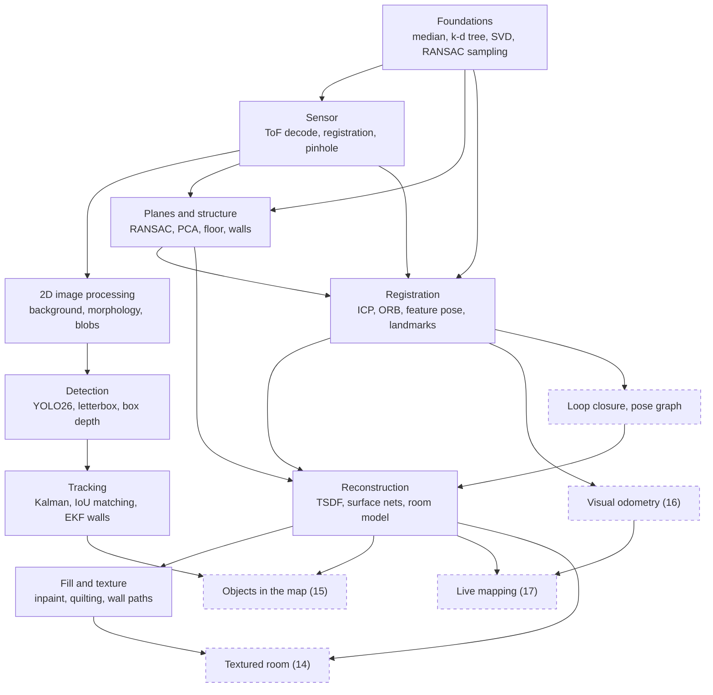
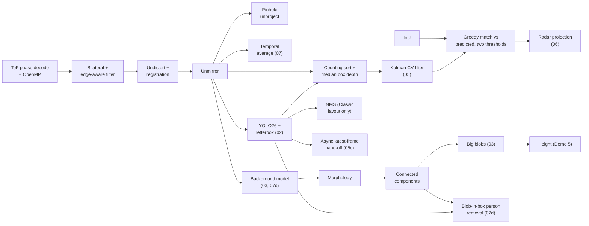
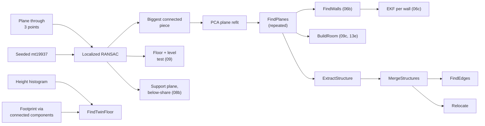
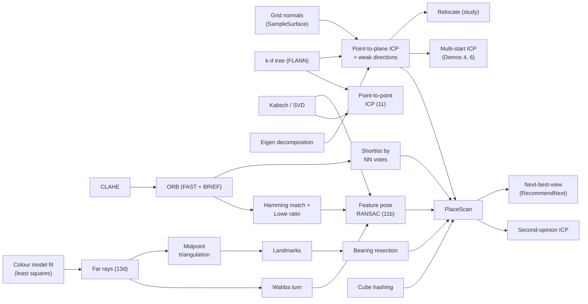
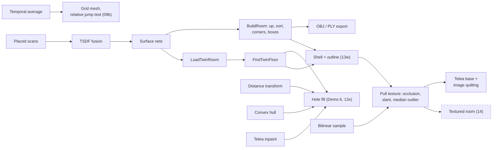
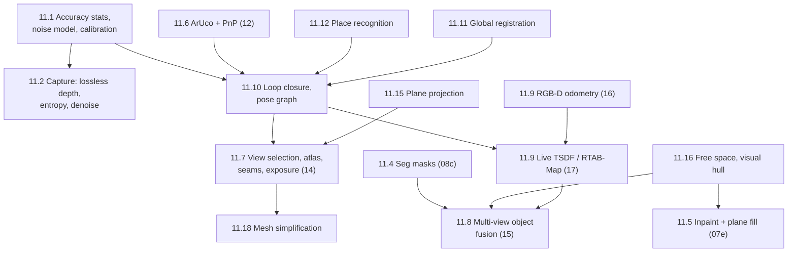

# Algorithms reference

Every algorithm Spotter uses, from a median to a room reconstruction, and the ones the full scope
(a 3D map of the space, D44's scanner + PC split) will need. For each one: where it lives, what it
does, why we chose it, the alternatives, when it's excluded or should be revisited, and sources.

*Written 2026-11-16 from the code at commit c5e7445 (after D56). It replaces the 2026-11-14 table of the
same name and keeps its sources and its "Ours" marking. Sources were written from knowledge, not opened
online: confirm the details before quoting them in anything published.*

**Status labels**

| Label | Meaning |
|---|---|
| **Library** | In the `spotter` library ([exercises/cpp/spotter/](../exercises/cpp/spotter/)), shared by every example |
| **Example** | Inline in one example's `main.cpp` (its own lesson, per D35) |
| **Upstream** | Done for us inside a dependency (libfreenect2, OpenCV, Ultralytics) |
| **Python** | In the finished Python exercises ([exercises/python/](../exercises/python/)) |
| **Prototype** | Built for a study, not adopted ([structure](../exercises/cpp/spotter/include/spotter/structure.hpp)) |
| **Planned** | On the Roadmap in [CLAUDE.md](../CLAUDE.md) |
| **Idea** | In [ideas.md](ideas.md), not scheduled |
| **Ours** | A heuristic written for this project with no outside paper; its D-entry or code comment is the explanation |

**Contents**

- [0. Selection and exclusion criteria](#0-selection-and-exclusion-criteria)
- [1. How the algorithms build on each other](#1-how-the-algorithms-build-on-each-other)
- [2. Foundations: numerics and data structures](#2-foundations-numerics-and-data-structures)
- [3. The sensor and image formation](#3-the-sensor-and-image-formation)
- [4. 2D image processing](#4-2d-image-processing)
- [5. Detection](#5-detection)
- [6. Tracking and filtering](#6-tracking-and-filtering)
- [7. Planes and room structure](#7-planes-and-room-structure)
- [8. Registration: placing one view against another](#8-registration-placing-one-view-against-another)
- [9. Surfaces, rooms and texture](#9-surfaces-rooms-and-texture)
- [10. Data integrity procedures](#10-data-integrity-procedures)
- [11. Algorithms the full scope will need](#11-algorithms-the-full-scope-will-need)
- [12. Index](#12-index)

---

## 0. Selection and exclusion criteria

Every algorithm here was chosen, or will be, against these rules. Each entry's **Excluded /
revisit** line refers to them by number.

| # | Rule | Where it comes from |
|---|---|---|
| X1 | **CPU only on the scanner.** The Pi captures and exports; nothing needs a GPU there. Whether the PC side may use a GPU is still open, so a GPU-only method is "PC only, pending D44". | D11, D44 |
| X2 | **Builds on Windows and Linux; no vendor SDKs.** | D5, D7 |
| X3 | **Dependencies.** Prefer what's already built: libfreenect2 and OpenCV's core, imgproc, features2d, flann, video, photo, dnn and highgui. Adding OpenCV's `calib3d`, `objdetect` or `png` means rebuilding OpenCV on both PCs. Any new library must be permissive open source (MIT, BSD, Apache). | D9, D13, D14, D27, D29 |
| X4 | **Readable.** One idea per example, in a number of lines a learner can follow. A method that needs a lookup table or a solver library loses to a simpler one of similar quality. | Conventions, D21, D27 |
| X5 | **Privacy.** Nothing that requires saving images of people. Room scans may hold colour frames of an empty room only. | Conventions, D17, D29 |
| X6 | **Seen and guessed stay apart.** Anything that invents geometry or colour marks its output (its own OBJ group, a colour, stripes). | D17, D20, D31 |
| X7 | **Testable.** A synthetic `check_*` that fails without it; randomness seeded so a run repeats. | D34, D37 |
| X8 | **Robust to the Kinect.** 0 means "no reading"; flying pixels at edges; multipath in corners; a floor seen at a grazing angle; black, glossy and glass surfaces read nothing. | D12, D32, D33 |
| X9 | **Live code keeps 30 fps.** The camera loop never waits on heavy work; that goes to a background thread. | D15, 05c, D26 |

---

## 1. How the algorithms build on each other

### 1.1 The whole system

Solid = built. Dashed = planned or an idea (section 11).

### 1.2 Sensor to detection and tracking (examples 01–07d, Demos 1, 2, 3, 5)

### 1.3 Planes and structure

### 1.4 Registration (examples 10–13e)

### 1.5 Reconstruction, filling and texture

---

## 2. Foundations: numerics and data structures

### 2.1 Median and percentile by selection (quickselect)

- **Status / where:** Library. `Median`, `Percentile` in [stats.cpp](../exercises/cpp/spotter/src/stats.cpp).
- **What:** `std::nth_element` puts only the k-th value in place. O(n), not a sort's O(n log n).
- **Why:** medians and percentiles are the project's robust statistic everywhere: a box's distance
  (02), wall ends (2nd/98th percentile), room bounds (1st/99th), plane heights, colour outliers. One
  stray reading can't move them, which matters with flying pixels (X8).
- **Alternatives:** full sort (slower, same answer); mean (fooled by outliers); streaming
  approximate quantiles such as P² or t-digest (only if values can't be held in memory).
- **Excluded / revisit:** revisit if a median runs per pixel per frame (then a histogram median or
  a running estimate).
- **Sources:** [cppreference: nth_element](https://en.cppreference.com/w/cpp/algorithm/nth_element);
  [Hoare 1961, "Algorithm 65: Find"](https://doi.org/10.1145/366622.366647);
  [Huber & Ronchetti, *Robust Statistics* (the median as a robust estimator)](https://doi.org/10.1002/9780470434697).

### 2.2 Robust extents (trimmed percentiles)

- **Status / where:** Library and examples. `FindWalls`, `BuildRoom`, `FuseScans`, `FindEdges`.
- **What:** an object's extent is its 2nd-to-98th percentile, not its min-to-max.
- **Why:** a wall line stretched by one stray reading would join the wrong corner (X8).
- **Alternatives:** min/max (fragile); convex hull of all points (as fragile); statistical outlier
  removal before taking min/max (an extra pass).
- **Sources:** [NIST/SEMATECH e-Handbook, percentiles](https://www.itl.nist.gov/div898/handbook/prc/section2/prc262.htm).

### 2.3 Counting sort into cells (bucketing)

- **Status / where:** Library. `BoxDepthSampler::Build` in [depth.cpp](../exercises/cpp/spotter/src/depth.cpp).
- **What:** once per frame, files all 217k depth readings by their colour row and 32-column block
  in two passes (count, then place). A box then reads only the cells it covers.
- **Why:** finding the depth under a colour box otherwise scans every depth pixel per box. Measured:
  2.0 ms instead of 5.1 ms per frame with 5 boxes, identical answers on 4,000 boxes (D34).
- **Alternatives:** scan every pixel per box (simple, slow with many boxes); a summed-area table
  (gives means, not medians); map the box into the depth image instead (inexact, the cameras don't
  line up).
- **Sources:** [Cormen et al., *Introduction to Algorithms*, ch. 8](https://mitpress.mit.edu/9780262046305/introduction-to-algorithms/).

### 2.4 Spatial hashing ("one point per cube")

- **Status / where:** Library. `CubeKey` in [room_scan.cpp](../exercises/cpp/spotter/src/room_scan.cpp), used by `PlaceScan`, `RecommendNext`, `MakeRoomMap`, and 13w (3 cm thinning before the floor and ceiling, D43).
- **What:** a point's cube index packed into 21 bits per axis, kept in an `unordered_set`. The first
  point to claim a cube wins.
- **Why:** thins ICP targets to 1 cm and coverage maps to 5 cm in O(n), with memory only where
  points are. This is what keeps 13c+ at about 3 s per scan at any scan count (D26).
- **Alternatives:** a dense voxel grid (memory for empty space); averaging points per cube (smoother,
  slower); Morton codes (better locality, same idea); Open3D/PCL voxel down-sampling (X3).
- **Excluded / revisit:** the key repeats every 2²¹ cubes (21 km at 1 cm), harmless for rooms.
- **Sources:** [Rusu & Cousins 2011, PCL (its VoxelGrid filter is the same idea)](https://doi.org/10.1109/ICRA.2011.5980567);
  [Teschner et al. 2003, "Optimized Spatial Hashing"](https://matthias-research.github.io/pages/publications/tetraederCollision.pdf);
  [Nießner et al. 2013, voxel hashing](https://doi.org/10.1145/2508363.2508374).

### 2.5 Nearest neighbour: k-d tree (FLANN)

- **Status / where:** Library and example. `Icp` ([register.cpp](../exercises/cpp/spotter/src/register.cpp)), `OffPlaneShare`, `Relocate` ([structure.cpp](../exercises/cpp/spotter/src/structure.cpp)); example 11.
- **What:** `cv::flann::Index` with 4 randomized k-d trees, 16–32 checks per query. Approximate,
  close to exact at these settings.
- **Why:** ICP pairs every point with its nearest neighbour each round. 11_s1 measured the tree 4×
  faster than checking every point. FLANN ships with OpenCV (X3).
- **Alternatives:** brute force (O(n·m)); nanoflann (header-only, exact, often faster, a new
  dependency); projective association (look up the pixel the point projects to: O(1), the
  KinectFusion choice, but only for organised clouds from one camera); voxel-grid lookup.
- **Excluded / revisit:** each `Icp` call rebuilds its tree. Fine at 1–3 cm targets; LocateKinect's
  63 starts would benefit from one shared tree.
- **Sources:** [Bentley 1975](https://doi.org/10.1145/361002.361007);
  [Muja & Lowe 2014, FLANN](https://doi.org/10.1109/TPAMI.2014.2321376);
  [nanoflann](https://github.com/jlblancoc/nanoflann).

### 2.6 Brute-force Hamming matching

- **Status / where:** Library. `MatchFeatures`, `NearestFeatures` in [features_orb.cpp](../exercises/cpp/spotter/src/features_orb.cpp).
- **What:** `cv::BFMatcher(NORM_HAMMING)`: popcount of XOR between 256-bit ORB descriptors, every
  pair. O(n·m), but each comparison is a few CPU instructions.
- **Why:** exact, simple, fast enough for thousands of descriptors per scan pair.
- **Alternatives:** FLANN LSH for binary descriptors (multi-probe LSH); a bag-of-words vocabulary
  (DBoW2) for hundreds of scans; see 11.12.
- **Excluded / revisit:** `Shortlist` stacks every scan's descriptors per call. The code's
  `ponytail:` note: keep a persistent index once sessions reach hundreds of scans.
- **Sources:** [OpenCV feature matching](https://docs.opencv.org/4.x/dc/dc3/tutorial_py_matcher.html);
  [Lv et al. 2007, multi-probe LSH](https://www.vldb.org/conf/2007/papers/research/p950-lv.pdf).

### 2.7 SVD, eigen decomposition and linear least squares

- **Status / where:** Library. `Kabsch`, `FitPlane` ([geometry.cpp](../exercises/cpp/spotter/src/geometry.cpp)), `Icp`, `FitColourModel`, `TurnBetween`, bearing resection ([room_scan.cpp](../exercises/cpp/spotter/src/room_scan.cpp)).
- **What:** `cv::SVD::compute`, `cv::eigen`, `cv::solve(…, DECOMP_SVD)`, `cv::PCA` on small
  fixed-size matrices (3×3, 6×6) or tall thin systems.
- **Why:** every geometric fit here (rotation, plane, ICP step, camera model) reduces to one of
  these. Eigen-directions also tell how well-constrained a fit is (ICP's weak directions).
- **Alternatives:** the Eigen library (nicer API, a dependency); normal equations with Cholesky
  (faster, less stable); iterative solvers such as Ceres (for non-linear problems, see 11.10).
- **Sources:** [Golub & Van Loan, *Matrix Computations*](https://jhupbooks.press.jhu.edu/title/matrix-computations);
  [OpenCV core: SVD, eigen, solve](https://docs.opencv.org/4.x/d2/de8/group__core__array.html).

### 2.8 Seeded random sampling

- **Status / where:** Library. Every RANSAC takes a `std::mt19937&`.
- **What:** the Mersenne Twister, seeded by the caller.
- **Why:** RANSAC is random; a seed makes a check repeatable (X7).
- **Alternatives:** `cv::RNG` (used in the checks' noise); PCG (smaller state). No reason to change.
- **Sources:** [Matsumoto & Nishimura 1998](https://doi.org/10.1145/272991.272995).

### 2.9 Rigid transforms: compose, rotate about an axis, angle of a turn

- **Status / where:** Library. `Pose`, `Pose::Then`, `Pose::Degrees`, `TurnAbout` in [geometry.hpp](../exercises/cpp/spotter/include/spotter/geometry.hpp).
- **What:** a pose is a 3×3 turn plus a shift. `Then` composes two. `TurnAbout` is Rodrigues'
  formula (axis × angle → matrix). `Degrees` is acos((trace − 1) / 2).
- **Why:** written by hand because `cv::Rodrigues` lives in `calib3d`, which isn't built (X3).
- **Alternatives:** quaternions (no drift when composing many; worth it for live tracking in 16);
  Lie-algebra se(3) parameterisation (what ICP's small-angle step already approximates).
- **Since D51:** `Pose::Inverse` undoes a pose, and "how far b turns from a" is
  `a.Inverse().Then(b).Degrees()`. Hot loops keep a precomputed transpose.
- **Sources:** [Murray, Li & Sastry, *A Mathematical Introduction to Robotic Manipulation*, ch. 2](https://www.cds.caltech.edu/~murray/books/MLS/pdf/mls94-complete.pdf);
  [Sola et al. 2018, "A micro Lie theory"](https://arxiv.org/abs/1812.01537).

---

## 3. The sensor and image formation

### 3.1 Time-of-flight depth decoding (multi-frequency phase unwrapping)

- **Status / where:** Upstream (libfreenect2's CPU depth packet processor), plus our OpenMP patch
  ([ports/libfreenect2](../exercises/cpp/ports/libfreenect2/)).
- **What:** the Kinect v2 measures the phase shift of infrared light modulated at three
  frequencies. Each phase alone is ambiguous; combining the three unwraps it into a distance.
- **Why ours:** libfreenect2's CPU decoder runs on the Pi (X1). Our patch adds
  `#pragma omp parallel for schedule(dynamic, 8)` to its five per-pixel passes: 7.5 → 30 fps with
  the filters on (D11), and depth with colour 14 → 27 fps (D15). Dynamic scheduling, because one
  thread sharing a core with JPEG decoding held up a static split.
- **Alternatives:** libfreenect2's OpenGL/OpenCL/CUDA decoders (X1); the Microsoft SDK's GPU decoder
  (X2, D5); kernel-density phase unwrapping (Lawin et al., fewer wrong unwraps at range).
- **Excluded / revisit:** decode every other frame if the Pi can't keep up (D11).
- **Sources:** [libfreenect2](https://github.com/OpenKinect/libfreenect2);
  [Sell & O'Connor 2014, the Xbox One SoC and Kinect sensor](https://doi.org/10.1109/MM.2014.9);
  [Bamji et al. 2015, the Kinect v2 sensor chip](https://doi.org/10.1109/JSSC.2014.2364270);
  [Järemo Lawin et al. 2016, phase unwrapping with KDE](https://arxiv.org/abs/1608.05209);
  [OpenMP specifications](https://www.openmp.org/specifications/).

### 3.2 Bilateral and edge-aware depth filters

- **Status / where:** Upstream, switched by `KinectSource::Options::depthFilters`
  ([source_freenect2.cpp](../exercises/cpp/spotter/src/source_freenect2.cpp)).
- **What:** libfreenect2 smooths depth with a bilateral filter (weights by distance and by
  difference) and drops pixels at depth edges (flying pixels).
- **Why:** on by default. Off, libfreenect2 also skips its range clipping and junk comes through
  (D11).
- **Alternatives:** Gaussian blur, **rejected** (D12): it smears objects into the background at edges
  and averages in the 0 "no reading" values. Joint (cross) bilateral guided by colour; temporal
  averaging (3.7); plane projection (11.15). The user's untriaged note asks for "a Gaussian noise
  filter when processing": see 11.2.
- **Sources:** [Tomasi & Manduchi 1998](https://doi.org/10.1109/ICCV.1998.710815).

### 3.3 Undistortion and depth-to-colour registration, with occlusion filter

- **Status / where:** Upstream. `Registration::apply` / `undistortDepth`, called in
  [source_freenect2.cpp](../exercises/cpp/spotter/src/source_freenect2.cpp).
- **What:** removes the depth lens distortion with the factory model, maps each depth pixel into the
  colour image (`registered`, `colourIndex`) and colour back onto depth (`bigdepth`). The occlusion
  filter drops colour that a nearer surface hides from the colour camera.
- **Why:** factory calibration read from the device, no checkerboard needed (D6).
- **Alternatives:** our own calibration (Zhang's method, 11.1), revisit if the accuracy milestone
  fails.
- **Excluded / revisit:** occlusion filter must stay on wherever registered colour is used (review
  bug, open for some `examples/`).
- **Sources:** [libfreenect2 Registration API](https://openkinect.github.io/libfreenect2/classlibfreenect2_1_1Registration.html);
  [Hartley & Zisserman, ch. 9 (two calibrated views)](https://www.robots.ox.ac.uk/~vgg/hzbook/);
  [Brown–Conrady distortion, OpenCV camera model](https://docs.opencv.org/4.x/d9/d0c/group__calib3d.html).

### 3.4 Unmirror

- **Status / where:** Library, **Ours** (D35). `Unmirror` in [frame.cpp](../exercises/cpp/spotter/src/frame.cpp); `room_folder` mirrors format-1 rooms on load.
- **What:** flips every picture left-right, remaps `colourIndex` (column → width − 1 − column), and
  moves each camera's principal point (cx → width − cx), so 3D points come out the right way round.
  Old rooms: points x → −x, turns R → S R S with S = diag(−1, 1, 1).
- **Why:** the Kinect sends selfie-style mirror images, and libfreenect2's `getPointXYZ` keeps the
  mirror in 3D (D35, D36, confirmed on the sensor).
- **Sources:** [Hartley & Zisserman, *Multiple View Geometry*, ch. 6](https://www.robots.ox.ac.uk/~vgg/hzbook/).

### 3.5 Pinhole projection and the depth cloud

- **Status / where:** Library. `PinholeCamera::Unproject`, `Project`, `Cloud` in [frame.cpp](../exercises/cpp/spotter/src/frame.cpp).
- **What:** X = (column + 0.5 − cx)·Z / fx, Y = (row + 0.5 − cy)·Z / fy. The cloud keeps one point per
  pixel (NaN = none), so picture neighbours stay neighbours.
- **Why:** the base of every 3D step. `check_frame` matches libfreenect2's `getPointXYZ` (with X
  negated, the mirror fix).
- **Alternatives:** `getPointXYZ` per pixel (mirrored, slower); a lookup table of ray directions per
  pixel (faster, same maths).
- **Sources:** [Hartley & Zisserman, ch. 6](https://www.robots.ox.ac.uk/~vgg/hzbook/);
  [OpenCV pinhole model](https://docs.opencv.org/4.x/d9/d0c/group__calib3d.html).

### 3.6 Depth as a picture

- **Status / where:** Library. `DepthPicture` in [depth.cpp](../exercises/cpp/spotter/src/depth.cpp); 01.
- **What:** linear grey ramp from near (white) to far (black, 6 m since D36), red for no reading.
- **Alternatives:** a colour map such as turbo (more distinguishable steps); histogram-equalised
  depth. Grey keeps example 01 simple.
- **Sources:** [OpenCV colour maps](https://docs.opencv.org/4.x/d3/d50/group__imgproc__colormap.html).

### 3.7 Temporal averaging per pixel

- **Status / where:** Library. `DepthAverager` in [depth.cpp](../exercises/cpp/spotter/src/depth.cpp); 07, 08b, 09b, 13e (30 frames per scan).
- **What:** per-pixel sum and count over N frames; a pixel that read in fewer than half the frames
  gives 0.
- **Why:** random noise falls with √N. Measured: ±1.2 mm one frame, ±0.3 mm averaged (07). Only valid
  with a still camera and scene (D12).
- **Alternatives:** per-pixel median (robust to flicker, costs memory); exponential moving average
  (07c's blend); per-object filtering when things move (D12, section 6); plane projection (11.15).
- **Excluded / revisit:** time per scan; 11.15 would cut it on flat surfaces.
- **Sources:** [NIST/SEMATECH e-Handbook of Statistical Methods](https://www.itl.nist.gov/div898/handbook/).

### 3.8 Colour camera model by least squares

- **Status / where:** Library. `FitColourModel` in [room_scan.cpp](../exercises/cpp/spotter/src/room_scan.cpp); 13d+, 13w.
- **What:** fits column = a·x/z + e/z + b and row = c·y/z + f/z + d by SVD least squares on every 7th
  pixel that has both depth and a colour index. The colour camera sits at (−e/a, −f/c, 0).
- **Why:** gives a ray from the colour camera for pixels with no depth (far features) and lets 13w
  sample the 1920×1080 picture, with no `calib3d` (X3, D27).
- **Alternatives:** libfreenect2's colour camera parameters directly; a full calibrated stereo model
  (`calib3d`); 14 needs the same model.
- **Sources:** [Hartley & Zisserman, ch. 7 (camera resectioning)](https://www.robots.ox.ac.uk/~vgg/hzbook/).

### 3.9 Sensor simulation for checks and the visualizer

- **Status / where:** checks: the shared test room [test_room.hpp](../exercises/cpp/spotter/checks/test_room.hpp) (D54; used by check_room, check_room_twin, check_fill, check_room_shell, check_scan_session), `Raycast` in [check_icp.cpp](../exercises/cpp/spotter/checks/check_icp.cpp); [visualizer.html](visualizer.html).
- **What:** a box room with a couch, raycast by the slab method (where a ray enters and leaves each
  box). Every surface is painted in 10 cm blocks of random but repeatable colour: a spatial hash of the
  block's indices (Teschner's three primes, then a MurmurHash-style mix), so ORB finds features on every
  wall. Depth noise: Gaussian in the checks; (0.8 + 0.2·z²) mm in the visualizer, approximated by a sum
  of four uniforms (Irwin–Hall), with no reading on glass and black objects and flaky edges.
- **Limits (test_room.hpp says so):** no holes, plain walls or slanted walls; a second scene is still to
  do (D54).
- **Why:** every algorithm is tested on known truth without the sensor or images of people (X5, X7).
- **Alternatives:** a real recording replayed (review initiative 5, record/replay); a mesh renderer.
- **Sources:** [Kay & Kajiya 1986, ray-box slabs](https://doi.org/10.1145/15886.15916);
  [Teschner et al. 2003, spatial hashing primes](https://matthias-research.github.io/pages/publications/tetraederCollision.pdf);
  [MurmurHash (the finaliser)](https://github.com/aappleby/smhasher);
  [Box & Muller 1958](https://doi.org/10.1214/aoms/1177706645);
  [Fankhauser et al. 2015, Kinect v2 noise model](https://doi.org/10.1109/ICAR.2015.7251485);
  [Khoshelham & Oude Elberink 2012, Kinect v1 accuracy](https://doi.org/10.3390/s120201437).

---

## 4. 2D image processing

### 4.1 Still background (recorded once)

- **Status / where:** Library. `StillBackground` in [depth.cpp](../exercises/cpp/spotter/src/depth.cpp); 03, Demos 4, 5.
- **What:** after a countdown, keep one depth frame. Foreground = at least `nearerMm` nearer.
- **Why:** with depth, "nearer than the empty room" is a cleaner foreground test than any colour
  model: no shadows, no lighting changes.
- **Alternatives:** 4.2 (adapts); colour background models (4.3).
- **Sources:** [Piccardi 2004, background subtraction review](https://doi.org/10.1109/ICSMC.2004.1400815).

### 4.2 Adaptive depth background

- **Status / where:** Library, **Ours** (07c). `AdaptiveBackground` in [depth.cpp](../exercises/cpp/spotter/src/depth.cpp); 07c, 07d, Demo 2.
- **What:** a per-pixel state machine. Same distance: blend in (rate 0.05). Nearer for 300 frames:
  joins the room. Farther for 10 frames: replaces the memory. A mask can forbid absorbing (people).
- **Why:** `LeaveFrames` 10, not 1, because a spinning ceiling fan made 2–6 blobs otherwise (07c, the
  user confirmed it was the fan).
- **Alternatives:** MOG2 on depth (a Gaussian mixture per pixel; heavier and tuned for colour);
  ViBe (sample-based); refreshing both spots when the tracker sees an object move (ideas.md).
- **Sources:** the family it belongs to: [Piccardi 2004](https://doi.org/10.1109/ICSMC.2004.1400815);
  [Stauffer & Grimson 1999](https://doi.org/10.1109/CVPR.1999.784637);
  [Barnich & Van Droogenbroeck 2011, ViBe](https://doi.org/10.1109/TIP.2010.2101613).

### 4.3 Colour background subtraction (MOG2 / KNN)

- **Status / where:** Python. [02_CV_Motion_Detect.py](../exercises/python/02_CV_Motion_Detect.py).
- **What:** OpenCV's Gaussian-mixture (MOG2) or k-nearest-neighbour model per pixel; shadows (grey
  127) thresholded out.
- **Why:** the webcam track has no depth. Superseded by 4.1/4.2 on the Kinect.
- **Sources:** [Zivkovic 2004, MOG2](https://doi.org/10.1109/ICPR.2004.1333992);
  [Zivkovic & van der Heijden 2006, KNN](https://doi.org/10.1016/j.patrec.2005.11.005).

### 4.4 Morphology: opening, closing, dilation

- **Status / where:** Library (`StillBackground::Foreground`; `MakeScan` and `AddFarFeatures` erode feature masks 3 and 8 pixels clear of depth holes' edges), 13x / Demo 6, Python 02.
- **What:** opening removes specks and thin edges; closing joins specks a cell apart; dilation
  grows a mask (e.g. "seen" spreads one cell).
- **Why:** cheap clean-up of noisy masks before counting blobs.
- **Alternatives:** median filter on the mask; area opening (removes by size directly, which
  `KeepBigBlobs` already does).
- **Sources:** [OpenCV morphology](https://docs.opencv.org/4.x/d9/d61/tutorial_py_morphological_ops.html).

### 4.5 Connected-component labelling

- **Status / where:** Library: `KeepBigBlobs` ([depth.cpp](../exercises/cpp/spotter/src/depth.cpp)), `FindPlanes` (biggest piece), `FindTwinFloor` (footprint), `BuildRoom` (furniture). Examples 03, 06b, Demo 6, 13x.
- **What:** `cv::connectedComponentsWithStats` labels groups of touching pixels/cells and returns
  their areas and boxes. O(pixels).
- **Why:** turns a mask into objects, and "the biggest connected piece" is what stops a plane
  slicing strips off other surfaces (D18).
- **Alternatives:** contours (`findContours`, Python 02: outlines, not areas); flood fill per seed
  (4.6); union-find on a point graph (for unorganised clouds).
- **Sources:** [OpenCV connectedComponents](https://docs.opencv.org/4.x/d3/dc0/group__imgproc__shape.html);
  [Rosenfeld & Pfaltz 1966](https://doi.org/10.1145/321356.321357);
  [Wu, Otoo & Suzuki 2009](https://doi.org/10.1007/s10044-008-0109-y);
  [Suzuki & Abe 1985, contours](https://doi.org/10.1016/0734-189X(85)90016-7).

### 4.6 Flood fill with a depth-jump limit

- **Status / where:** Example. 08b's click-anywhere ([08b main.cpp](../exercises/cpp/examples/08b_Object_Mesh/main.cpp)); 13x's `PieceDomains` (a surface's enclosed area, flood-filled from outside).
- **What:** `cv::floodFill` from the clicked pixel on the depth picture, stepping only to neighbours
  within `MaxJumpMm`, mask-only.
- **Why:** scans an object YOLO didn't name (the paper cup), with no model (ideas.md, "Detection misses").
- **Alternatives:** region growing on normals (stops at creases too); graph-cut segmentation
  (GrabCut, colour-driven); YOLO-seg (11.4).
- **Sources:** [OpenCV floodFill](https://docs.opencv.org/4.x/d7/d1b/group__imgproc__misc.html);
  Heckbert, "A Seed Fill Algorithm", *Graphics Gems*, 1990.

### 4.7 Distance transform with labels

- **Status / where:** Example. The 13x / Demo 6 fill, `FillWalls` in [fill_holes.hpp](../exercises/cpp/examples/13x_Room_Fill/fill_holes.hpp).
- **What:** `cv::distanceTransform(DIST_L2, DIST_MASK_5, DIST_LABEL_PIXEL)`: every plan cell's
  distance to, and identity of, the nearest wall-path cell.
- **Why:** assigns each upright point to its nearest wall path in one pass.
- **Alternatives:** exact Euclidean transform (Felzenszwalb–Huttenlocher); a k-d tree over path cells.
- **Sources:** [Borgefors 1986, chamfer distances](https://doi.org/10.1016/S0734-189X(86)80047-0);
  [Felzenszwalb & Huttenlocher 2012](https://doi.org/10.4086/toc.2012.v008a019).

### 4.8 CLAHE (contrast-limited adaptive histogram equalisation)

- **Status / where:** Library. `FindFeatures` with `evenContrast` ([features_orb.cpp](../exercises/cpp/spotter/src/features_orb.cpp)); clip 2.0, 8×8 tiles.
- **What:** equalises each tile's histogram with a clip limit, blended between tiles.
- **Why:** a dim room gave 48–73 ORB features (refused); CLAHE + FAST 7 gave about 1250 (D24). Only
  the features see it; meshes keep true colour.
- **Alternatives:** global histogram equalisation (blows out bright areas); gamma; longer exposure
  (costs fps, D15); learned features robust to light (11.12).
- **Sources:** [Zuiderveld 1994, *Graphics Gems IV*](https://doi.org/10.1016/B978-0-12-336156-1.50061-6);
  [Pizer et al. 1987](https://doi.org/10.1016/S0734-189X(87)80186-X).

### 4.9 Image inpainting (Telea)

- **Status / where:** Example. Demo 6 / 13x (filled cells' colour), 13w (slow colour changes on 25 cm cells).
- **What:** `cv::inpaint(INPAINT_TELEA)`: fast marching from the hole's edge inwards, each pixel a
  weighted average of known neighbours.
- **Why:** cheap and good for small holes and smooth shading. Big holes smear, so 13w adds pattern
  by quilting (4.10). The fill is always marked (X6).
- **Alternatives:** Navier–Stokes inpainting (`INPAINT_NS`, similar); exemplar-based (Criminisi,
  keeps texture); deep inpainting (LaMa), **rejected** for live use, too heavy (D16), PC-only (X1).
- **Sources:** [Telea 2004](https://doi.org/10.1080/10867651.2004.10487596);
  [Bertalmío et al. 2001](https://doi.org/10.1109/CVPR.2001.990497);
  [Criminisi et al. 2004](https://doi.org/10.1109/TIP.2004.833105);
  [Suvorov et al. 2022, LaMa](https://arxiv.org/abs/2109.07161).

### 4.10 Image quilting (texture synthesis)

- **Status / where:** Example. 13w `Fill`, `Exemplar` in [room_shell.hpp](../exercises/cpp/examples/13w_Room_Shell/room_shell.hpp); checked by `check_room_shell` (the filled floor's colours vary about as much as the seen floor's).
- **What:** the surface's pattern (seen colour minus its slow changes) is copied in 32-texel blocks
  from its plainest fully seen square; each block is the best of 80 random candidates at matching
  the 8-texel overlap. Written only into unseen texels. No minimum-error seam cut.
- **Why:** inpainting alone left the floor under a couch flat (pattern spread 0.21 of the real one);
  quilting gave 0.78 (D42).
- **Alternatives:** the seam cut (Efros & Freeman's full method, fewer visible edges); PatchMatch;
  Wang tiles; texture from the nearest textured surface once 14 exists.
- **Sources:** [Efros & Freeman 2001](https://doi.org/10.1145/383259.383296);
  [Barnes et al. 2009, PatchMatch](https://doi.org/10.1145/1531326.1531330).

### 4.11 Bilinear sampling

- **Status / where:** Example. 13w (colour at a fractional pixel of `colour_full.bmp`).
- **What:** blend of the four nearest pixels by distance.
- **Alternatives:** nearest (blocky); bicubic (sharper, overshoots); `cv::remap` for whole images.
- **Sources:** [OpenCV geometric transformations](https://docs.opencv.org/4.x/da/d54/group__imgproc__transform.html).

### 4.12 Convex hull, polygon fill and outline chaining

- **Status / where:** Examples. 13w `Outline` and `Clip`; Demo 6 / 13x table-top outlines.
- **What:** walls' ends chained into a closed loop when each next end lies within `JoinMeters`,
  else their convex hull (`cv::convexHull`, Sklansky's algorithm). The outline is filled into a
  texel mask (`cv::fillPoly`).
- **Why:** any room outline works for the floor and ceiling; the hull is the safe fallback.
- **Alternatives:** concave hull / alpha shapes (follows L-shaped rooms without walls); the floor's
  own footprint.
- **Sources:** [OpenCV convexHull](https://docs.opencv.org/4.x/d3/dc0/group__imgproc__shape.html);
  [Sklansky 1982](https://doi.org/10.1016/0167-8655(82)90016-2);
  [Edelsbrunner et al. 1983, alpha shapes](https://doi.org/10.1109/TIT.1983.1056714).

---

## 5. Detection

### 5.1 YOLO26 through OpenCV DNN, letterboxed

- **Status / where:** Library. `YoloDetector`, `Letterbox`, `DecodeYolo` in [detector_yolo_opencvdnn.cpp](../exercises/cpp/spotter/src/detector_yolo_opencvdnn.cpp). Python 03, 04 via Ultralytics.
- **What:** the picture is scaled to fit a 640 (or 320) square, padded grey 114, scaled to 0..1 RGB,
  run through the ONNX network. The end-to-end export (`nms=False`) outputs 300 final boxes
  (1×300×6), decoded in one pass and mapped back through the letterbox.
- **Why:** no Python at runtime; OpenCV is already there (D3). The end-to-end head needs no NMS. About
  130–180 ms at 640 on the PC; 55–80 ms at 320, which misses objects cut off at the edge.
  `intrinsics` and `thread` must stay on in OpenCV: 650 → 150 ms (D13).
- **Alternatives:** ONNX Runtime (faster, a dependency); NCNN on the Pi, **dropped** (D44: no detection
  on the Pi); bigger models (yolo26s/m) post-capture (11.8); a dynamic-size export (doesn't load in
  OpenCV 4.14, hence two files).
- **Excluded / revisit:** the model is a settings change (path, size, names, layout), not code.
- **Sources:** [Redmon et al. 2016, YOLO](https://arxiv.org/abs/1506.02640);
  [Wang et al. 2024, YOLOv10 (NMS-free training)](https://arxiv.org/abs/2405.14458);
  [Ultralytics YOLO26 docs](https://docs.ultralytics.com/models/yolo26/);
  [OpenCV DNN](https://docs.opencv.org/4.x/d6/d0f/group__dnn.html).

### 5.2 Non-maximum suppression (Classic layout only)

- **Status / where:** Library. `DecodeYolo` with `YoloLayout::Classic`.
- **What:** per candidate, its best class; then per class, of two boxes overlapping more than 0.45
  IoU keep the more confident (`cv::dnn::NMSBoxesBatched`).
- **Why:** older exports (1×84×8400) need it. YOLO26's end-to-end layout doesn't.
- **Alternatives:** Soft-NMS (decays scores instead of deleting; better in crowds).
- **Sources:** [Neubeck & Van Gool 2006](https://doi.org/10.1109/ICPR.2006.479);
  [Bodla et al. 2017, Soft-NMS](https://arxiv.org/abs/1704.04503).

### 5.3 Asynchronous detection, latest frame wins

- **Status / where:** Library. `AsyncDetector` in [detector_yolo_opencvdnn.cpp](../exercises/cpp/spotter/src/detector_yolo_opencvdnn.cpp); 05c.
- **What:** a worker thread takes a frame only when idle (`Offer` drops frames while busy); the main
  loop collects a finished batch with `TryTake`. Errors on the thread are rethrown on the caller's
  thread (D46).
- **Why:** display went 4 → 15 fps, later 24–27 (X9, D15). The tracker predicts between batches.
- **Alternatives:** a queue of frames (latency grows); running YOLO every N frames on the main
  thread (stutters).
- **Sources:** [C++ condition_variable](https://en.cppreference.com/w/cpp/thread/condition_variable);
  Williams, *C++ Concurrency in Action*, 2nd ed., 2019 (producer/consumer).

### 5.4 Box distance: median of the middle half

- **Status / where:** Library. `BoxDepthSampler::MedianMeters`; 02, 05+.
- **What:** median of the depth readings inside the middle half of the box (each way), at least 20.
- **Why:** the whole box mostly measures the wall behind the object (02).
- **Alternatives:** the box's mode depth (histogram peak, the guide's option); a segmentation mask
  (11.4); a depth-blob inside the box (08b's band).
- **Sources:** [kinect_rgbd_fusion_guide.md](../kinect_rgbd_fusion_guide.md).

### 5.5 Person removal: blob-in-box

- **Status / where:** Example. 07d; Demo 2 copies it.
- **What:** a depth-foreground blob lying mostly inside YOLO person boxes is the person; its pixels
  are painted from a colour memory, except inside other objects' boxes (a carried cup stays). The
  colour memory learns only away from foreground and people.
- **Why:** the blob is fresh every frame; YOLO's boxes lag (D16).
- **Alternatives:** YOLO-seg masks (cleaner, heavy every frame, D16); never-seen pixels filled (07e,
  11.5).
- **Sources:** D16.

### 5.6 Height from the top and bottom rows

- **Status / where:** Example. Demo 5.
- **What:** the 3D distance between the blob's top and bottom rows that have readings. Refused when
  either row is short of readings (review bug 12).
- **Alternatives:** height above the floor plane (needs 09, works when feet are hidden).

---

## 6. Tracking and filtering

### 6.1 Intersection over union

- **Status / where:** Library. `Overlap` in [track.cpp](../exercises/cpp/spotter/src/track.cpp).
- **What:** shared area ÷ combined area.
- **Alternatives:** GIoU / DIoU (non-zero for boxes that don't touch; useful for fast movers);
  centre distance.
- **Sources:** [Everingham et al. 2010, PASCAL VOC](https://doi.org/10.1007/s11263-009-0275-4);
  [Rezatofighi et al. 2019, GIoU](https://arxiv.org/abs/1902.09630).

### 6.2 Kalman filter, constant velocity

- **Status / where:** Library. `BoxFilter` in [track.cpp](../exercises/cpp/spotter/src/track.cpp); 05.
- **What:** state = box centre x, y (pixels), distance (m) and their speeds; measures the first three.
  Process noise from a random acceleration (discrete white-noise acceleration model). A missing part
  of a measurement keeps the prediction.
- **Why:** predicts where a box will be, so matching survives fast motion and YOLO's gaps
  ("coasting"), and gives a speed (D12). Still chairs: jitter 2–4 mm → 0.4 mm (04/05).
- **Alternatives:** running average (04; no prediction, no speed); alpha-beta filter (fixed gains);
  constant-acceleration model; unscented filter (not needed while the model is linear).
- **Sources:** [Kalman 1960](https://doi.org/10.1115/1.3662552);
  [Welch & Bishop, "An Introduction to the Kalman Filter"](https://www.cs.unc.edu/~welch/media/pdf/kalman_intro.pdf);
  [Bar-Shalom, Li & Kirubarajan 2001](https://doi.org/10.1002/0471221279);
  [OpenCV KalmanFilter](https://docs.opencv.org/4.x/dd/d6a/classcv_1_1KalmanFilter.html).

### 6.3 Greedy matching against predicted boxes, with two thresholds and a fading coast

- **Status / where:** Library. `Tracker` in [track.cpp](../exercises/cpp/spotter/src/track.cpp); 05b, 05c.
- **What:** repeatedly take the same-class pair with the highest IoU against the *predicted* box
  (at least 0.3): strong detections (≥ 0.40) first, then weak ones (≥ 0.15) that may only continue an
  ID. Unseen tracks coast with speed fading by exp(−dt / 0.5 s), dropped after 5 s. Distances are
  re-measured from fresh depth every frame between batches.
- **Why:** the same TV over 60 s: 7 IDs with 05, 1 with 05b. The cause was detection gaps over 2 s,
  not matching.
- **Alternatives:** the Hungarian algorithm (globally optimal assignment; greedy is equal in sparse
  scenes); ByteTrack (the same two-threshold idea, published); appearance embeddings (DeepSORT);
  Mahalanobis gating.
- **Excluded / revisit:** switch to Hungarian + Mahalanobis gating if IDs swap in crowds (11.17).
- **Sources:** [Bewley et al. 2016, SORT](https://arxiv.org/abs/1602.00763);
  [Bochinski, Eiselein & Sikora 2017, IOU tracker](https://doi.org/10.1109/AVSS.2017.8078516);
  [Zhang et al. 2022, ByteTrack](https://arxiv.org/abs/2110.06864);
  [Wojke et al. 2017, DeepSORT](https://arxiv.org/abs/1703.07402);
  [Kuhn 1955, Hungarian method](https://doi.org/10.1002/nav.3800020109).

### 6.4 Extended Kalman filter per wall

- **Status / where:** Example. 06c ([06c main.cpp](../exercises/cpp/examples/06c_Wall_Filter/main.cpp)); Demo 3 copies it.
- **What:** state = the wall's foot (nearest point) as X, Z plus where its two ends are along it.
  Measurement = the plane's distance, the angle to the foot, and the ends. The measurement is a
  non-linear function of the state (hypot, atan2), linearised every frame (the Jacobian H). Covariance
  update in Joseph form (stays symmetric positive); a zero-length guard (bug 9). Matched by a fixed
  gate in metres and degrees, drawn after 3 sightings.
- **Why:** the user asked for an EKF; a point state can be moved when the camera moves (stage E).
  Wobble fell 3–6×, and the plane's own distance fixed 06b's tilt error (3.255 → 3.16 m) (D19).
- **Alternatives:** a plain Kalman filter on (distance, angle) (equal for a fixed camera); a
  Mahalanobis gate (D19: revisit if walls swap IDs); a UKF.
- **Planned move:** 06c and Demo 3 share 242 lines of it, so it goes into the library (D56's decision 5).
- **Sources:** [Simon, *Optimal State Estimation*](https://doi.org/10.1002/0470045345);
  [Thrun, Burgard & Fox, *Probabilistic Robotics*, ch. 3](http://www.probabilistic-robotics.org/);
  [Bucy & Joseph, Joseph form, via Bar-Shalom et al.](https://doi.org/10.1002/0471221279).

### 6.5 BoT-SORT and line crossing

- **Status / where:** Python. [07_Real_Time_Tracking_Line_Count.py](../exercises/python/07_Real_Time_Tracking_Line_Count.py).
- **What:** Ultralytics' `model.track` (BoT-SORT by default) gives IDs; `supervision.LineZone` counts
  a crossing when a track's anchor changes side of the line (sign of a cross product).
- **Why:** the webcam track's finished exercise; the C++ tracker is ours to teach the parts.
- **Sources:** [Aharon et al. 2022, BoT-SORT](https://arxiv.org/abs/2206.14651);
  [supervision LineZone](https://supervision.roboflow.com/latest/detection/tools/line_zone/).

### 6.6 Radar projection and trails

- **Status / where:** Library, **Ours**. `RadarView`, `TrackTrails` in [radar.cpp](../exercises/cpp/spotter/src/radar.cpp); 06.
- **What:** a tracked box centre and distance → floor X, Z by the colour pinhole model; the last 150
  spots kept per ID.
- **Alternatives:** project onto the floor plane from 09 (correct for a tilted camera).

---

## 7. Planes and room structure

### 7.1 Plane through three points

- **Status / where:** Library. `PlaneThrough` in [geometry.cpp](../exercises/cpp/spotter/src/geometry.cpp).
- **What:** normal = cross product of two edges, turned towards the camera; refused if the points are
  nearly in a line.
- **Sources:** [Hartley & Zisserman, ch. 3](https://www.robots.ox.ac.uk/~vgg/hzbook/).

### 7.2 Least-squares plane by PCA

- **Status / where:** Library. `FitPlane` in [geometry.cpp](../exercises/cpp/spotter/src/geometry.cpp). Demo 6 uses a 2D version for cabinet fronts.
- **What:** the direction the points spread least in (smallest principal component) is the normal.
- **Why:** total least squares: errors measured at right angles to the plane, which suits a sensor
  whose noise isn't along one axis. O(n).
- **Alternatives:** regression z = ax + by + c (fails for upright planes); robust M-estimators (if
  refits pick up outliers).
- **Sources:** [Hoppe et al. 1992](https://doi.org/10.1145/133994.134011).

### 7.3 Repeated localized RANSAC with biggest connected piece (`FindPlanes`)

- **Status / where:** Library. `FindPlanes` in [geometry.cpp](../exercises/cpp/spotter/src/geometry.cpp); 06b, 09c, `BuildRoom`, `ExtractStructure`.
- **What:** on a thinned grid: pick three free cells *near each other* in the picture, take their
  plane, count points within 3 cm; best of 200 tries. Keep that plane's biggest connected piece,
  refit it (PCA), take it away, repeat up to 8 planes or until under 3% of readings. A plane too
  scattered to be one surface is taken away anyway (bug 8: it was found again and again).
- **Why:** three random points from anywhere almost never land on one small surface (09);
  neighbours usually do. The connected piece stops a plane picking up strips of the floor, ceiling
  and other walls (D18: a couch front passed as 2.4 m tall).
- **Alternatives:** region growing on normals; agglomerative clustering on organised clouds
  (Feng et al., fast); 3D Hough transform; efficient RANSAC (Schnabel et al., the published form of
  localized sampling); MSAC/MLESAC scoring; a Hough transform on a top-down picture, **rejected** for
  walls (D18: no height).
- **Sources:** [Fischler & Bolles 1981](https://doi.org/10.1145/358669.358692);
  [Schnabel, Wahl & Klein 2007](https://doi.org/10.1111/j.1467-8659.2007.01016.x);
  [Torr & Zisserman 2000, MLESAC](https://doi.org/10.1006/cviu.1999.0832);
  [Feng, Taguchi & Kamat 2014](https://doi.org/10.1109/ICRA.2014.6907776);
  [Borrmann et al. 2011, 3D Hough](https://doi.org/10.1007/3DRes.02(2011)3).

### 7.4 Walls from upright planes (`FindWalls`)

- **Status / where:** Library, **Ours** (D18), on RANSAC planes. `FindWalls` in [walls.cpp](../exercises/cpp/spotter/src/walls.cpp); 06b, 06c.
- **What:** upright planes (within 20° of the camera's upright), up to 4, each 5%+ of readings and
  0.8 m+ tall, as a line on the floor between their 2nd and 98th percentile points.
- **Why:** height tells a wall from a couch back (D18).
- **Excluded / revisit:** assumes a roughly level camera; use 09's floor when tilted on purpose.

### 7.5 Floor by RANSAC with a level test; support plane with a below-share

- **Status / where:** Examples. 09 (floor: camera height, tilt, roll); 08b `FindSupport`.
- **What:** 09: RANSAC on neighbouring points, only roughly level planes. 08b: RANSAC over the
  object's own pixels, keeping planes with few points *below* them (≤ 10%), so a chair seat isn't the
  floor (D17).
- **Excluded / revisit:** 09's 5% `MinFloorFraction` is too low to say "no floor" (it found a
  level-ish surface every second with no floor in view).

### 7.6 The floor from footprints and the walls' foot (`FindTwinFloor`)

- **Status / where:** Library, **Ours** (D33, D43). `FindTwinFloor` in [room_twin.cpp](../exercises/cpp/spotter/src/room_twin.cpp); Demos 4, 6, 13w, 13x.
- **What:** the walls' foot = the lowest 2 cm step where upright points crowd as densely as up a wall.
  Level points go into 2 cm height bins; each peak's biggest connected footprint is measured on a
  5 cm grid. The floor = the lowest piece of 0.25 m² within 25 cm of the foot, or the biggest level
  piece that isn't too high (D43); a floor nobody saw is laid at the foot.
- **Why:** "the lowest 2% of points" sat 27 cm too low: flying pixels and multipath under a floor
  seen at a grazing angle (D33). Footprint, not point count, because grazing readings are sparse but
  wide.
- **Alternatives:** plane RANSAC on up-facing normals (fooled by table tops); BuildRoom's biggest
  level plane.
- **Excluded / revisit:** D43's cause still unconfirmed on the real room. See 7.10: one floor/up rule
  waits for it.
- **Sources:** D33, D40, D43.

### 7.7 Ceiling: the highest level height with 0.5 m²

- **Status / where:** Example, **Ours** (D42). `FindCeiling` in [room_shell.hpp](../exercises/cpp/examples/13w_Room_Shell/room_shell.hpp); `check_room_shell` (not a 0.09 m² patch above, nor a fan below; none without a ceiling).
- **What:** a height histogram of level readings; the highest bin covering 0.5 m².
- **Why:** a fan, lamp or beam hangs lower and covers less; "most crowded" could pick a big fan,
  "highest" picks noise (D42).

### 7.8 Structure: up, merging, edges (`ExtractStructure`, `MergeStructures`, `FindEdges`)

- **Status / where:** Prototype, **Ours**. [structure.cpp](../exercises/cpp/spotter/src/structure.cpp); `13y_Structure_Survey`, `check_structure`.
- **What:** planes per scan with area (each cell's patch at its distance, stretched by slant), sorted
  into floor/ceiling/wall/other. Up = biggest level plane, else the cross product of two walls, else
  one wall, else the camera's −Y. Merging is greedy clustering (10°, 5 cm). An edge is the line
  n₁ × n₂ through the point on both planes, its stretch the 2nd–98th percentile of supporting points.
- **Why:** to test whether structure alone can place a scan.
- **Excluded / revisit:** edges added nothing beyond their planes and disagreed 8–15 cm between real
  scans. Use ceilings for "up" and height, not their edges ([findings](structure-localization-findings.md)).
- **Sources:** [findings report](structure-localization-findings.md).

### 7.9 Surface normals from grid neighbours (`SampleSurface`)

- **Status / where:** Library. `SampleSurface` in [register.cpp](../exercises/cpp/spotter/src/register.cpp).
- **What:** every step-th pixel; normal = (right − left) × (down − up) from neighbours 2 pixels away,
  turned towards the camera. Dropped at depth jumps over 5% of the distance, with a missing
  neighbour, or with neighbours in a line (bug 2: a NaN normal).
- **Why:** organised clouds give normals in O(1) per point; one rule for live and loaded scans (bug 3).
- **Alternatives:** PCA over k nearest neighbours (works on unorganised clouds, slower); integral
  images (PCL); averaging face normals (used by `LoadTwinRoom` on meshes).
- **Sources:** Holz et al., "Real-Time Plane Segmentation Using RGB-D Cameras", RoboCup 2011 (normals from
  neighbours); [PCL: normals from integral images](https://pcl.readthedocs.io/projects/tutorials/en/latest/normal_estimation_using_integral_images.html);
  [Hoppe et al. 1992](https://doi.org/10.1145/133994.134011).

### 7.10 The three floor/up rules, compared

- **Status / where:** `check_room_shell` step 2b ([check_room_shell.cpp](../exercises/cpp/spotter/checks/check_room_shell.cpp)), D51, D54.
- **What:** three rules decide the floor and "up" today: `BuildRoom` (9.4), `FindTwinFloor` with 13w's
  `FindCeiling` (7.6, 7.7), and `ExtractStructure` (7.8). The check runs all of them on the same five
  shots and needs them to agree: floors −1.200 / −1.200 m, ceilings 1.305 / 1.299 m, up within 0.03°
  (BuildRoom) and 0.16° (ExtractStructure). A 3 cm shift in BuildRoom's floor fails it.
- **Why not one rule yet:** merging them would change answers before D43's cause is known. It starts
  once the real room's `Floor:` lines are in; the acceptance is "D43 and the real room agree" (D51).

---

## 8. Registration: placing one view against another

### 8.1 Kabsch / Umeyama (best rigid fit to pairs)

- **Status / where:** Library. `Kabsch` in [geometry.cpp](../exercises/cpp/spotter/src/geometry.cpp); 11, 11b, `FeaturePose`.
- **What:** centre both sets; the SVD of their cross-covariance gives the turn; a reflection is fixed
  by flipping the weakest axis.
- **Alternatives:** Horn's quaternion method (same answer); Umeyama (adds scale).
- **Sources:** [Kabsch 1976](https://doi.org/10.1107/S0567739476001873);
  [Arun, Huang & Blostein 1987](https://doi.org/10.1109/TPAMI.1987.4767965);
  [Umeyama 1991](https://doi.org/10.1109/34.88573);
  [Horn 1987](https://doi.org/10.1364/JOSAA.4.000629).

### 8.2 Wahba's problem (best turn between directions)

- **Status / where:** Library. `TurnBetween` in [room_scan.cpp](../exercises/cpp/spotter/src/room_scan.cpp).
- **What:** Kabsch without centring: unit rays have direction but no position.
- **Why:** far features (no depth) still fix the turn (D27).
- **Sources:** [Wahba 1965](https://doi.org/10.1137/1007077).

### 8.3 Point-to-point ICP

- **Status / where:** Example. 11 (inline, its lesson) and ladder 11_s1–s3.
- **What:** pair each point with its nearest (k-d tree), Kabsch, repeat.
- **Why kept:** the textbook version, and its weakness is the next lesson: on sparse samples it slid
  3.4 cm along a wall (D21). Recovers 5 cm / 3°, stalls on 15 cm / 8° (11's reason for 11b).
- **Sources:** [Besl & McKay 1992](https://doi.org/10.1109/34.121791);
  [Rusinkiewicz & Levoy 2001, ICP variants](https://doi.org/10.1109/IM.2001.924423).

### 8.4 Point-to-plane ICP that leaves weak directions alone

- **Status / where:** Library. `Icp` in [register.cpp](../exercises/cpp/spotter/src/register.cpp); 11b, 13e, Demos 4/6, structure.
- **What:** pair by nearest neighbour; the gap is measured along the target's normal; the linearised
  6×6 system (small turn + shift, about the pairs' centre) is solved per eigen-direction. A direction
  pinned by under 5% of pairs keeps the start's value instead of drifting on noise. The turn is
  scaled by the pairs' rms radius so turns and shifts compare in metres (bug 13). Gate 5 cm, shrinking
  30% a round to 2 cm; 50 rounds; NaN gaps excluded (bug 2).
- **Why:** point-to-plane fixes point-to-point's slide; the weak-direction rule fixed a 21 cm slide
  along a bare wall (D21). 2% → 5% after a constant bias on bent normals at wall–floor seams drifted
  12–21 cm over 30 scans (D26). Result: 0.2–2.9 mm, under 0.2°.
- **Alternatives:** Generalized-ICP (plane-to-plane; more robust, slower); coloured ICP (adds a
  photometric term, helps on flat walls; 11.14); robust kernels (Huber, Tukey) instead of a hard gate;
  symmetric ICP; Open3D's `RegistrationICP` (X3).
- **Sources:** [Chen & Medioni 1992](https://doi.org/10.1016/0262-8856(92)90066-C);
  [Low 2004, linear point-to-plane](https://www.comp.nus.edu.sg/~lowkl/publications/lowk_point-to-plane_icp_techrep.pdf);
  [Gelfand et al. 2003, geometric stability](https://doi.org/10.1109/IM.2003.1240258);
  [Zhang, Kaess & Singh 2016, degeneracy](https://doi.org/10.1109/ICRA.2016.7487211);
  [Segal et al. 2009, GICP](https://www.roboticsproceedings.org/rss05/p21.pdf).

### 8.5 ORB features and Lowe's ratio test

- **Status / where:** Library. `FindFeatures`, `MatchFeatures` in [features_orb.cpp](../exercises/cpp/spotter/src/features_orb.cpp); 11b, 13e.
- **What:** FAST corners (threshold 7, not ORB's 20), Harris-ranked, 8-level pyramid at 1.2×,
  oriented BRIEF 256-bit descriptors, up to 3000; matched by Hamming distance, kept when nearer than
  0.8 × the second nearest.
- **Why:** free, fast, in `features2d` (X3), rotation-invariant. ORB stops matching beyond about
  30–45° of viewpoint change or 3× distance (D26), hence live anchors.
- **Alternatives:** SIFT (more robust to viewpoint, slower; patent expired, in OpenCV ≥ 4.4); AKAZE;
  SuperPoint + LightGlue (much more robust, a network: PC only, X1); mutual nearest-neighbour check.
- **Sources:** [Rublee et al. 2011, ORB](https://doi.org/10.1109/ICCV.2011.6126544);
  [Rosten & Drummond 2006, FAST](https://doi.org/10.1007/11744023_34);
  [Calonder et al. 2010, BRIEF](https://doi.org/10.1007/978-3-642-15561-1_56);
  [Lowe 2004, SIFT and the ratio test](https://doi.org/10.1023/B:VISI.0000029664.99615.94).

### 8.6 Feature pose by RANSAC: near, far and landmark matches vote together

- **Status / where:** Library. `FeaturePose` in [room_scan.cpp](../exercises/cpp/spotter/src/room_scan.cpp); 11b inline, 13e.
- **What:** near matches (both have depth) give 3D–3D pairs; far matches give ray–ray pairs; matches to
  landmarks give ray–point pairs. Hypotheses: Kabsch on 3 near pairs, or a turn from 2 far rays.
  Every match type votes (near: within 5 cm; far: the rays meet over 4 m away within 0.5°; landmark:
  the ray points at it). 5000 tries; refit on the agreeing set. Placed only with 20+ agreeing.
- **Why:** colour finds the rough pose that ICP can't (11's 15 cm / 8° stall), no markers (D20). Far
  rays rescue hallways with plain walls (D27).
- **Alternatives:** PnP (needs `calib3d`, X3, D27); essential matrix (same); PROSAC/LO-RANSAC
  (faster convergence); global registration on geometry alone (11.11).
- **Sources:** [Fischler & Bolles 1981](https://doi.org/10.1145/358669.358692);
  [Hartley & Zisserman, ch. 4 (robust estimation)](https://www.robots.ox.ac.uk/~vgg/hzbook/);
  [Chum, Matas & Kittler 2003, LO-RANSAC](https://doi.org/10.1007/978-3-540-45243-0_31).

### 8.7 Ray triangulation (midpoint) and landmarks

- **Status / where:** Library. `Triangulate`, `AddLandmarks` in [room_scan.cpp](../exercises/cpp/spotter/src/room_scan.cpp).
- **What:** the closed-form closest points of two skew rays; a landmark is their midpoint when they
  meet 4–30 m away at least 2° apart. A nearby landmark with a similar descriptor is averaged in.
- **Why:** far details pin distance along a hallway: 33–34 mm where 13c refused (D27). About ±12 cm
  in depth at 12 m from a 0.6 m step: good enough to place, not to model.
- **Alternatives:** optimal (Hartley–Sturm) triangulation, minimising image error (better at small
  parallax); bundle adjustment of landmarks and poses together (11.10).
- **Sources:** [Hartley & Sturm 1997](https://doi.org/10.1006/cviu.1997.0547).

### 8.8 Bearing-only resection (camera from rays to known landmarks)

- **Status / where:** Library. inside `PlaceScan` in [room_scan.cpp](../exercises/cpp/spotter/src/room_scan.cpp).
- **What:** the camera position is where the landmarks' lines of sight pass closest: a 3×3 least
  squares Σ(I − uuᵀ)p = Σ(I − uuᵀ)L; then the turn re-pointed by Wahba; five rounds. Used only when
  the eigenvalues show the landmarks are spread across the view.
- **Why:** about 40 readable lines instead of `calib3d`'s PnP (X3, X4, D27).
- **Alternatives:** P3P / EPnP with RANSAC (`calib3d`); non-linear refinement.
- **Sources:** [Lepetit et al. 2009, EPnP](https://doi.org/10.1007/s11263-008-0152-6);
  [Hartley & Zisserman, ch. 7](https://www.robots.ox.ac.uk/~vgg/hzbook/).

### 8.9 Shortlist by nearest-neighbour votes

- **Status / where:** Library. `Shortlist` in [room_scan.cpp](../exercises/cpp/spotter/src/room_scan.cpp).
- **What:** each new descriptor votes for the scan holding its nearest twin, if within 50 of 256 bits;
  the top 4 scans get full matching.
- **Why:** 13b matched every scan against every scan and slowed down from scan 28; work now follows the
  room, not the scan count (D26).
- **Alternatives:** bag-of-visual-words retrieval (DBoW2), the standard for hundreds of images (11.12).
- **Sources:** [Sivic & Zisserman 2003, Video Google](https://doi.org/10.1109/ICCV.2003.1238663).

### 8.10 Placing a scan (`PlaceScan`) and the second opinion

- **Status / where:** Library. `PlaceScan` in [room_scan.cpp](../exercises/cpp/spotter/src/room_scan.cpp); 13e on a background thread.
- **What:** shortlist → feature pose → (bearing resection if few near matches) → ICP against every
  earlier scan, cropped to what the rough pose sees (+10% margin) and thinned to one point per 1 cm
  cube → a second ICP against all but the matched scan (30 cm gate). Flagged red when ICP moved it
  10 cm+ or 5°+, the gap is 8 mm+, overlap under 40%, or the rest of the room disagrees.
- **Why:** against all scans, not just the previous, so errors don't pile up (D21). The second opinion
  (**Ours**) catches a scan that inherits a misplaced scan's error (D26, "disagrees by 15.0 cm").
- **Checked:** `check_room` places within 1 mm / 0.1° (D54); `check_scan_session` runs 13e's session on a
  background thread, then K, X, P, U and the rescue (D50).
- **Alternatives:** pose-graph optimisation with loop closures (11.10), the real fix for long loops.
- **Sources:** D21, D26, D27.

### 8.11 Live check ("anchors")

- **Status / where:** Library. `CheckLive` in [room_scan.cpp](../exercises/cpp/spotter/src/room_scan.cpp); 13e.
- **What:** the current frame against the 2 shortlisted scans, 500 RANSAC tries; agreeing features
  drawn green with a counter.
- **Why:** shows the real placing condition while aiming, instead of a distance rule (D26).

### 8.12 Next-best-view (`RecommendNext`)

- **Status / where:** Library. `RecommendNext` in [room_scan.cpp](../exercises/cpp/spotter/src/room_scan.cpp).
- **What:** from each existing spot, 7 turns × 3 tilts; a candidate's 16×12 view cells are known if a
  seen point (one per 5 cm cube) lands there or a scan from nearly that spot looked that way. Score =
  new share − 0.05 per metre from the last spot, with at least 50% overlap.
- **Why:** greedy coverage, simple and fast. Only from existing spots, because a suggested position
  could be inside furniture (D26).
- **Alternatives:** frontier-based or information-gain NBV with free-space ray casting (needs a
  free-space map, 11.16).
- **Sources:** [Connolly 1985](https://doi.org/10.1109/ROBOT.1985.1087372);
  [Scott, Roth & Rivest 2003, view planning survey](https://doi.org/10.1145/937503.937505).

### 8.13 Multi-start ICP (`LocateKinect`)

- **Status / where:** Library. `LocateKinect` in [room_twin.cpp](../exercises/cpp/spotter/src/room_twin.cpp); Demos 4, 6.
- **What:** ICP on a quarter of the view from up to 63 starts (7 turns about up × 9 shifts of 0.4 m),
  nearest first, stopping at 95% paired; the best refined on the whole view. Warns when two distinct
  fits score within 5%.
- **Why:** one start settled on wrong fits from 15° / 30 cm off; now all test cases within 1 mm and
  0.04° (D33).
- **Alternatives:** Relocate (8.14); global registration (11.11).
- **Excluded / revisit:** not a true unknown-location search (±30°, ±0.4 m).

### 8.14 Relocate from structure (study)

- **Status / where:** Prototype, **Ours**. `Relocate`, `ViewAgreement`, `ColourVotes`, `OffPlaneShare`, `PlaceAfter` in [structure.cpp](../exercises/cpp/spotter/src/structure.cpp).
- **What:** the floor or ceiling fixes up and height; each scan wall pair × map wall pair close in
  angle gives yaw and position in closed form; one wall direction only → slide along it in 25 cm
  steps. ICP polishes the best; ranked by `ViewAgreement`: render the map from the candidate pose
  (every 4th pixel, nearest wins) and penalise seeing through a map surface. Ties broken by colour
  votes or furniture overlap.
- **Why:** ICP's paired share can't tell one corner from another; seeing through a wall can.
- **Excluded / revisit:** **not adopted.** Real room: right and unique on 8 of 21 scans, confidently
  wrong on 6; `PlaceAfter` (ICP from the last pose) failed all 20 real pairs (turns of about 40°).
  Waits on the user's review of the [findings](structure-localization-findings.md).
- **Sources:** [findings report](structure-localization-findings.md); free-space (visibility) consistency
  as in Huber & Hebert, "Fully Automatic Registration of Multiple 3D Data Sets", *Image and Vision
  Computing* 21(7), 2003.

---

## 9. Surfaces, rooms and texture

### 9.1 Grid meshing with a relative depth-jump test

- **Status / where:** Library. `MeshFromGrid` in [mesh.cpp](../exercises/cpp/spotter/src/mesh.cpp); 09b; 08b inline.
- **What:** two triangles per square of neighbouring pixels; skipped where corners' depths differ by
  more than 3% of the nearest.
- **Why:** a share, not fixed mm, because neighbouring pixels are farther apart far away (D20). The 3%
  rule is **Ours**.
- **Alternatives:** Poisson or ball-pivoting on the cloud (closed surfaces from many views; 9.3).
- **Sources:** [Turk & Levoy 1994, range image meshing](https://doi.org/10.1145/192161.192241).

### 9.2 TSDF fusion

- **Status / where:** Library. `FuseScans` in [room.cpp](../exercises/cpp/spotter/src/room.cpp); 13e (E), 13z, Demos 4, 6.
- **What:** a voxel grid (2 cm, growing ×1.25 until under 80M voxels; bounds from 1st/99th
  percentiles). Each voxel projects into each scan; signed distance (seen − voxel depth), truncated at
  3 voxels, clamped to 1, voxels more than one truncation behind the surface skipped as unknown;
  averaged with weight +1 per scan. Colour averaged near the surface. Parallel over slices.
- **Why:** the KinectFusion representation (ideas.md), offline over a few scans; averages noise and
  fills between scans.
- **Alternatives:** weighted TSDF (weight by distance or angle; KinectFusion's capped running weight);
  voxel hashing (memory only near surfaces, 11.9); merged points voxel-down-sampled (13z's
  `points.ply`, sharper colour); surfels (ElasticFusion).
- **Excluded / revisit:** about 1.9 GB at the cap: fine on the PC (D44), not the Pi. Colour is blurred
  (one per 2 cm corner, D29): 14 textures instead.
- **Sources:** [Curless & Levoy 1996](https://doi.org/10.1145/237170.237269);
  [Newcombe et al. 2011, KinectFusion](https://doi.org/10.1109/ISMAR.2011.6092378).

### 9.3 Surface nets (isosurface extraction)

- **Status / where:** Library. `FuseScans` in [room.cpp](../exercises/cpp/spotter/src/room.cpp).
- **What:** one vertex per 8-voxel cube where the sign changes, at the mean of the edge zero-crossings;
  each voxel edge that crosses joins the 4 cubes around it into a quad, wound to face the empty side.
  Cubes touching never-seen voxels are skipped.
- **Why:** no 256-case lookup table; about 80 readable lines (D21, X4).
- **Alternatives:** marching cubes (the standard; tables); dual contouring (keeps sharp corners, needs
  normals and a QEF solve); Poisson reconstruction (watertight from oriented points; fills holes,
  which breaks X6 unless marked).
- **Sources:** [Gibson 1998, surface nets](https://doi.org/10.1007/BFb0056277);
  [Lysenko 2012, naive surface nets explained](https://0fps.net/2012/07/12/smooth-voxel-terrain-part-2/);
  [Lorensen & Cline 1987](https://doi.org/10.1145/37402.37422);
  [Ju et al. 2002, dual contouring](https://doi.org/10.1145/566654.566586);
  [Kazhdan & Hoppe 2013, screened Poisson](https://doi.org/10.1145/2487228.2487237).

### 9.4 The tidy room model (`BuildRoom`)

- **Status / where:** Library, **Ours** (D20, D28), on RANSAC planes. `BuildRoom` in [room.cpp](../exercises/cpp/spotter/src/room.cpp); 09c (one view), 13e, 13z, 13w.
- **What, in order:**
  1. `FindPlanes` per scan on every 4th pixel; the same plane from two spots merged (10°, 5 cm),
     refitted.
  2. **Up** from the level plane with the most points (floor or ceiling), else the cross product of
     the two most different walls, else the first camera.
  3. Planes sorted again against that up within 10° (a ramp is neither floor nor wall).
  4. **Room frame** by Gram–Schmidt: up, the biggest wall's normal flattened, their cross product.
  5. **Walls** as lines (median offset, 2nd–98th percentile extent); **corners** where two lines'
     2×2 system crosses within 0.5 m of both ends.
  6. **Furniture**: leftover cells per scan, cut at 3% depth jumps, connected components, percentile
     boxes; touching boxes joined while under 3 m.
- **Why:** 28° tilt from "the farthest level plane" and one box covering the whole flat (D28) led to
  "biggest plane" and the 3 m cap.
- **Alternatives:** Manhattan-world assumption (snap walls to two directions); room layout networks;
  semantic segmentation of the mesh. The complex-layout mode (ideas.md) would allow sloped ceilings.
- **Sources:** [Coughlan & Yuille 1999, Manhattan world](https://doi.org/10.1109/ICCV.1999.790349); D20, D28.

### 9.5 Guessed back of an object

- **Status / where:** Example. 08b `AddGuessedBack`.
- **What:** a grey twin of the front pushed behind (mirrored about the middle depth, or flat at the
  farthest), joined along the border edges (an edge whose reverse no triangle uses), group
  `guessed_back`.
- **Why:** the simplest guess that closes the model; kept apart (X6, D17).
- **Alternatives:** shape by class (cylinders from fitted circles, cuboids) (11.8); learned shape
  completion (PC only); a real back from more views (TSDF).

### 9.6 Hole filling: wall paths, slabs, openings, legs and shadows (Demo 6, 13x)

- **Status / where:** Example, **Ours** (D31–D33). `FillHoles` in 13x's [fill_holes.hpp](../exercises/cpp/examples/13x_Room_Fill/fill_holes.hpp); Demo 6 includes the same header (D50: its copy is gone). Checked by `check_fill`: the floor under the couch filled, 98% of filled points within 3 cm of a true surface, nothing seen filled again. Moving into the library as `spotter/room_fill` (D56's decision 5).
- **What, in order:**
  1. **Wall cells:** upright points stacked 1.2 m+ in a 3 cm plan cell.
  2. **Thinning:** one cell across the wall, at the points' mean.
  3. **Bridging:** path ends up to 1.2 m apart pointing at each other (doorways).
  4. **Ordering:** split where three paths meet; order each from one end by a double sweep (walk
     from any cell to the farthest, then from there).
  5. **Unrolling:** each path becomes a flat picture (along × height), so straight, bent and curved
     walls are filled the same way. Points assigned by a labelled distance transform (4.7).
  6. **Seen** = a real point from 5 cm in front to 50 cm behind (a slab). Points further behind, on the
     first camera's line of sight (ray marched in half cells), are openings.
  7. **Level surfaces:** height-histogram peaks (2 cm), ±4 cm gathered, height per 50 cm tile
     (median), pieces 10 cm apart joined, outline by convex hull.
  8. **Legs:** under a top, blobs ≤ 12 cm across that span 15% of the gap and cross its middle become
     posts.
  9. **Shadows:** an unseen wall cell inside the camera's view with nothing in front is a dark object;
     placed at the median floor distance of readings in a downward cone.
  10. **Colour:** Telea inpaint (4.9). Everything filled is marked (blue stripes, X6).
- **Why:** each step answers a failure on the real room (D31 → D32 → D33). Only flat things and legs
  with readings: a plane is the one shape a hole can be filled from honestly (D31).
- **Alternatives:** Zhang–Suen thinning; Dijkstra for path order (equal on a path graph);
  every scan's line of sight for openings and a visual hull for dark objects (11.16); complex layout
  via 3D RANSAC (ideas.md).
- **Sources:** [Zhang & Suen 1984, thinning](https://doi.org/10.1145/357994.358023);
  [Dijkstra 1959](https://doi.org/10.1007/BF01386390);
  [Amanatides & Woo 1987, voxel ray traversal](http://www.cse.yorku.ca/~amana/research/grid.pdf); D31–D33.

### 9.7 Shell texturing: pulled per texel (13w)

- **Status / where:** Example. `FindSurfaces`, `Texture`, `Sight` in [room_shell.hpp](../exercises/cpp/examples/13w_Room_Shell/room_shell.hpp), beside [13w main.cpp](../exercises/cpp/examples/13w_Room_Shell/main.cpp) (D50). Checked by `check_room_shell`: 99.6% of seen texels have their true colour, 99.7% behind the couch.
- **What:** for each 1 cm texel on the walls, floor and ceiling, ask each scan: its depth must agree
  with the surface (4 cm + 1%), its colour camera must have seen the spot (colour index), the view must
  be less slanted than cos 0.25. Colour from `colour_full.bmp` through the colour model (3.8),
  bilinear. With 3+ sightings, colours more than 60 from the per-channel median are dropped (a fan
  blade). The most head-on, nearest sighting wins (one scan per texel, no blur). Unseen texels: 4.9 +
  4.10.
- **Why:** "pulled, not pushed": a couch in front of a wall never paints it. About 4× sharper than the
  depth grid's colour (D42).
- **Alternatives:** weighted blending of all views (blurs on small misplacements); MRF/graph-cut view
  selection with seam levelling (14, 11.7).
- **Excluded / revisit:** exposure not evened between scans (14's job). Doors filled shut.
- **Sources:** [Waechter, Moehrle & Goesele 2014](https://doi.org/10.1007/978-3-319-10602-1_54);
  Press et al., *Numerical Recipes*, 3rd ed., 2007, §3.6 (bilinear interpolation); D42.

### 9.8 Point viewer: orbit camera and z-buffer splatting

- **Status / where:** Library. `OrbitView`, `PointRenderer` in [view.cpp](../exercises/cpp/spotter/src/view.cpp); 08, 13e, 13z, demos.
- **What:** turn points about a pivot, step back, pinhole-project; each point fills a small square
  where it's nearer than the z-buffer.
- **Why:** no extra library (X3); 193k points at 14 loops/s (08).
- **Alternatives:** OpenGL / Open3D visualiser (fast, a dependency); surface splatting with
  normals (smoother).
- **Sources:** Catmull, *A Subdivision Algorithm for Computer Display of Curved Surfaces*, PhD thesis,
  Utah, 1974 (the z-buffer); [Akenine-Möller et al., *Real-Time Rendering*](https://www.realtimerendering.com/);
  [Zwicker et al. 2001, surface splatting](https://doi.org/10.1145/383259.383300).

### 9.9 Export: OBJ, PLY, Y-up, vertex normals

- **Status / where:** Library. `SaveObj`, `SavePly`, `TurnToYUp` in [mesh.cpp](../exercises/cpp/spotter/src/mesh.cpp); `LoadTwinRoom` vertex normals.
- **What:** text OBJ with vertex colours and named groups (`seen_room`, `clean_walls`,
  `guessed_back`…); binary PLY; a 180° turn about X for Y-up programs; a vertex normal = the sum of
  its faces' normals.
- **Why:** opens in Blender, MeshLab, CloudCompare; groups keep seen and guessed apart (X6, D17). Binary
  PLY because 5 million points would be about 150 MB of text. Each file is checked after closing (D54).
- **Alternatives:** glTF (compact, textures, modern); E57 (the survey standard, see
  [standards.md](standards.md)); PLY meshes.
- **Sources:** [Wavefront OBJ spec](https://paulbourke.net/dataformats/obj/);
  [PLY format (Turk 1994)](https://paulbourke.net/dataformats/ply/).

---

## 10. Data integrity procedures

Small, but correctness depends on them.

| Procedure | Where | What | Why |
|---|---|---|---|
| Write beside, then rename | `room_folder` | a file is written as `.new`, flushed, then renamed over the old | a crash leaves the old copy, never half a new one (D30, D45) |
| Commit marker last | `room_folder` | every scan file is flushed (`_commit` / `fsync`) before `pose.txt`, which holds the point count | a half-written scan is skipped; a zeroed `cloud.bin` after a blue screen is refused (D38, bug 4) |
| Count check | `room_folder` | `cloud.bin` must match `pose.txt`'s count; z = 0 is no reading | damage is refused with a reason (D46) |
| Natural sort | `room_folder` | scan folders sorted by number | `scan_1000` no longer sorts before `scan_101` (bug 5) |
| Rescue fallback chain | 13e, `RescueFolders` | on K, Q, a lost Kinect or any exception: save everything, then try each rescue folder in turn | scans are dropped only after an explicit yes (D30, D39, D48) |
| Path checks | `CheckRoomFolder` | refuses `build/`, relative paths, unwritable or full disks, and the folder the program runs from | the 21-scan scare (D48, D53) |
| Say why a save failed | `WriteScan` | prints the file, the step and the system's reason; 13e reports unsaved scans in its exit code | a failure nobody can act on is a silent loss (D53) |
| Check after close | `SaveObj`, `SavePly`, `SaveRoomObj` | the stream is checked after closing, not only after writing | a full disk shows up at close (D54) |

Source for the whole pattern: [Pillai et al. 2014, "All File Systems Are Not Created Equal"](https://www.usenix.org/conference/osdi14/technical-sessions/presentation/pillai).
Still missing (D54): a check that interrupts a save at each step, and a lock against two programs saving to one
room folder. Revisit: a checksum per file (CRC32) if SD-card corruption on the Pi shows up.

---

## 11. Algorithms the full scope will need

What the Roadmap and ideas.md still need, by stage. **Need** = required for a scheduled step;
**Likely** = needed once real data arrives; **Optional** = only if a trigger fires.

### 11.1 Accuracy: error statistics, the Kinect v2 noise model, calibration — **Need** (accuracy milestone)

- **Why:** merging views exaggerates any distance error; the tape-measure milestone was skipped.
- **Algorithms:** trueness (bias) and precision (spread) per ISO 5725; uncertainty budgets per GUM;
  a noise model σ(z) fitted to measurements (quadratic in z, as the visualizer assumes); plane-fit
  residuals as a precision test; Zhang's checkerboard calibration if errors exceed the guide's (D6).
  Multipath correction in corners is research-grade; detect and down-weight instead.
- **Exclusion:** calibration needs `calib3d` (X3); only if D6's trigger fires.
- **Sources:** [standards.md §1 (ISO 5725, GUM)](standards.md#1-measurement-accuracy-and-testing);
  [JCGM publications (GUM)](https://www.bipm.org/en/committees/jc/jcgm/publications);
  [Fankhauser et al. 2015](https://doi.org/10.1109/ICAR.2015.7251485);
  [Zhang 2000](https://doi.org/10.1109/34.888718).

### 11.2 Capture on the Pi: lossless depth, information per pixel, denoising — **Need** (Pi milestone, D44)

- **Decided:** one frame-file format is both the Pi's capture and the recording, read by a `ReplaySource`
  beside `source_freenect2` (D56). Depth and calibration only by default; colour is switched on per run,
  for an empty room only (D55).
- **Lossless depth, still to choose:** 16-bit PNG (DEFLATE; needs OpenCV's `png`, X3; `*.png` is already
  gitignored, D54) or RVL (run-length + variable length, very fast on a CPU, made for depth). The user's
  note says no lossy compression for room scans; both are lossless.
- **Information per pixel:** the user's ask. Shannon entropy of the depth (or colour) histogram gives
  bits per pixel; entropy of the difference from a neighbour predictor gives what a lossless coder can
  reach. Cheap: one histogram per frame.
- **Gaussian noise filter (the user's note):** a plain Gaussian was rejected (D12). Options that respect
  edges and holes: masked/normalised Gaussian (weights only valid pixels), bilateral (already upstream),
  joint bilateral guided by colour, or plane projection (11.15). Measure with plane-fit residuals.
- **Sources:** [W3C PNG spec](https://www.w3.org/TR/png/); [RFC 1951, DEFLATE](https://www.rfc-editor.org/rfc/rfc1951);
  [Wilson 2017, RVL](https://doi.org/10.1145/3132272.3134144);
  [Shannon 1948](https://doi.org/10.1002/j.1538-7305.1948.tb01338.x);
  [Knutsson & Westin 1993, normalised convolution](https://doi.org/10.1109/CVPR.1993.341081);
  [Kopf et al. 2007, joint bilateral upsampling](https://doi.org/10.1145/1276377.1276497).

### 11.3 Phantom detection rejection — **Likely**

- **Algorithms:** no depth in the box → screen, mirror or window; real size = box height × Z / fy,
  refused outside 1–2 m for a person.
- **Exclusion:** none; a few lines (ideas.md).

### 11.4 Instance segmentation masks (08c) — **Planned**

- **Algorithm:** YOLO-seg outputs mask coefficients and prototype masks; mask = sigmoid(coefficients ·
  prototypes), cropped to the box, resized (YOLACT's scheme), about 30 lines.
- **Exclusion:** first test that OpenCV 4.14 DNN loads `yolo26n-seg`; once at export, not per frame on
  the Pi (X1, D16).
- **Sources:** [Bolya et al. 2019, YOLACT](https://arxiv.org/abs/1904.02689);
  [Ultralytics segmentation](https://docs.ultralytics.com/tasks/segment/).

### 11.5 Fill never-seen pixels in one picture (07e) — **Planned**

- **Algorithms:** Telea inpaint for colour (4.9), plane fill for depth (7.3), marked (X6).
- **Sources:** as 4.9.

### 11.6 Marker pose (12, ArUco) — **Planned** (fallback for blank walls)

- **Algorithms:** ArUco detection (adaptive threshold, contour quad, bit decode with error
  correction); planar pose by IPPE (or `solvePnP`); RANSAC over several markers.
- **Exclusion:** adds `calib3d` + `objdetect` to `vcpkg.json` (X3); 11b's features come first (D20).
- **Sources:** [Garrido-Jurado et al. 2014](https://doi.org/10.1016/j.patcog.2014.01.005);
  [Collins & Bartoli 2014, IPPE](https://doi.org/10.1007/s11263-014-0725-5);
  [OpenCV ArUco](https://docs.opencv.org/4.x/d5/dae/tutorial_aruco_detection.html).

### 11.7 Textured room (14) — **Planned**

- **View selection:** per triangle, the most head-on, nearest scan, checked against depth (13w's
  rule), then smoothed by an MRF / graph cut so neighbours prefer the same scan (fewer seams).
- **Texture atlas:** charts (connected triangles from one scan) packed into an image; UVs by
  projection (each chart's own camera), packing by a library such as xatlas, or LSCM parameterisation.
- **Seams and exposure:** per-scan gain compensation (least squares on overlaps), then seam levelling
  or multi-band / Poisson blending.
- **Exclusion:** the atlas as BMP, or add OpenCV's `png` (X3). Graph cut: OpenCV has no general one;
  a greedy smoothing pass is the readable first step (X4).
- **Sources:** [Waechter et al. 2014](https://doi.org/10.1007/978-3-319-10602-1_54);
  [Lempitsky & Ivanov 2007](https://doi.org/10.1109/CVPR.2007.383078);
  [Brown & Lowe 2007, gain compensation](https://doi.org/10.1007/s11263-006-0002-3);
  [Burt & Adelson 1983, multi-band blending](https://doi.org/10.1145/245.247);
  [Pérez et al. 2003, Poisson editing](https://doi.org/10.1145/882262.882269);
  [Lévy et al. 2002, LSCM](https://doi.org/10.1145/566654.566590);
  [xatlas](https://github.com/jpcy/xatlas).

### 11.8 Objects in the map (15) and post-capture detection — **Planned**

- **Algorithms:** each detection lifted to 3D (box depth, 5.4, or mask × depth); associated across
  views by 3D distance + class (Hungarian, 6.3); labels fused by voting or Bayesian class
  probabilities; 3D boxes oriented to the room's walls; tracks (section 6) moved into room coordinates
  by the camera pose. Shape by class for unseen backs: circle fits on horizontal slices for cups and
  bottles, cuboids for boxes.
- **Exclusion:** heavy models run post-capture on the PC (D44); saving colour frames needs the user's
  privacy decision (X5, ideas.md).
- **Sources:** [McCormac et al. 2018, Fusion++](https://doi.org/10.1109/3DV.2018.00015);
  [Al-Sharadqah & Chernov 2009, circle fitting](https://doi.org/10.1214/09-EJS419);
  [Kuhn 1955](https://doi.org/10.1002/nav.3800020109).

### 11.9 Visual odometry (16) and live mapping (17) — **Planned**

- **Odometry:** frame-to-frame point-to-plane ICP (8.4) with projective association and a 3-level
  image pyramid, starting from the last motion; reject large jumps. Or dense RGB-D odometry (photometric
  + depth error), better on plain walls with texture.
- **Live mapping:** KinectFusion: TSDF with a capped running weight, raycast the model each frame and
  track against it; voxel hashing to fit the PC's memory. Or adopt RTAB-Map (BSD; odometry, loop
  closure and mapping in one).
- **Exclusion:** moving people must be masked (ghosts). The room pipeline is teaching code; adopting an
  outside foundation such as RTAB-Map is decided after a real comparison on the same room (D56). Live
  mapping on the Pi is out (X1, D44); on the PC, GPU pending D44.
- **Sources:** [Newcombe et al. 2011](https://doi.org/10.1109/ISMAR.2011.6092378);
  [Steinbrücker, Sturm & Cremers 2011](https://doi.org/10.1109/ICCVW.2011.6130321);
  [Kerl, Sturm & Cremers 2013, DVO](https://doi.org/10.1109/ICRA.2013.6631104);
  [Nießner et al. 2013](https://doi.org/10.1145/2508363.2508374);
  [Labbé & Michaud 2019, RTAB-Map](https://doi.org/10.1002/rob.21831);
  [Zhou, Park & Koltun 2018, Open3D](https://arxiv.org/abs/1801.09847).

### 11.10 Loop closure and pose-graph optimisation — **Likely** (any room scanned all the way round)

- **Algorithms:** nodes = scan poses, edges = relative poses from ICP/features with information
  matrices; non-linear least squares (Gauss–Newton / Levenberg–Marquardt on SE(3)); robust kernels or
  switchable constraints against wrong loops. Optionally bundle adjustment over landmarks.
- **Why:** 13e places against all earlier scans, which slows error build-up but doesn't remove it;
  "Later: loop closure for long loops" (Roadmap 13).
- **Exclusion:** a solver library (g2o, Ceres, GTSAM; all permissive) fails X3/X4 for an example; a
  small Gauss–Newton over 6-DoF poses with `cv::solve` is readable for tens of scans.
- **Sources:** [Lu & Milios 1997](https://doi.org/10.1023/A:1008854305733);
  [Grisetti et al. 2010, graph SLAM tutorial](https://doi.org/10.1109/MITS.2010.939925);
  [Kümmerle et al. 2011, g2o](https://doi.org/10.1109/ICRA.2011.5979949);
  [Choi, Zhou & Koltun 2015, robust indoor reconstruction](https://doi.org/10.1109/CVPR.2015.7299195);
  [Ceres Solver](http://ceres-solver.org/).

### 11.11 Global registration without a first guess — **Optional** (merge sessions; Relocate misses)

- **Algorithms:** FPFH descriptors + RANSAC; Fast Global Registration; TEASER++ (certifiable, robust to
  99% outliers); Go-ICP (branch-and-bound, globally optimal, slow).
- **Trigger:** merging two sessions of one space (ideas.md), or real rooms without two clear wall
  directions in view.
- **Exclusion:** each adds a dependency and is heavy for a Pi (fine on the PC, D44).
- **Sources:** [Rusu et al. 2009, FPFH](https://doi.org/10.1109/ROBOT.2009.5152473);
  [Zhou, Park & Koltun 2016, FGR](https://doi.org/10.1007/978-3-319-46475-6_47);
  [Yang, Shi & Carlone 2021, TEASER++](https://doi.org/10.1109/TRO.2020.3033695);
  [Yang et al. 2016, Go-ICP](https://doi.org/10.1109/TPAMI.2015.2513405).

### 11.12 Place recognition and a persistent descriptor index — **Optional** (hundreds of scans)

- **Algorithms:** bag of binary words (DBoW2) with inverse files; or FLANN multi-probe LSH kept between
  calls. Learned features (SuperPoint + LightGlue) if ORB fails across viewpoint.
- **Trigger:** `Shortlist`'s per-call stacking gets slow (its `ponytail:` note), or loop closure needs
  candidates (11.10).
- **Sources:** [Gálvez-López & Tardós 2012, DBoW2](https://doi.org/10.1109/TRO.2012.2197158);
  [DeTone et al. 2018, SuperPoint](https://arxiv.org/abs/1712.07629);
  [Lindenberger et al. 2023, LightGlue](https://arxiv.org/abs/2306.13643).

### 11.13 Distance beyond the depth range — **Optional**

- **Algorithms:** known size (Z = fy × height / pixels); floor contact (ray through the box bottom meets
  09's floor plane; tilt error grows with Z²); monocular depth networks scaled by in-range pixels.
- **Exclusion:** networks are several times heavier than YOLO, PC only (X1).
- **Sources:** [Yang et al. 2024, Depth Anything V2](https://arxiv.org/abs/2406.09414);
  [Ranftl et al. 2020, MiDaS](https://arxiv.org/abs/1907.01341).

### 11.14 Coloured ICP — **Optional**

- **Algorithm:** point-to-plane plus a photometric term on the tangent plane's colour gradient.
- **Trigger:** placements sliding on flat walls with texture where features are few.
- **Sources:** [Park, Zhou & Koltun 2017](https://doi.org/10.1109/ICCV.2017.25).

### 11.15 Projecting points onto known planes — **Idea** (the user's ask)

- **Algorithm:** within ~3σ(z) of a fitted plane, project the point onto it; outside, leave it (real
  detail); resample on a uniform grid in the plane. A plane fit over N points has error ~σ/√N.
- **Why:** fewer frames per scan; thin walls in 13z.
- **Watch out:** doubled walls from drift (snap per strip); corners.
- **Sources:** [Hoppe et al. 1992](https://doi.org/10.1145/133994.134011); ideas.md.

### 11.16 Free space, doorways and visual hulls — **Idea**

- **Algorithms:** every scan's rays carve free space (a ray through a cell means it's empty), so
  doorways aren't filled shut and the next-best-view can propose new positions; shape from silhouettes
  for dark objects (where each scan's shadow cone intersects).
- **Sources:** [Laurentini 1994, visual hull](https://doi.org/10.1109/34.273735);
  [Kutulakos & Seitz 2000, space carving](https://doi.org/10.1023/A:1008191222954);
  [Hornung et al. 2013, OctoMap](https://doi.org/10.1007/s10514-012-9321-0).

### 11.17 Tracker upgrades: Hungarian assignment, Mahalanobis gating — **Optional**

- **Trigger:** IDs swapping in crowds (6.3) or walls swapping (6.4, D19).
- **Sources:** [Kuhn 1955](https://doi.org/10.1002/nav.3800020109);
  [Bar-Shalom et al. 2001](https://doi.org/10.1002/0471221279).

### 11.18 Mesh simplification — **Likely** (with 14)

- **Algorithm:** quadric error metric edge collapse: flat walls collapse to few triangles, detail stays.
- **Why:** a 2 cm surface-net room is millions of triangles; Blender and a texture atlas want fewer.
- **Sources:** [Garland & Heckbert 1997](https://doi.org/10.1145/258734.258849).

### Considered and excluded

| Algorithm | Why not (rule) | Revisit when |
|---|---|---|
| Gaussian blur on raw depth | smears edges, averages in 0s (X8, D12) | never on raw depth; masked forms in 11.2 |
| GPU depth decoding | not on the Pi (X1, D11) | never for the scanner |
| On-device YOLO, NCNN, INT8, AI HAT | no detection on the Pi (D44) | D44 changes |
| Body/skeleton tracking | Microsoft-only (X2, D5) | — |
| Hough lines for walls | no height, can't tell a couch back (D18) | — |
| Marching cubes | lookup table; surface nets are shorter (X4, D21) | sharp corners matter: dual contouring |
| PnP / essential matrix | need `calib3d` (X3, D27) | `calib3d` added for ArUco (12) |
| Deep inpainting (LaMa) | too heavy live (X1, D16) | post-capture on the PC |
| YOLO-seg every frame | too heavy on the Pi (D16) | at export only (08c) |
| Autosave every scan | heavy writes while scanning (D39) | Pi power cuts (D44's open question) |
| Learned shape completion | GPU (X1) | offline PC tool |
| Stereo / structure from motion for range | needs a second or moving camera | stage E |

---

## 12. Index

| Algorithm | Status | Section |
|---|---|---|
| Ambiguity check (two distinct fits within 5%) | Library | 8.13 |
| ArUco + IPPE | Planned | 11.6 |
| Async detection, latest frame wins | Library | 5.3 |
| Background, adaptive depth | Library | 4.2 |
| Background, colour MOG2 / KNN | Python | 4.3 |
| Background, still depth | Library | 4.1 |
| Bearing-only resection | Library | 8.8 |
| Bilateral / edge-aware filter | Upstream | 3.2 |
| Bilinear sampling | Example | 4.11 |
| Blob-in-box person removal | Example | 5.5 |
| BoT-SORT, line crossing | Python | 6.5 |
| Box distance, median of middle half | Library | 5.4 |
| CLAHE | Library | 4.8 |
| Colour camera model fit | Library | 3.8 |
| Coloured ICP | Optional | 11.14 |
| Connected components | Library | 4.5 |
| Convex hull, polygon fill, outline chain | Example | 4.12 |
| Counting sort into cells | Library | 2.3 |
| Depth picture mapping | Library | 3.6 |
| Distance transform | Example | 4.7 |
| EKF per wall | Example | 6.4 |
| Entropy per pixel | Need | 11.2 |
| Feature pose RANSAC | Library | 8.6 |
| FindPlanes (localized RANSAC) | Library | 7.3 |
| FindTwinFloor | Library | 7.6 |
| FindWalls | Library | 7.4 |
| Flood fill | Example | 4.6 |
| Floor/up rules compared | Check | 7.10 |
| Global registration (FPFH, FGR, TEASER++) | Optional | 11.11 |
| Grid meshing | Library | 9.1 |
| Guessed back | Example | 9.5 |
| Hamming brute-force matching | Library | 2.6 |
| Height from rows | Example | 5.6 |
| Hole filling (wall paths, legs, shadows) | Example | 9.6 |
| ICP, multi-start | Library | 8.13 |
| ICP, point-to-plane, weak directions | Library | 8.4 |
| ICP, point-to-point | Example | 8.3 |
| Image quilting | Example | 4.10 |
| Inpainting, Telea | Example | 4.9 |
| IoU | Library | 6.1 |
| k-d tree (FLANN) | Library | 2.5 |
| Kabsch | Library | 8.1 |
| Kalman filter, constant velocity | Library | 6.2 |
| Letterbox + YOLO decode | Library | 5.1 |
| Live anchors | Library | 8.11 |
| Lossless depth (PNG, RVL) | Need | 11.2 |
| Loop closure, pose graph | Likely | 11.10 |
| Median / percentile (quickselect) | Library | 2.1 |
| Mesh simplification (QEM) | Likely | 11.18 |
| Morphology | Library | 4.4 |
| Next-best-view | Library | 8.12 |
| NMS | Library | 5.2 |
| Normals from grid neighbours | Library | 7.9 |
| OBJ / PLY export | Library | 9.9 |
| Odometry, RGB-D | Planned | 11.9 |
| ORB + ratio test | Library | 8.5 |
| PCA plane fit | Library | 7.2 |
| Pinhole projection | Library | 3.5 |
| Place recognition (DBoW2) | Optional | 11.12 |
| PlaceScan + second opinion | Library | 8.10 |
| Plane projection of points | Idea | 11.15 |
| Plane through 3 points | Library | 7.1 |
| Radar projection | Library | 6.6 |
| Registration, depth to colour | Upstream | 3.3 |
| Relocate from structure | Prototype | 8.14 |
| Rigid transforms, Rodrigues | Library | 2.9 |
| Robust extents | Library | 2.2 |
| Room model (BuildRoom) | Library | 9.4 |
| Seeded RNG | Library | 2.8 |
| Sensor simulation, shared test room | Checks | 3.9 |
| Segmentation masks | Planned | 11.4 |
| Shell texturing | Example | 9.7 |
| Shortlist by votes | Library | 8.9 |
| Spatial hashing | Library | 2.4 |
| Structure extraction, edges | Prototype | 7.8 |
| Surface nets | Library | 9.3 |
| SVD / eigen / least squares | Library | 2.7 |
| Temporal averaging | Library | 3.7 |
| Texturing (view selection, atlas, seams) | Planned | 11.7 |
| ToF phase unwrapping + OpenMP | Upstream | 3.1 |
| Tracker matching, two thresholds | Library | 6.3 |
| Triangulation, landmarks | Library | 8.7 |
| TSDF fusion | Library | 9.2 |
| Unmirror | Library | 3.4 |
| Viewer, z-buffer splatting | Library | 9.8 |
| Visual hull, free space | Idea | 11.16 |
| Wahba | Library | 8.2 |
| Write-then-rename, commit marker | Library | 10 |

---

## Keeping this current

When an example or module adds, changes or drops an algorithm, update its entry here (with a source, or
**Ours** and its D-entry), its row in the index, and the diagram it belongs to. A choice someone would later
ask "why?" about also gets a D-entry in [decisions.md](decisions.md).
