# The examples, as flowcharts

Each C++ example teaches one idea on top of an earlier one. This page draws every example's
pipeline, from the Kinect to what you see. **Boxes with a thick border are what that example adds**;
the thin ones it takes over from the example it starts from. To build and run them, see the
[main README](../../README.md); the measurements behind the "What to compare" lines are in
[README.md](README.md).

## Family tree

Which example each one starts from. A solid arrow means "starts from that example's code"; a
dotted arrow means "borrows one idea from it". Dashed boxes are planned.

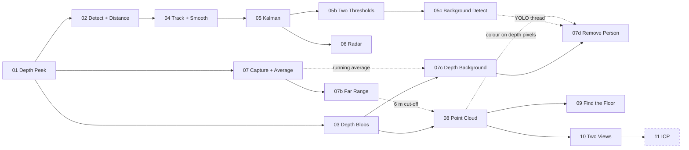

---

## 01 Depth Peek

The starting point: read the depth camera and look at what it actually measures, including where
it fails.

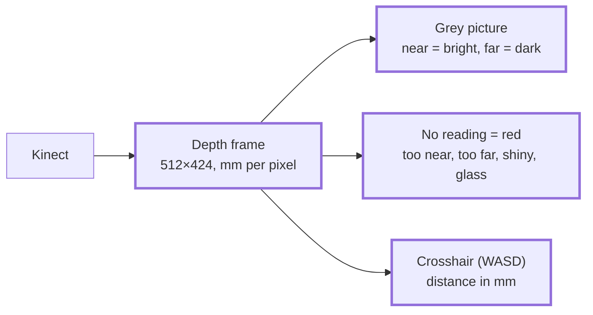

**What to compare:** about 30 fps. Point it at a window, a mirror or something black and watch the
red appear.

## 02 Detect + Distance

Starts from 01. Adds the colour camera and YOLO: the detector finds boxes in colour, and depth then
says how far away each box is ("late fusion").

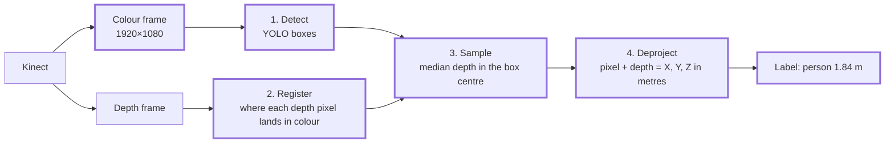

**What to compare:** the frame rate drops from 30 to about 6 fps, because YOLO takes 130–180 ms.

## 03 Depth Blobs

Starts from 01, and uses no AI. Remember the empty room; anything nearer than it is something new.
It doesn't know what anything is, but it works in the dark.

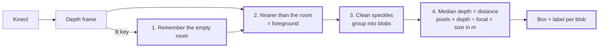

**What to compare:** turn the lights off. 03 keeps working, 02 finds nothing.

## 04 Track + Smooth

Starts from 02. 02 measures every box from scratch, so distances jitter and nothing links an
object in one frame to the next. 04 follows each object over time.

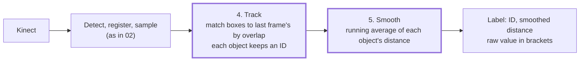

**What to compare:** two still chairs: jitter fell from 2–4 mm to 0.4 mm per frame.

## 05 Kalman

Starts from 04. At 6 fps a walking person barely overlaps their last box, and averaging lags
behind anything that moves. A Kalman filter per object fixes both: predict, then correct.

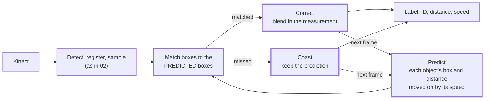

**What to compare:** walk across the room with 04 and then 05. Each prints a `new ID` line when an
ID changes. Walking speed should read about 1–1.5 m/s.

## 05b Two Thresholds

Starts from 05. IDs reset because YOLO's confidence wobbles around the 0.40 cut-off. Two levels
fix it (the core of ByteTrack): strong boxes may start an ID, weak ones only continue one.

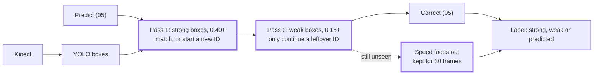

**What to compare:** the same flickering TV for 60 s: 7 IDs with 05, 1 with 05b.

## 05c Background Detect

Starts from 05b. Everything so far waits about 150 ms for YOLO every frame. 05c stops waiting:
YOLO runs on its own thread, and the main loop keeps the camera's pace.

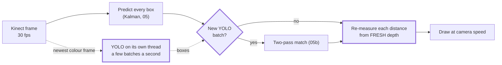

**What to compare:** set `DetectInBackground = false` to get 05b's behaviour: display 4 fps
waiting for YOLO, 24–27 fps in the background. `ModelInputSize = 320` makes YOLO about 3× faster
but misses objects cut off at the image edge.

## 06 Radar

Starts from 05. 02–05 say how far away each object is; 06 adds where: a position on the floor in
metres, drawn from above. The project's first map.

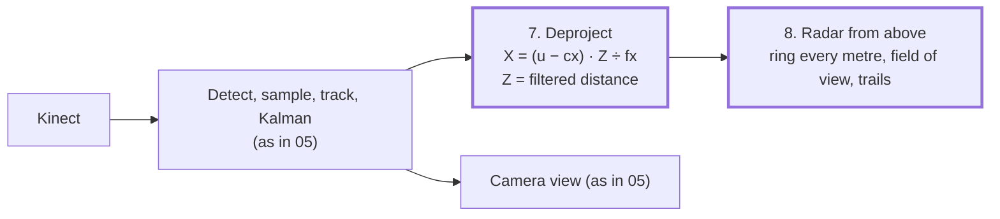

**What to compare:** still objects stay steady to about 1 cm. Walk left: does your dot move left?

## 07 Capture + Average

Starts from 01. The first room-lane example: a map is built from still captures, so noise matters
more than speed. With the camera still, average each pixel over many frames.

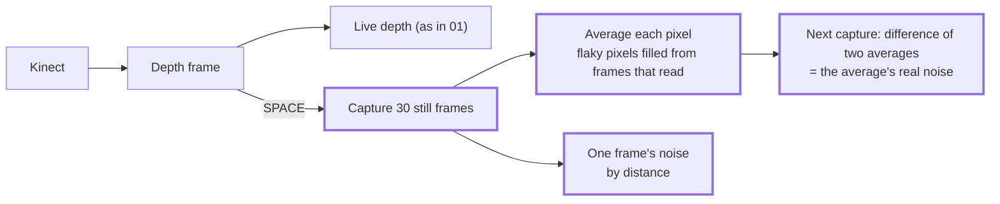

**What to compare:** one frame ±1.2 mm at 0.5–1 m; the average ±0.3 mm (theory says ±0.2).

## 07b Far Range

Starts from 07. Everything so far stops at 4.5 m, but that's libfreenect2's default, not the
sensor. Raise the cut-off and measure how much worse far readings are.

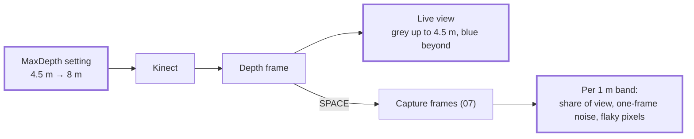

**What to compare:** never-read pixels 33.8% → 2.3% in the same scene. 4–6 m reads ±5 mm, as good as
3–4 m; past 6 m almost nothing reads, hence the 6 m cut-off in later examples.

## 07c Depth Background

Starts from 03. 03 needed an empty room at the start (the B key). 07c's memory keeps itself up to
date, per pixel, so it heals by itself when something moves away.

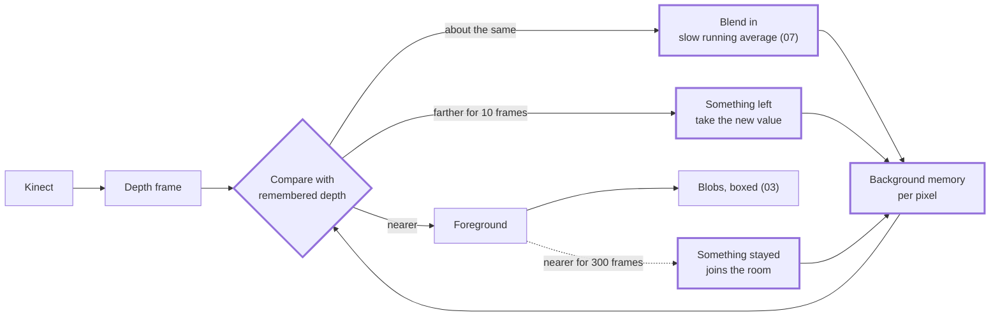

**What to compare:** a spinning ceiling fan made 2–6 blobs when a farther reading was taken at
once; waiting 10 frames (`LeaveFrames`) makes it 0.

## 07d Remove Person

Starts from 07c, with YOLO on its own thread (05c). Decides which foreground is a person and
paints them out with the room behind them. Anything they carry stays visible.

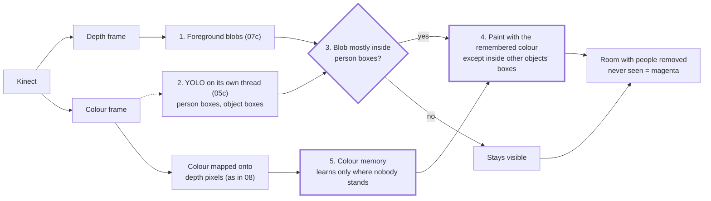

**What to compare:** walk in carrying a cup: you should vanish and the cup should float. Press V
to see why each pixel was removed or kept.

## 08 Point Cloud

Starts from 03's maths (pixel + depth = X, Y, Z), done for every pixel at once. The room becomes
3D dots, in a small viewer we wrote ourselves.

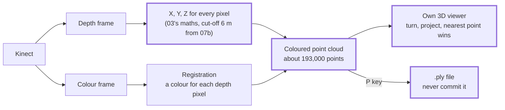

**What to compare:** turn the view sideways: the room is a thin shell, because the camera only sees
the front of everything.

## 09 Find the Floor

Starts from 08. Its points are in the camera's coordinates, so tilting the Kinect tilts the room.
RANSAC finds the floor plane, which gives the room's own "down".

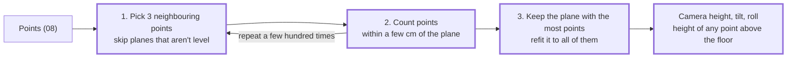

**What to compare:** tilt the Kinect down so some floor shows, then check its reported height with a
tape measure.

## 10 Two Views

Starts from 08. One position only sees the front of things, so a map needs captures from several
places, placed by each capture's pose. Here the pose is measured by hand.

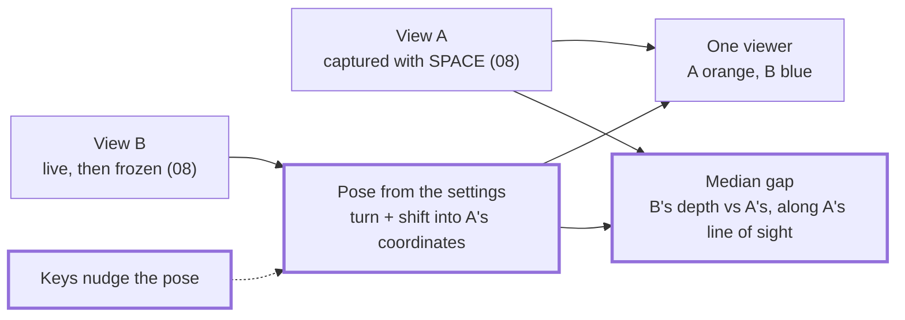

**What to compare:** move the Kinect a measured 30 cm and type it in: do the walls meet, or show
double? The gap can't see sliding along a wall: 5 cm sideways only raised it from 0.5 to 1.2 cm.

---

**Next (planned):** 11 ICP finds the pose by itself, 12 gets it from a printed marker, 13 merges
many views, and 14 places the tracked objects in that map. See the Roadmap in
[CLAUDE.md](../../CLAUDE.md).
