# The examples, as flowcharts

Each C++ example teaches one idea on top of an earlier one. This page draws every example's
pipeline, from the Kinect to what you see. **Boxes with a thick border are what that example adds**;
the thin ones it takes over from the example it starts from. For an animated version, where each
example's steps run on a simulated Kinect, open [docs/visualizer.html](../../docs/visualizer.html)
in a browser. To build and run them, see the
[main README](../../README.md); the measurements behind the "What to compare" lines are in
[README.md](README.md).

## Family tree

Which example each one starts from. A solid arrow means "starts from that example's code"; a
dotted arrow means "borrows one idea from it". Dashed boxes are planned.

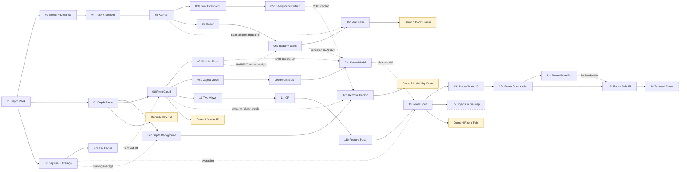

---

## 01 Depth Peek

The starting point: read the depth camera and look at what it actually measures, including where
it fails.

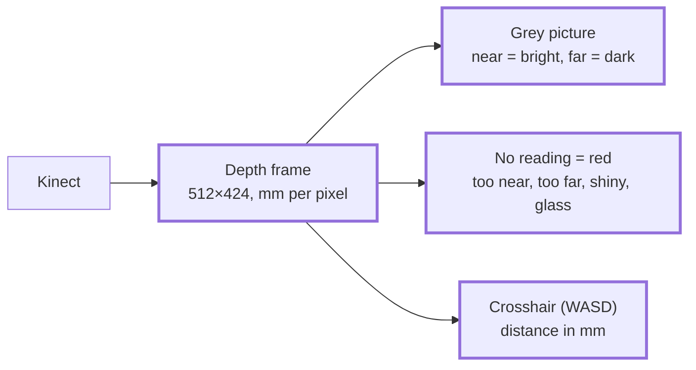

**What to compare:** about 30 fps. Point it at a window, a mirror or something black and watch the
red appear.

## 02 Detect + Distance

Starts from 01. Adds the colour camera and YOLO: the detector finds boxes in colour, and depth then
says how far away each box is ("late fusion").

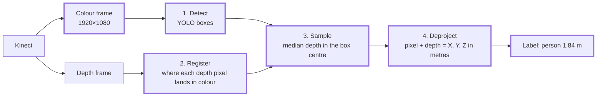

**What to compare:** the frame rate drops from 30 to about 6 fps, because YOLO takes 130–180 ms.

## 03 Depth Blobs

Starts from 01, and uses no AI. Remember the empty room; anything nearer than it is something new.
It doesn't know what anything is, but it works in the dark.

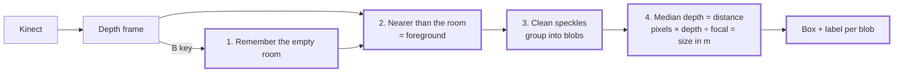

**What to compare:** turn the lights off. 03 keeps working, 02 finds nothing.

## 04 Track + Smooth

Starts from 02. 02 measures every box from scratch, so distances jitter and nothing links an
object in one frame to the next. 04 follows each object over time.

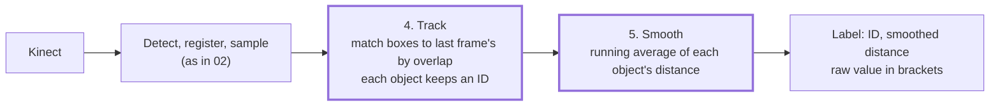

**What to compare:** two still chairs: jitter fell from 2–4 mm to 0.4 mm per frame.

## 05 Kalman

Starts from 04. At 6 fps a walking person barely overlaps their last box, and averaging lags
behind anything that moves. A Kalman filter per object fixes both: predict, then correct.

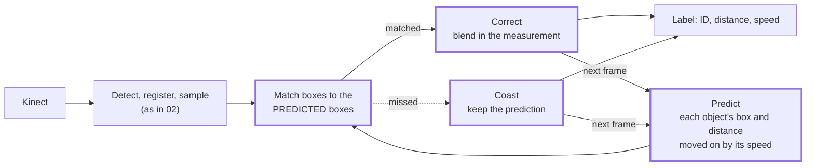

**What to compare:** walk across the room with 04 and then 05. Each prints a `new ID` line when an
ID changes. Walking speed should read about 1–1.5 m/s.

## 05b Two Thresholds

Starts from 05. IDs reset because YOLO's confidence wobbles around the 0.40 cut-off. Two levels
fix it (the core of ByteTrack): strong boxes may start an ID, weak ones only continue one.

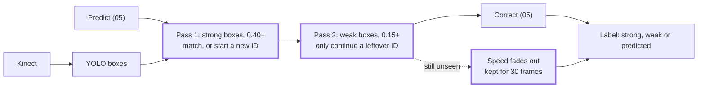

**What to compare:** the same flickering TV for 60 s: 7 IDs with 05, 1 with 05b.

## 05c Background Detect

Starts from 05b. Everything so far waits about 150 ms for YOLO every frame. 05c stops waiting:
YOLO runs on its own thread, and the main loop keeps the camera's pace.

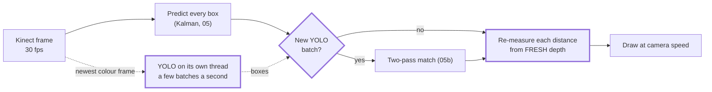

**What to compare:** set `DetectInBackground = false` to get 05b's behaviour: display 4 fps
waiting for YOLO, 24–27 fps in the background. `ModelInputSize = 320` makes YOLO about 3× faster
but misses objects cut off at the image edge.

## 06 Radar

Starts from 05. 02–05 say how far away each object is; 06 adds where: a position on the floor in
metres, drawn from above. The project's first map.

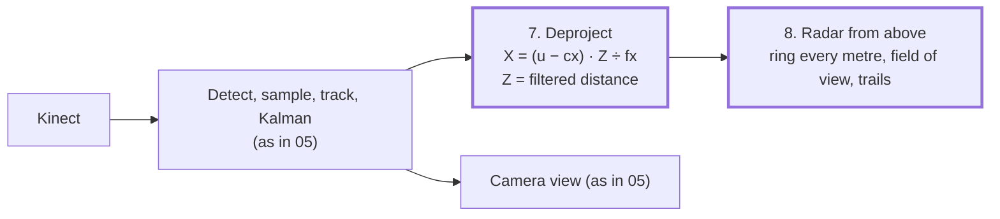

**What to compare:** still objects stay steady to about 1 cm. Walk left: does your dot move left?

## 06b Radar + Walls

Starts from 06; the plane finder comes from 09. 06's map has objects but no room around them. A
wall is a big, flat, upright surface, so 09's floor finder, turned on its side, finds them.

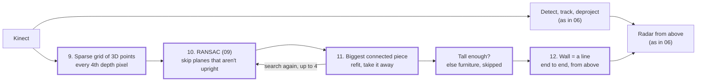

**What to compare:** the printed distance to the wall ahead against a tape measure, and two walls
in a corner about 90° apart.

## 06c Wall Filter

Starts from 06b; the filter and the matching come from 05. 06b finds the walls afresh every frame,
so they wobble. Walls don't move, so each one gets its own extended Kalman filter. "Extended",
because the filter keeps the wall's nearest point as X, Z on the floor, but the wall finder
measures a distance and an angle: curved maths (hypot, atan2) that the EKF straightens out around
its current guess every frame (the Jacobian, H).

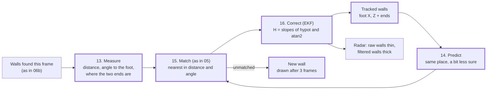

**What to compare:** "m away" against "raw" in the console, and the thick grey line against the
thin dark one on the radar.

## 07 Capture + Average

Starts from 01. The first room-lane example: a map is built from still captures, so noise matters
more than speed. With the camera still, average each pixel over many frames.

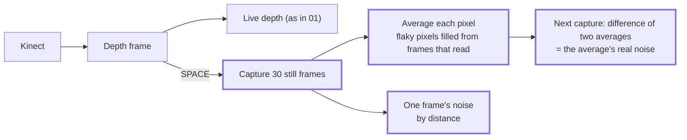

**What to compare:** one frame ±1.2 mm at 0.5–1 m; the average ±0.3 mm (theory says ±0.2).

## 07b Far Range

Starts from 07. Everything so far stops at 4.5 m, but that's libfreenect2's default, not the
sensor. Raise the cut-off and measure how much worse far readings are.

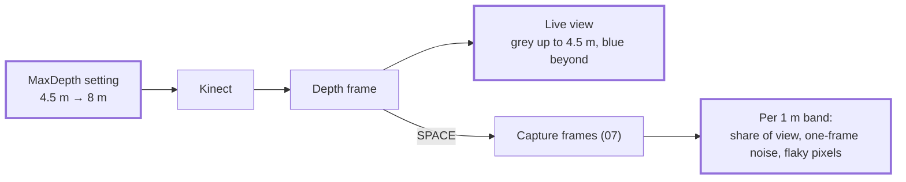

**What to compare:** never-read pixels 33.8% → 2.3% in the same scene. 4–6 m reads ±5 mm, as good as
3–4 m; past 6 m almost nothing reads, hence the 6 m cut-off in later examples.

## 07c Depth Background

Starts from 03. 03 needed an empty room at the start (the B key). 07c's memory keeps itself up to
date, per pixel, so it heals by itself when something moves away.

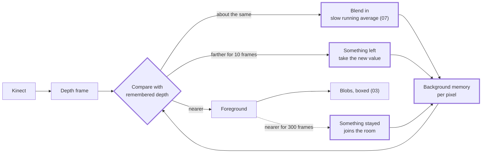

**What to compare:** a spinning ceiling fan made 2–6 blobs when a farther reading was taken at
once; waiting 10 frames (`LeaveFrames`) makes it 0.

## 07d Remove Person

Starts from 07c, with YOLO on its own thread (05c). Decides which foreground is a person and
paints them out with the room behind them. Anything they carry stays visible.

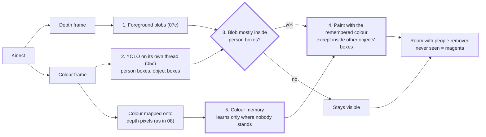

**What to compare:** walk in carrying a cup: you should vanish and the cup should float. Press V
to see why each pixel was removed or kept.

## 08 Point Cloud

Starts from 03's maths (pixel + depth = X, Y, Z), done for every pixel at once. The room becomes
3D dots, in a small viewer we wrote ourselves.

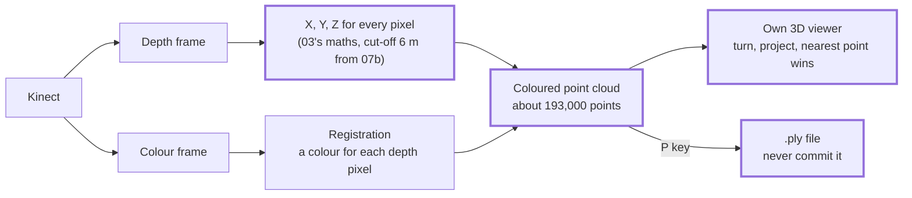

**What to compare:** turn the view sideways: the room is a thin shell, because the camera only sees
the front of everything.

## 09 Find the Floor

Starts from 08. Its points are in the camera's coordinates, so tilting the Kinect tilts the room.
RANSAC finds the floor plane, which gives the room's own "down".

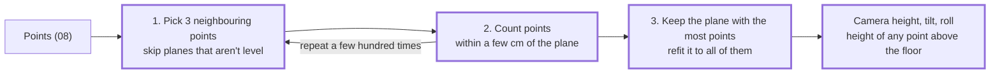

**What to compare:** tilt the Kinect down so some floor shows, then check its reported height with a
tape measure.

## 09b Room Mesh

Starts from 08b. 08b meshed one object; 09b meshes everything in view: the first recreation of the
room, from one view. The holes behind every object are why the next examples take several views.

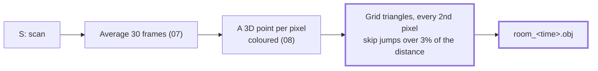

**What to compare:** turn the mesh in Blender: every hole is a shadow pointing away from the camera.

## 09c Room Model

Starts from 09b; the plane search comes from 06b, "up" from 09. Next to the raw mesh it builds the
room the way you'd draw it: flat walls, floor and ceiling, furniture as boxes, all stood straight.

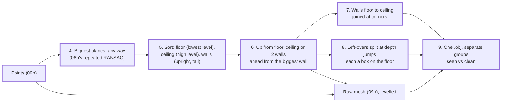

**What to compare:** hide groups in Blender: the raw mesh against the clean model. Does the model
stand straight, and do the corners meet?

## 10 Two Views

Starts from 08. One position only sees the front of things, so a map needs captures from several
places, placed by each capture's pose. Here the pose is measured by hand.

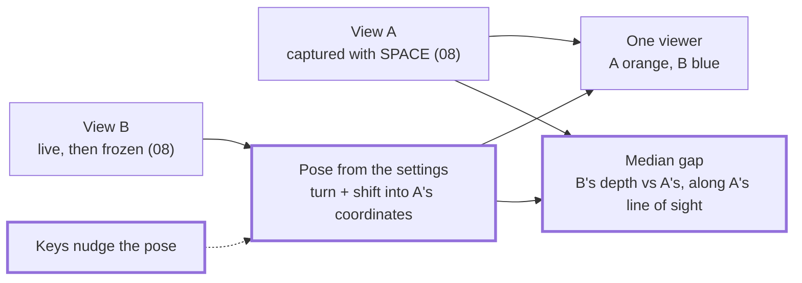

**What to compare:** move the Kinect a measured 30 cm and type it in: do the walls meet, or show
double? The gap can't see sliding along a wall: 5 cm sideways only raised it from 0.5 to 1.2 cm.

---

## 11 ICP

Starts from 10. Instead of nudging the pose by hand, ICP nudges it: pair every point with its
nearest neighbour in the other view, find the one turn + shift that brings the pairs closest
(Kabsch: an SVD), apply it, repeat.

```mermaid
flowchart LR
    B["View B (10)"] --> MOVE["1. Move B by the pose<br/>(10's settings to start)"]
    MOVE --> NN["2. Nearest A point to each<br/>k-d tree; far pairs ignored"]
    A["View A (10)"] --> NN
    NN --> FIT["3. Best turn + shift<br/>for the pairs (Kabsch, SVD)"]
    FIT --> MOVE
    FIT --> VIEW["Viewer + gap (10)"]

    classDef new stroke-width:3px
    class MOVE,NN,FIT new
```

**What to compare:** a small move (20 cm, 10°) lines up; a big one (50 cm, 30°) settles on a wrong
fit. ICP needs a rough start.

## 11b Feature Pose

Starts from 11. The rough start found automatically, the way Meshroom does it: details in the
colour pictures matched between the views. Depth makes it simpler than Meshroom: each match is
already a pair of 3D points.

```mermaid
flowchart LR
    CA["A's colour picture"] --> ORB["1. ORB features<br/>where there's depth"]
    CB["B's colour picture"] --> ORB
    ORB --> M["2. Match descriptions<br/>ratio test"]
    M --> L["3. Depth under each<br/>= pairs of 3D points"]
    L --> R["4. RANSAC: pose from 3 pairs,<br/>keep the one most agree with"]
    R --> ICP["5. ICP (11)"]
    ICP --> VIEW["Viewer + match window"]

    classDef new stroke-width:3px
    class ORB,M,L,R new
```

**What to compare:** the match window: do the lines join the same things? How far can the Kinect
move before too few matches agree?

## 13 Room Scan

Starts from 11b; the averaging comes from 07, the clean model from 09c. Any number of scans, each
placed against all earlier ones, then merged into one mesh. The step-by-step guide is in the
[main README](../../README.md#recreate-a-room-example-13).

```mermaid
flowchart LR
    S["SPACE: average 30 frames (07)<br/>points, normals, features"] --> F["Features vs every earlier scan<br/>best one: rough pose (11b)"]
    F --> I["ICP vs all earlier scans<br/>point to plane, bare-wall safe"]
    I -->|"placed (U undoes)"| ALL["All scans in the room<br/>viewer, C = colour by scan"]
    ALL -->|E| T["TSDF grid<br/>distance to the surface, averaged"]
    T --> N["Surface net<br/>one mesh, no double walls"]
    ALL -->|E| CM["Clean model (09c)<br/>planes merged across scans,<br/>boxes joined"]
    N --> OBJ["room_scan_&lt;time&gt;.obj"]
    CM --> OBJ

    classDef new stroke-width:3px
    class S,F,I,ALL,T,N,CM new
```

**What to compare:** press C while scanning: a scan's colour should lie on the others. In the
saved file, `seen_room` against the clean groups.

## 13b Room Scan HQ

Starts from 13. Better recognition in dim light, and quality over time everywhere else (more
frames, features, RANSAC tries, ICP points and rounds; 2 cm cubes).

```mermaid
flowchart LR
    P["Colour picture<br/>on the depth grid"] --> G["Grey"]
    G --> CL["CLAHE: contrast evened out<br/>tile by tile"]
    CL --> ORB["ORB, gentler corner test<br/>FAST 7, up to 3000"]
    ORB --> PL["Place: features + ICP (13)<br/>every 2nd pixel, 20 must agree"]
    PL --> E["E: TSDF at 2 cm + surface net,<br/>clean model (13)"]

    classDef new stroke-width:3px
    class CL,ORB new
```

**What to compare:** the "N features" in the console, against 13 in the same spot and light.

## 13c Room Scan Assist

Starts from 13b. Help for long scans: what the next scan will be placed by (live), where to go
next, bad scans flagged and removable, and the same speed at scan 30 as at scan 3.

```mermaid
flowchart LR
    S["SPACE: 60 frames,<br/>features (13b)"] --> V["Vote: which 4 earlier scans<br/>share most features"]
    V --> F["Features + RANSAC<br/>against those 4"]
    F --> I["ICP: only what this view sees,<br/>1 cm thinned; weak below 5%"]
    I --> C["Second opinion: ICP against<br/>all but the matched scan"]
    C -->|"agrees"| ALL["The room so far"]
    C -->|"disagrees"| RED["Placed, flagged red"]
    RED --> ALL
    ALL --> N["Next shot: turns from each spot,<br/>most new, half known"]
    L["Live frame, twice a second"] --> A["Anchors: features matching<br/>the room (green) + counter"]
    ALL --> A
    ALL -->|"click, X / P"| X["Exclude or place again"]

    classDef new stroke-width:3px
    class V,I,C,RED,N,L,A,X new
```

**What to compare:** walk away from the scanned part watching the anchor counter; where it turns
red is how far you can go from there.

## 13d Room Scan Far

Starts from 13c. Details too far for depth still give a direction: they help place scans, and
seen from two spots they become landmarks in the room.

```mermaid
flowchart LR
    C["Full colour picture"] --> M["Where depth reads nothing<br/>(bigdepth)"]
    M --> O["ORB there: far features,<br/>each a ray"]
    K["Pixels with depth"] --> F["Colour camera model<br/>fitted per scan"]
    F --> O
    O --> V["Far matches vote in RANSAC<br/>(rays must meet far away)"]
    N["Near features (13c)"] --> V
    V -->|"under 3 near"| R["Turn from far rays,<br/>ICP with a wide gate"]
    V -->|"3+ near"| I["Kabsch + ICP (13c)"]
    L["Landmarks"] -->|"rays to them"| P["Position + turn<br/>from landmark rays"]
    P --> R
    R --> T["Triangulate new landmarks<br/>(2+ degrees apart)"]
    I --> T
    T --> L
    L --> OBJ["far_landmarks in the .obj"]

    classDef new stroke-width:3px
    class M,O,F,V,R,L,P,T,OBJ new
```

**What to compare:** a hallway scan in 13c (refused) and in 13d; then the far_landmarks group in
Blender against where the far doorway really is.

## 13z Room Rebuild

Starts from 13c's export and viewer, with no Kinect. In 13c and 13d, **K** keeps the scans in a
folder; 13z reads such folders back, so a room can be looked at and rebuilt any time later.

```mermaid
flowchart LR
    SC["Scans in 13c / 13d"] -->|K| FO["A folder per room:<br/>points, pictures, poses,<br/>points.ply"]
    FO --> FIND["Find saved rooms<br/>(room.txt), list them"]
    FIND --> PICK["Pick rooms, then<br/>which scans to load"]
    PICK --> LOAD["Read cloud, picture, pose<br/>(no placing: poses are saved)"]
    LOAD --> VIEW["13c's viewer<br/>X excludes, saved to pose.txt"]
    LOAD --> OBJ["13c's E: TSDF + surface net<br/>+ clean model, .obj"]
    LOAD --> PLY["Every scan's own points<br/>and colours, .ply"]
    VIEW --> OBJ
    VIEW --> PLY

    classDef new stroke-width:3px
    class FO,FIND,PICK,LOAD,PLY new
```

**What to compare:** the same room's `points.ply` and `.obj` in MeshLab (a poster's text, a book
spine), and the `.obj` at `VoxelMeters` 0.02 and 0.01.

## Presentation demos

Five fullscreen remixes for an exhibition, in [presentation/](presentation/README.md) (yellow in
the family tree). Demos 1, 2, 3 and 5 are 08, 07d, 06c and 03 with fullscreen, big text and no
save keys; Demo 5 also measures height from each end's own depth. Demo 4 is new: the first cut of
15, for people.

```mermaid
flowchart LR
    OBJ["13's room_scan_&lt;time&gt;.obj<br/>seen_room points + normals,<br/>scan 1's camera turn"] --> DH["Doll's house<br/>ceiling cut off, turning"]
    K["Kinect, empty view"] --> BG["Empty view's depth (03)"]
    BG --> LOC["Locate: start at scan 1's turn,<br/>13's point-to-plane ICP"]
    OBJ --> LOC
    K2["Kinect, every frame"] --> FG["Nearer than the empty view<br/>= visitors (03's blobs)"]
    BG --> FG
    FG --> MOVE["Visitors' points<br/>moved into the room"]
    LOC --> MOVE
    MOVE --> V["Viewer: the room + visitors,<br/>orange, live"]
    DH --> V

    classDef new stroke-width:3px
    class DH,LOC,MOVE new
```

**What to compare:** walk to a corner of the stand: does your orange shell stand in the same
corner of the doll's house?

---

**Next (planned):** 12 gets a pose from a printed marker (a fallback for bare walls), 14 paints a
kept room with its full-resolution pictures (a textured mesh), and 15 places the tracked objects in
the scanned room. See the Roadmap in [CLAUDE.md](../../CLAUDE.md).
