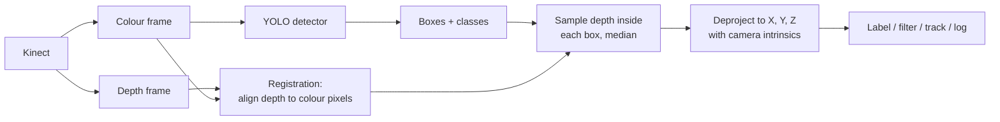

# Kinect + Object Detection — Adding Depth to the Detector

A build guide for plugging an Xbox Kinect into the detector from the other two guides. The detector says **what** is in the picture and **where on screen**. The Kinect adds **how far away** it is, **where it is in 3-D** and **how big it really is**.

> **Scope.** Build guide. It assumes you have finished [learning guide](object_detection_learning_guide.md) Stage 2 (a webcam detector runs) and reuses its stack: Python + OpenCV + Ultralytics + `yolo26n.pt`. Background on detection-plus-depth is in [landscape §3.10](object_detection_landscape.md#310-detection--segmentation--pose--depth). Overview: [README.md](README.md).

> **As-of: 2026-10-15.** Driver maintenance status, Windows support and used-hardware prices change. Dated facts below were read on this date.

> **Sourcing note (what was and wasn't verified).**
> - **Live-fetched 2026-10-15** (page content read): libfreenect repo and its `libfreenect.h` header, `freenect.pyx` and `demo_cv_sync.py`; libfreenect2 repo, README and `Registration` API docs; pylibfreenect2 repo, API docs, installation docs and `multiframe_listener.py`; PyKinect2 repo; commit histories of all four; Microsoft's Kinect SDK 2.0 system-requirements page, Kinect v1 `DepthRange` page and Kinect for Windows Runtime 2.2 download page; the Azure Kinect Sensor SDK repo; Open3D PyPI and `PointCloud` API docs; Khoshelham & Oude Elberink (2012) full text; Sarbolandi et al. (2015) abstract; MathWorks Kinect v2 support page; Ultralytics COCO8-Multispectral page.
> - **Search-confirmed only** (a search result said so; the page itself was not read): Kinect v2 0.5–4.5 m range and 70° × 60° depth FOV; Kinect v1 57° × 43° FOV; the Kinect and Kinect Adapter production end dates; the Femto Bolt as Azure Kinect successor; the Kinect v1 power brick rating; the Ultralytics `channels` key arriving in v8.3.112.
> - **Executed:** the pure-math helper [`rgbd_fuse.py`](#61-shared-helper-rgbd_fusepy-all-builds) and its self-check ran and passed on **Python 3.14.6 + numpy 2.4.4** (Windows, 2026-10-15). **Not executed:** both Kinect capture scripts and every Build C snippet. They are syntax-checked only, because no Kinect was attached. Treat your first run as the test (§7).
> - Items from general knowledge are marked *(general knowledge)*. As in the landscape doc, a project's own repo or docs count as the authority for its own license, version and API facts. The "≥2 independent sources" rule is applied to hardware specs and accuracy claims.

---

## Contents

1. [What you're building](#1-what-youre-building)
2. [Identify your Kinect](#2-identify-your-kinect)
3. [Difficulty · time · cost](#3-difficulty--time--cost)
4. [What already exists (survey before building)](#4-what-already-exists-survey-before-building)
5. [How it works](#5-how-it-works)
6. [Build options](#6-build-options)
7. [Test it](#7-test-it)
8. [Troubleshooting](#8-troubleshooting)
9. [Safety](#9-safety)
10. [What it unlocks](#10-what-it-unlocks)
11. [Myths, disputes and uncertainties](#11-myths-disputes-and-uncertainties)
12. [Glossary](#12-glossary)
13. [References](#13-references)
14. [Known gaps](#14-known-gaps)

---

## 1. What you're building

A live window that shows your normal YOLO boxes, with each label extended like this:

```
person 1.84m x-0.31 y+0.12
chair  2.60m x+0.75 y+0.48
```

That is the distance in metres, plus the left/right (**x**) and up/down (**y**) offset from the camera's centre line. Everything after that builds on this one fusion step: filtering by distance, 3-D tracking, speed, real object size, and point clouds.

The method is ***late fusion***. The detector runs on the colour image exactly as it does with a webcam. The depth image is used only *after* detection, to measure each box. You don't retrain anything, and every detector from the landscape survey works unchanged. Training on colour + depth together (***early fusion***) is covered briefly in §5.6 as an advanced option.



---

## 2. Identify your Kinect

There are three generations, and each one needs a different driver. Look at the front of the sensor before buying adapters or installing anything.

**Kinect v1, "Kinect for Xbox 360"** · has a motorised tilt base and says *XBOX 360* on the front
Structured-light depth sensor. libfreenect aligns depth to a **640 × 480** RGB image.[^2] Microsoft's SDK lists a default depth range of **800–4,000 mm** and a **400–3,000 mm** "near" range.[^13] Near mode was a Kinect for Windows feature *(general knowledge; see §11)*. The field of view is about **57° horizontal × 43° vertical** *(search-confirmed, two secondary sources)*.[^14]
Driver: **libfreenect** (Linux/macOS/Windows), or Microsoft Kinect SDK 1.8 on Windows.[^1]
> The original units need a **12 V** power brick with USB split-off. The commonly listed one is Microsoft model 1431, rated **12 V 1.08 A** *(search-confirmed, single source)*.[^24] Later units for the Xbox 360 S/E slim console had a different plug. Whether libfreenect fully supports every v1 hardware revision is **unconfirmed**. Test with `freenect-glview` before writing code (§7).

**Kinect v2, "Kinect for Xbox One"** · flat glossy face, no tilt motor, a thick proprietary cable
Time-of-flight depth sensor. Colour is **1920 × 1080**, and depth is **512 × 424**.[^15][^6] The range is **0.5–4.5 m** and the depth field of view is **70° × 60°** *(search-confirmed, two sources; a pre-release leak said 0.8–4.0 m)*.[^15]
Needs **USB 3.0**. USB 2 is not supported. Intel and NEC controllers are known to work, and ASMedia controllers are known *not* to.[^5] Microsoft lists Intel or Renesas.[^11]
Driver: **libfreenect2** (Linux/macOS/Windows),[^5] or the Microsoft Kinect for Windows runtime/SDK 2.x on Windows.[^11][^12]
> To connect it to a PC you need the **Kinect Adapter for Windows** (a power supply plus USB 3.0 breakout). Microsoft stopped making it in **January 2018**, about three months after Kinect production ended in October 2017 *(search-confirmed, several news reports)*.[^16] Today you buy a used original or a third-party clone.

**Azure Kinect DK** (2019 developer kit, not an Xbox product)
The Sensor SDK repo was **archived on 2024-08-22** (MIT license, read-only).[^17] Orbbec's **Femto Bolt** is the widely cited successor and offers an Azure Kinect-compatible API wrapper *(search-confirmed; vendor-adjacent sources)*.[^18] It is out of scope here. If you have one, the fusion method in §5 is identical, and only the capture code changes.

**Which is better for this project?** *(my assessment)* v2 has about 3× the colour resolution and a wider, cleaner depth image. MathWorks calls it "three times more depth fidelity".[^15] v2 also tolerates ambient light much better (§5.5). v1 is simpler: it runs on USB 2, needs no GPU depth decoding, and its driver was touched more recently. **Use whichever you own.** If you're buying, pick v2 plus an adapter, because the adapter is the scarce part.

---

## 3. Difficulty · time · cost

**Difficulty:** intermediate. It is Python glue plus one native driver build, and the driver build is where people get stuck.
**Time:** 1–3 hours to get the driver demo running, then 30 minutes to the first labelled distances. Allow longer for a v2 on a machine with an untested USB 3.0 controller.
**Cost:** $0 if you already own the sensor.

📦 **Parts** (prices are **unverified placeholders from model knowledge, not checked 2026-10-15**; check current used listings)

**Kinect v1 sensor** · 1 · Build A
Used "Kinect for Xbox 360". *Placeholder: roughly US$10–30 used.*
Buy: used marketplaces. Search "Xbox 360 Kinect sensor".
> Check the plug. An original-style unit needs the power brick below, and a sensor without it is useless on a PC.

**Kinect v1 power/USB adapter** · 1 · Build A
The 12 V brick with a USB-A tail. The commonly cited original is Microsoft model 1431, rated 12 V 1.08 A.[^24]
Buy: search "Xbox 360 Kinect AC adapter USB". *Placeholder: roughly US$8–15.*
> A third-party listing seen in search quoted only 0.3 A. Prefer one that states **≥1 A at 12 V**.

**Kinect v2 sensor** · 1 · Build B
Used "Kinect for Xbox One" (or the identical Kinect for Windows v2). *Placeholder: roughly US$20–50 used.*

**Kinect Adapter for Windows (or clone)** · 1 · Build B
Mains power supply plus a box that splits the Kinect cable into power and **USB 3.0**. Discontinued by Microsoft in 2018.[^16]
Buy: search "Kinect adapter Xbox One S Windows". *Placeholder: roughly US$20–40 for a clone.*

**PCIe USB 3.0 card, Intel/NEC/Renesas chipset** · 0–1 · Build B, only if your built-in USB 3.0 fails
libfreenect2 reports NEC cards working (up to 5 Kinects on x8/x16 slots), and ASMedia not working.[^5]
> Check the chipset in the listing, not just "USB 3.0".

**Tape measure** · 1 · §7 test.

---

## 4. What already exists (survey before building)

Everything you need exists. The missing piece is the ~60 lines of glue that pass YOLO boxes into the depth image. That makes this a **"build on it"** job.

**Kinect for Windows SDK 2.0 / runtime 2.2 (Microsoft)** · Windows · proprietary (EULA not reviewed)
Covers: v2 drivers, colour/depth/IR streams, coordinate mapping, and **built-in body tracking of 25 joints for up to 6 people**.[^15] On Windows 10 (1809 or later), the driver arrives through Windows Update on first plug-in. Runtime 2.2.1905's download page says it was published 2024-07-15.[^12] The SDK's own requirements page still lists only Windows 8/8.1 and Visual Studio 2012/2013.[^11]
Gap: Windows-only, people-only (no chairs, cups or dogs), C#/C++ first. Windows 11 support is not stated on any page read.
**Use as is if all you need is people's 3-D positions on Windows.** The SDK's skeleton tracker already does that without YOLO.

**libfreenect (OpenKinect)** · Kinect v1 · Apache-2.0 **or** GPL-2.0 (your choice)[^1]
Covers: v1 colour, depth, motor and LED, plus a Python wrapper (`-DBUILD_PYTHON3=ON`).[^1] It can output depth **already in millimetres and aligned to the 640 × 480 RGB image** (`DEPTH_REGISTERED`), with **0 = no reading**.[^2] That's exactly what fusion needs.
Maintenance: last commit **2024-01-06**, with no tagged releases on GitHub.[^1] *Low activity, but the hardware is frozen too.*
Gap: you build it from source. On Windows you also install the libusbK driver with Zadig.[^1]

**libfreenect2 (OpenKinect)** · Kinect v2 · Apache-2.0 / GPL-2.0 license files in repo[^5]
Covers: v2 colour/IR/depth with GPU depth decoding (OpenGL 3.1, OpenCL 1.1, CUDA), and **registration of depth onto colour**.[^5][^6] Includes the `Protonect` test viewer.
Maintenance: last commit **2020-03-01**.[^5] *Effectively frozen. Still the standard open driver.*
Gap: picky about USB controllers, and on Windows it needs UsbDk or libusbK (not both).[^5]

**`freenect` Python wrapper (in libfreenect)** · v1 · same license as libfreenect
`sync_get_video()` / `sync_get_depth(format=...)` return `(array, timestamp)`.[^3][^4] It is two calls with no threads to manage.

**pylibfreenect2** · v2 · MIT[^7]
Python bindings for libfreenect2, including `Registration.apply(..., bigdepth=...)` and `getPointXYZ`.[^8][^9]
Maintenance: the docs claim Python **2.7–3.5** only.[^9] The last commit (2023-10-31) is titled "fix for cython3", which suggests someone builds it on modern Python, but **support for Python ≥3.10 is unconfirmed**.[^7] *This is the riskiest dependency in the guide.*

**PyKinect2 (Microsoft org on GitHub)** · v2 on Windows via the official SDK · MIT[^10]
Last commit **2016-09-28**, with 71 open issues.[^10] Not used here, because it's stale and its API was not verified. It's a fallback if pylibfreenect2 won't build on Windows.

**Open3D** · point clouds and 3-D viewing · MIT · `pip install open3d`, v0.20.0 (2026-09-16), Python ≥3.10.[^21]
Covers: depth image to point cloud with your intrinsics.[^22] Used only in Build C.

**Ultralytics** · the detector · AGPL-3.0 / Enterprise (see [landscape §5.3](object_detection_landscape.md#53-licensing-summary)).
The license that governs your project is Ultralytics' AGPL, not the Kinect drivers' (Apache/MIT options exist for all of them). Swap in an Apache-2.0 detector from the landscape if that matters.

**Where AI fits** *(my assessment)*: the detector *is* the AI component, and the Kinect contributes geometry that needs no learning. Two places to push further:
- An **open-vocabulary detector** ([landscape §4.3](object_detection_landscape.md#43-open-vocabulary-and-zero-shot-detectors)) lets you ask for "a red mug" and get its 3-D position.
- A **coding assistant** is well suited to adapting the glue in §6 to your exact library versions, because the parts most likely to break (wrapper builds, array shapes) are mechanical.

---

## 5. How it works

### 5.1 Two cameras, so the pixels don't line up

The Kinect's colour camera and depth camera sit centimetres apart and have different lenses and resolutions. Pixel (300, 200) in colour is *not* pixel (300, 200) in depth. If you sample depth with a box drawn on the colour image without fixing this, you measure the wrong thing, often the background next to the object.

***Registration*** maps one image onto the other. Both drivers do it for you:

- **v1:** ask for `DEPTH_REGISTERED`. The header documents it as *"processed depth data in mm, aligned to 640x480 RGB"*. Plain `DEPTH_MM` is *"left unaligned to RGB image"*. **Use REGISTERED.**[^2][^3]
- **v2:** `Registration.apply(color, depth, undistorted, registered, bigdepth=...)`. `registered` is colour squeezed down to the 512 × 424 depth grid. `bigdepth` is **depth stretched up to the colour image: 1920 × 1082 float, "1082 not 1080, with a blank top and bottom row"**.[^6][^9] This guide uses `bigdepth[1:-1]` so depth lines up with the 1920 × 1080 frame the detector sees. *(Dropping one row from each end is my reading of that doc line. §7 test 3 catches it if wrong.)*

### 5.2 One number per box: median of the centre

A detection box is a rectangle around an irregular object, so its corners usually contain background. The helper in §6.1 therefore:

1. shrinks the box to its **central half** in each axis (`shrink=0.5`);
2. throws away invalid pixels: **0** (libfreenect's documented "no value"[^2]) and NaN/∞ (possible in float depth maps);
3. takes the **median**, which ignores the few background pixels that remain and the noisy "flying" pixels at object edges *(general knowledge)*;
4. returns `None` if fewer than 20 % of the sampled pixels were valid, instead of guessing.

Thin or hollow objects (a chair seen through its back, a bicycle) can still fail, because the centre of the box *is* background. Build C replaces the box with a **segmentation mask** for those.

### 5.3 From pixel + depth to X, Y, Z

Pinhole camera model *(standard; general knowledge)*: a pixel at column *u* and row *v*, seen at depth *Z*, sits at

- **X = (u − cx) · Z / fx** (right is +)
- **Y = (v − cy) · Z / fy** (down is +)
- **Z** = the depth value (forward)

*fx, fy* are the focal lengths in pixels, and *cx, cy* is the image centre the lens actually uses (the ***principal point***). Together they are the camera's ***intrinsics***. The same relation gives real size: an object *w* pixels wide at depth *Z* is about *w · Z / fx* wide. libfreenect2's own `getPointXYZ` also treats the depth value as *z* and returns metres.[^6]

> **Distance to "the object" means distance to its visible front surface**, along the camera's forward axis. Straight-line range from the lens is √(X² + Y² + Z²), slightly more than Z for off-centre objects.

### 5.4 Where the intrinsics come from

- **v2:** factory values from the device: `device.getColorCameraParams()` exposes `fx, fy, cx, cy`.[^9] Because `bigdepth` is in colour-image pixels, these are the right ones to use.
- **v1:** the Python wrapper gives no intrinsics. Build A estimates them from the field of view: `fx = (640/2) / tan(57°/2) ≈ 589 px`. ⚠️ This is a spec-sheet approximation. Other v1 sources quote different FOVs, and a wrong *fx* scales X, Y and size by the same percentage. **Z is unaffected**, because it comes straight from the sensor. If lateral position or size must be accurate, calibrate the colour camera with OpenCV's checkerboard procedure (`cv2.calibrateCamera`, *general knowledge*) and paste the resulting fx, fy, cx, cy into the script. That's the calibration knob.

### 5.5 What the depth sensor gets wrong

**Range limits.** Inside the minimum distance (v1 **0.8 m** default, v2 **0.5 m**) you get holes, not small numbers.[^13][^15] Plan the camera position so targets stay inside the range.

**Noise grows with distance.** For v1, Khoshelham & Oude Elberink measured random error rising from a few millimetres up to **about 4 cm at maximum range**. Their model and conclusions say it grows **quadratically** with distance, and they recommend **1–3 m** for mapping-grade data.[^19] *(One peer-reviewed study of v1; v2 behaves differently.)*

**Ambient light and surfaces.** Sarbolandi et al. compared both Kinects across seven test setups, including ambient light, multipath and semi-transparent materials.[^20] Their reported pattern *(abstract read; table values only seen in a search summary, not verified)*:
- the structured-light v1 loses depth entirely in strong background light;
- the time-of-flight v2 keeps working but gets noisier.

Practical upshot *(my assessment)*: indoors, either works. Near sunny windows or outdoors, expect v1 to blank out. For both, black, shiny, glass and mirrored surfaces give holes or wrong values.

**Two Kinects interfere** when their IR patterns or signals overlap. Sarbolandi et al. include a multi-device test,[^20] but how severe the effect is wasn't verified here.

**Dark rooms.** Depth uses its own IR light, so it works in the dark, but **the colour image doesn't**, and the detector runs on colour. See §11 for detecting on the IR image instead.

### 5.6 Other fusion levels (beyond this guide's builds)

**Depth-only detection: the no-AI rung.** Record the empty scene's depth once. Any pixel more than about 10 cm closer than that background is foreground, and `cv2.connectedComponentsWithStats` turns the foreground into blobs. This works in the dark, ignores shadows and lighting, and is the classic Kinect overhead people-counter *(general knowledge)*. Use it when "something is there" is enough and the class doesn't matter:
```python
fg = ((background_mm - depth_mm) > 100) & (depth_mm > 0)   # 100 mm threshold is a tuning knob
```

**Early fusion: training on RGB-D.** Ultralytics supports non-3-channel images through a `channels:` key in the dataset YAML. Its multispectral example stores images as `uint8` TIFFs in channel-first order and stacks them to HWC for training.[^23] For RGB-D you would build 4-channel images with depth as the fourth channel. ⚠️ **uint8 depth means only 256 levels**: 0–4.5 m becomes about 18 mm per step. How the pretrained 3-channel first layer is adapted is not documented on that page, and RGB-D on Ultralytics is not documented at all. You'd also need your own labelled RGB-D dataset. *My assessment:* only worth it when colour alone can't separate your classes (for example a printed photo of an object vs the object). Late fusion plus the size check (§10) handles most of those cases more cheaply.

---

## 6. Build options

- **A, simplest:** Kinect v1 + libfreenect + YOLO. Distance and XYZ per detection.
- **B, better:** Kinect v2 + libfreenect2 + pylibfreenect2 + YOLO. Same output at 1080p with better depth.
- **C, most capable:** either build + segmentation-mask depth + 3-D tracking with speed + Open3D point cloud.

Linux (Ubuntu/Debian) is the smoothest path for both drivers. Windows works with the Zadig/UsbDk step. The Python environment is the one from [learning guide §0](object_detection_learning_guide.md#0-prerequisites-and-setup), with one twist: the driver wrappers are compiled against your Python, so build them **for the same interpreter your venv uses**.

### 6.1 Shared helper: `rgbd_fuse.py` (all builds)

Save it next to your capture script. It is pure numpy and has no camera code. ✅ **Executed:** `python rgbd_fuse.py` prints `rgbd_fuse self-check: all assertions passed` (Python 3.14.6, numpy 2.4.4, 2026-10-15).

```python
"""Turn a 2-D detection box + a pixel-aligned depth map into distance, 3-D position and real size.

Pure numpy, no camera needed: `python rgbd_fuse.py` runs the self-check.
Conventions: depth in millimetres, 0 / NaN / inf = no reading; boxes are xyxy pixels;
camera frame is X right, Y down, Z forward (same unit as the depth you pass in).
"""
import math

import numpy as np


def box_depth_mm(depth_mm, box, shrink=0.5, min_valid=0.2):
    """Median depth (mm) of the valid pixels in the central part of an xyxy box.

    shrink=0.5 keeps the middle half of the box in each axis, so the background
    showing at the box corners is not averaged in. Returns None when fewer than
    `min_valid` of the sampled pixels hold a reading (object too close/far, black, shiny).
    """
    h, w = depth_mm.shape[:2]
    x1, y1, x2, y2 = box
    cx, cy = (x1 + x2) / 2, (y1 + y2) / 2
    hw, hh = (x2 - x1) * shrink / 2, (y2 - y1) * shrink / 2
    xa, xb = max(math.floor(cx - hw), 0), min(math.ceil(cx + hw), w)
    ya, yb = max(math.floor(cy - hh), 0), min(math.ceil(cy + hh), h)
    patch = np.asarray(depth_mm[ya:yb, xa:xb], dtype=np.float64)
    if patch.size == 0:
        return None
    valid = patch[np.isfinite(patch) & (patch > 0)]
    if valid.size < min_valid * patch.size:
        return None
    return float(np.median(valid))


def deproject(u, v, z, fx, fy, cx, cy):
    """Pixel (u, v) seen at depth z -> camera-frame (X, Y, Z), same unit as z (pinhole model)."""
    return (u - cx) * z / fx, (v - cy) * z / fy, z


def box_size(box, z, fx, fy):
    """Approximate real (width, height) of the box's footprint at depth z, same unit as z."""
    x1, y1, x2, y2 = box
    return (x2 - x1) * z / fx, (y2 - y1) * z / fy


def focal_from_fov(pixels, fov_deg):
    """Focal length in pixels from image width (or height) and its field of view.

    ponytail: spec-sheet approximation; replace with a checkerboard calibration when X/Y/size accuracy matters.
    """
    return (pixels / 2) / math.tan(math.radians(fov_deg) / 2)


if __name__ == "__main__":
    # Synthetic scene: wall at 3000 mm, a person-sized block at 1000 mm, sensor dropouts inside it.
    d = np.full((480, 640), 3000.0)
    d[100:400, 250:350] = 1000.0
    d[200:210, 290:300] = 0          # libfreenect "no value"
    d[220:225, 290:300] = np.inf     # what a float depth map may hold instead
    box = (200, 60, 400, 440)        # loose detector box: more wall than person inside it

    assert box_depth_mm(d, box) == 1000.0, "centre sampling must ignore the wall and the holes"
    assert box_depth_mm(d, box, shrink=1.0) == 3000.0, "whole-box median reads the wall: why shrink exists"
    assert box_depth_mm(np.zeros((480, 640)), box) is None, "all-holes box must give None"
    assert box_depth_mm(d, (700, 500, 800, 600)) is None, "box outside the image must give None"

    x, y, z = deproject(320, 240, 1500.0, 500, 500, 320, 240)
    assert (x, y, z) == (0.0, 0.0, 1500.0), "principal point must map onto the optical axis"
    x, _, _ = deproject(820, 240, 1500.0, 500, 500, 320, 240)
    assert x == 1500.0, "500 px right at f=500 px is 45 degrees: X == Z"

    w, h = box_size((0, 0, 100, 250), 2000.0, 500, 500)
    assert (w, h) == (400.0, 1000.0)

    assert abs(focal_from_fov(640, 90) - 320) < 1e-9
    print("rgbd_fuse self-check: all assertions passed")
```

The second assertion is the point of the whole helper. With a loose box, a plain whole-box median reports the **wall (3.0 m)**, not the person (1.0 m).

### 6.2 Build A: Kinect v1 + libfreenect

**1. Driver (Linux).** Follow the libfreenect README.[^1] *(The apt package names are general knowledge; on other distros, install the equivalents.)*
```bash
sudo apt install git cmake build-essential pkg-config libusb-1.0-0-dev python3-dev python3-numpy cython3
git clone https://github.com/OpenKinect/libfreenect.git
cd libfreenect && mkdir build && cd build
cmake .. -DBUILD_PYTHON3=ON          # documented flag for the Python 3 wrapper
make && sudo make install && sudo ldconfig
```
- To run without `sudo`, copy the udev rules shipped in the repo's `platform/linux/udev/` into `/etc/udev/rules.d/` and replug *(general knowledge; check the filename in your checkout)*.
- The wrapper installs into the **system** Python, so create your venv with `python3 -m venv --system-site-packages .venv` and the venv can see `freenect`. Then run `pip install ultralytics opencv-python` inside the venv.

**1b. Driver (Windows).** You need libusb ≥ 1.0.22 and the **libusbK** driver installed with **Zadig** for *each* Kinect sub-device (camera, motor, audio). Pass libusb's paths to CMake (`-DLIBUSB_1_INCLUDE_DIR`, `-DLIBUSB_1_LIBRARY`); the examples need pthreads-win32.[^1] *Expect this to take longer than the Linux path.*

**2. Driver test.** Run `freenect-glview` (built with the examples, *general knowledge*). You should see a live depth image. Don't write Python until this works.

**3. Script `kinect_v1_detect.py`.** *Not executed; syntax-checked only.*
```python
"""Kinect v1 (Xbox 360) + YOLO: label every detection with its distance and 3-D position."""
import cv2
import freenect
from ultralytics import YOLO

from rgbd_fuse import box_depth_mm, deproject, focal_from_fov

W, H = 640, 480
FX = focal_from_fov(W, 57.0)   # ponytail: 57 x 43 deg spec FOV; calibrate if X/Y matter (§5.4)
FY = focal_from_fov(H, 43.0)
CX, CY = W / 2, H / 2

model = YOLO("yolo26n.pt")
try:
    while True:
        video = freenect.sync_get_video()                                # (array, timestamp) or None
        depth = freenect.sync_get_depth(format=freenect.DEPTH_REGISTERED)  # mm, aligned to RGB, 0 = none
        if video is None or depth is None:
            raise SystemExit("No Kinect v1 found: check power brick, USB and `freenect-glview`")
        frame = cv2.cvtColor(video[0], cv2.COLOR_RGB2BGR)
        depth_mm = depth[0]

        result = model(frame, verbose=False)[0]
        for box, cls in zip(result.boxes.xyxy.tolist(), result.boxes.cls.tolist()):
            label = result.names[int(cls)]
            z = box_depth_mm(depth_mm, box)
            if z is None:
                text = f"{label} ?m"
            else:
                x, y, _ = deproject((box[0] + box[2]) / 2, (box[1] + box[3]) / 2, z, FX, FY, CX, CY)
                text = f"{label} {z / 1000:.2f}m x{x / 1000:+.2f} y{y / 1000:+.2f}"
            p1 = (int(box[0]), int(box[1]))
            cv2.rectangle(frame, p1, (int(box[2]), int(box[3])), (0, 255, 0), 2)
            cv2.putText(frame, text, (p1[0], max(p1[1] - 6, 12)), cv2.FONT_HERSHEY_SIMPLEX, 0.5, (0, 255, 0), 1)

        cv2.imshow("kinect v1 + yolo (q quits)", frame)
        if cv2.waitKey(1) & 0xFF == ord("q"):
            break
finally:
    freenect.sync_stop()
    cv2.destroyAllWindows()
```
Source notes:
- `sync_get_depth(index=0, format=...)`, the `DEPTH_REGISTERED` constant and `VIDEO_RGB` as the default video format are read from `freenect.pyx`.[^3]
- The `[0]` indexing follows the wrapper's own demo.[^4]
- Returning `None` when no device is present, and `sync_stop()`, are *general knowledge, not verified*.
- The frame comes back as **RGB**, so it is converted to OpenCV's BGR before YOLO, matching what the webcam path feeds it.

### 6.3 Build B: Kinect v2 + libfreenect2 + pylibfreenect2

**1. Driver (Linux), verbatim from the libfreenect2 README.**[^5]
```bash
sudo apt-get install build-essential cmake pkg-config
# plus the optional libraries the README lists (libusb, TurboJPEG, GLFW, OpenCL/CUDA); install those for GPU decoding
git clone https://github.com/OpenKinect/libfreenect2.git
cd libfreenect2 && mkdir build && cd build
cmake .. -DCMAKE_INSTALL_PREFIX=$HOME/freenect2
make
make install
sudo cp ../platform/linux/udev/90-kinect2.rules /etc/udev/rules.d/    # then replug the Kinect
./bin/Protonect
```
If Protonect starts but frames stall, the README says *"you may have to increase USBFS memory buffers"*. Its wiki's troubleshooting page has the setting.[^5]

**1b. Driver (Windows).** Install **UsbDk** (preferred) **or** libusbK via Zadig, **never both**.[^5] *(General knowledge: replacing the driver with Zadig hides the sensor from Microsoft's own Kinect SDK until you roll the driver back in Device Manager.)*

**2. Driver test.** Protonect must show live colour, IR and depth. If it says no device or bulk-transfer errors, go to §8 before touching Python.

**3. Python binding.** The pylibfreenect2 docs require a working Protonect, `LIBFREENECT2_INSTALL_PREFIX` pointing at the install, and the shared library on `LD_LIBRARY_PATH`.[^9] The prefix is string-concatenated with `include/…`, so **keep the trailing slash**.
```bash
export LIBFREENECT2_INSTALL_PREFIX=$HOME/freenect2/
export LD_LIBRARY_PATH=$HOME/freenect2/lib:$LD_LIBRARY_PATH
pip install cython numpy
pip install git+https://github.com/r9y9/pylibfreenect2    # master has the 2023 "fix for cython3" commit
pip install ultralytics opencv-python
```
⚠️ The docs only claim Python 2.7/3.4/3.5.[^9] If the build fails on your Python, try an older interpreter in a separate venv, or see §14.

**4. Script `kinect_v2_detect.py`.** *Not executed; syntax-checked only.* The structure follows pylibfreenect2's own `multiframe_listener.py`.[^8]
```python
"""Kinect v2 (Xbox One) + YOLO: label every detection with its distance and 3-D position."""
import cv2
import numpy as np
from pylibfreenect2 import Frame, FrameType, Freenect2, Registration, SyncMultiFrameListener
from ultralytics import YOLO

from rgbd_fuse import box_depth_mm, deproject

try:                                    # fastest depth decoder that loads, as in pylibfreenect2's example
    from pylibfreenect2 import OpenGLPacketPipeline
    pipeline = OpenGLPacketPipeline()
except Exception:
    from pylibfreenect2 import CpuPacketPipeline
    pipeline = CpuPacketPipeline()

fn = Freenect2()
if fn.enumerateDevices() == 0:
    raise SystemExit("No Kinect v2 found: get libfreenect2's Protonect working first")
device = fn.openDevice(fn.getDeviceSerialNumber(0), pipeline=pipeline)
listener = SyncMultiFrameListener(FrameType.Color | FrameType.Ir | FrameType.Depth)
device.setColorFrameListener(listener)
device.setIrAndDepthFrameListener(listener)
device.start()

color_params = device.getColorCameraParams()             # must be read after start()
registration = Registration(device.getIrCameraParams(), color_params)
undistorted, registered = Frame(512, 424, 4), Frame(512, 424, 4)
bigdepth = Frame(1920, 1082, 4)                          # depth mapped onto the colour image (+1 blank row top & bottom)
FX, FY, CX, CY = color_params.fx, color_params.fy, color_params.cx, color_params.cy

model = YOLO("yolo26n.pt")
try:
    while True:
        frames = listener.waitForNewFrame()
        registration.apply(frames["color"], frames["depth"], undistorted, registered, bigdepth=bigdepth)
        color = frames["color"].asarray()
        assert color.shape == (1080, 1920, 4), f"unexpected colour layout {color.shape}"
        frame = np.ascontiguousarray(color[:, :, :3])            # BGRX -> BGR copy
        depth_mm = bigdepth.asarray(np.float32)[1:-1].copy()     # 1082 -> 1080 rows, aligned to `frame`
        listener.release(frames)

        result = model(frame, verbose=False)[0]
        for box, cls in zip(result.boxes.xyxy.tolist(), result.boxes.cls.tolist()):
            label = result.names[int(cls)]
            z = box_depth_mm(depth_mm, box)
            if z is None:
                text = f"{label} ?m"
            else:
                x, y, _ = deproject((box[0] + box[2]) / 2, (box[1] + box[3]) / 2, z, FX, FY, CX, CY)
                text = f"{label} {z / 1000:.2f}m x{x / 1000:+.2f} y{y / 1000:+.2f}"
            p1 = (int(box[0]), int(box[1]))
            cv2.rectangle(frame, p1, (int(box[2]), int(box[3])), (0, 255, 0), 3)
            cv2.putText(frame, text, (p1[0], max(p1[1] - 10, 24)), cv2.FONT_HERSHEY_SIMPLEX, 1.0, (0, 255, 0), 2)

        cv2.imshow("kinect v2 + yolo (q quits)", cv2.resize(frame, (960, 540)))
        if cv2.waitKey(1) & 0xFF == ord("q"):
            break
finally:
    device.stop()
    device.close()
    cv2.destroyAllWindows()
```
Source notes:
- `Registration` must be created after `device.start()`. The pipeline fallback, frame sizes, the `bigdepth` 1920 × 1082 shape and the `waitForNewFrame` / `release` pattern all come from the official example and API docs.[^6][^8][^9]
- ⚠️ The pylibfreenect2 API page describes colour `asarray()` as `(4, height, width)`, but its own example treats it as height × width × 4.[^8][^9] The `assert` stops the script with the actual shape if your build differs. If it does, use `np.moveaxis(color, 0, -1)`.
- Frames are **copied before `release()`** because the buffers get reused *(general knowledge about this listener pattern)*.
- YOLO resizes the 1080p frame internally. The boxes come back in 1920 × 1080 pixels, which is the coordinate system `depth_mm` is in.

### 6.4 Build C: masks, 3-D tracking and point clouds

These are add-ons to the A or B loop. *Not executed; syntax-checked only.*

**C1. Mask depth instead of box depth** (thin or hollow objects). Use a segmentation model and sample depth only inside the object's outline. `result.masks.xy` gives one polygon per detection in original-image pixels *(Ultralytics docs; general knowledge here; confirm the `yolo26n-seg.pt` name in the docs)*.
```python
import numpy as np, cv2
model = YOLO("yolo26n-seg.pt")
# ... inside the loop, after result = model(frame, verbose=False)[0]:
if result.masks is not None:
    for poly, cls in zip(result.masks.xy, result.boxes.cls.tolist()):
        m = np.zeros(depth_mm.shape, np.uint8)
        cv2.fillPoly(m, [poly.astype(np.int32)], 1)
        m = cv2.erode(m, np.ones((7, 7), np.uint8))          # drop edge pixels; kernel size is a knob
        vals = depth_mm[(m == 1) & np.isfinite(depth_mm) & (depth_mm > 0)]
        z = float(np.median(vals)) if vals.size else None
```

**C2. 3-D tracking and speed.** `model.track(frame, persist=True)` keeps IDs across frames (see [landscape §3.9](object_detection_landscape.md#39-detection--tracking)). Store each ID's last 3-D position and time:
```python
import math, time
last = {}                                                # track id -> (t, x, y, z) in mm
ALPHA = 0.3                                              # speed smoothing, 0..1; depth noise makes raw speed jumpy
speed = {}
# ... inside the loop:
result = model.track(frame, persist=True, verbose=False)[0]
if result.boxes.id is not None:
    for box, tid in zip(result.boxes.xyxy.tolist(), result.boxes.id.int().tolist()):
        z = box_depth_mm(depth_mm, box)
        if z is None:
            continue
        p = deproject((box[0] + box[2]) / 2, (box[1] + box[3]) / 2, z, FX, FY, CX, CY)
        now = time.monotonic()
        if tid in last:
            t0, *p0 = last[tid]
            v = math.dist(p, p0) / 1000 / max(now - t0, 1e-3)   # m/s
            speed[tid] = ALPHA * v + (1 - ALPHA) * speed.get(tid, v)
        last[tid] = (now, *p)
```
`result.boxes.id` (`None` until tracks exist) is *general knowledge of the Ultralytics API; verify on first run*. Given v1's noise at distance (§5.5), expect a standing person to "move" a few cm/s. Raise the smoothing or add a dead-band before you trust walking speeds.

**C3. Point cloud of the scene.** For a sanity view in 3-D, use Open3D's documented `create_from_depth_image(depth, intrinsic, extrinsic, depth_scale=1000.0, depth_trunc=1000.0, stride=1, project_valid_depth_only=True)`.[^22]
```python
import open3d as o3d
d16 = np.nan_to_num(depth_mm, nan=0, posinf=0, neginf=0).astype(np.uint16)
h, w = d16.shape
intr = o3d.camera.PinholeCameraIntrinsic(w, h, FX, FY, CX, CY)
pcd = o3d.geometry.PointCloud.create_from_depth_image(
    o3d.geometry.Image(d16), intr, depth_scale=1000.0, depth_trunc=4.5, stride=4)
o3d.visualization.draw_geometries([pcd])               # blocks until the window is closed: use on a saved frame
```
`depth_trunc` is in metres after scaling, so 4.5 drops anything beyond the v2 range. The `PinholeCameraIntrinsic(width, height, fx, fy, cx, cy)` constructor and `draw_geometries` are *general knowledge of the Open3D API*. To crop one object, zero `d16` outside its box or mask before building the cloud.

---

## 7. Test it

Each test below **fails if the build is wrong**. Run them in order and don't skip ahead.

**Test 0: math (no hardware).** Run `python rgbd_fuse.py`.
- Pass: it prints `all assertions passed`.
- ✅ Already run by the author (§6.1).
- Catches: an edited helper that no longer ignores holes or background.

**Test 1: driver.** `freenect-glview` (v1) or `./bin/Protonect` (v2) shows live depth.
- Pass: a depth image that changes as you wave a hand.
- Catches: power, USB controller and driver problems, which are otherwise misread as Python bugs.

**Test 2: distance.** Put a chair, or a person facing the sensor, at **1.0, 2.0 and 3.0 m**. Measure with a tape to the *front surface* of the object, from the front face of the Kinect.
- Pass: each label reads within **±0.05 m**.
- ⚠️ ±5 cm is *my* threshold. It is chosen to sit above v1's reported random error (up to ~4 cm at max range[^19]) plus tape-measure error and the unknown offset between the sensor's internal origin and its front face.
- Catches: unit mistakes (reading `1000.00m` or `0.00m`), the wrong depth format (raw 11-bit values instead of mm), and a far-off scale.

**Test 3: foreground vs background (the registration test).** A person stands 1 m from the sensor, in front of a wall at least 3 m away, then walks slowly sideways from the left edge of the frame to the right.
- Pass: the label stays near **1.0 m** the whole way, *including at both edges*.
- Fail: it flips to about **3 m** near the edges, or reads `?m`. That means depth and colour are misaligned. On v1 check you used `DEPTH_REGISTERED`, not `DEPTH_MM`. On v2 check the `bigdepth[1:-1]` slice and the colour shape.

**Test 4: lateral position.** At **2.0 m**, put the object **0.50 m** to the left of the camera's centre line (measure along the floor).
- Pass: `x` reads **−0.50 ± 0.10 m** on v1 (FOV-estimated focal length) or **± 0.05 m** on v2 (factory intrinsics). *Both thresholds are my own.*
- Catches: a wrong focal length or principal point (§5.4), or a sign flip.

**Test 5: size sanity.** Print `box_size(box, z, FX, FY)` for a standing adult. Then hold a phone showing a photo of a person about 0.6 m from the sensor.
- Pass: the real adult's height reads roughly **1.5–2.0 m** and the photo's reads **well under 0.3 m**.
- If both pass, you have the "is it real?" filter used in §10.

---

## 8. Troubleshooting

**Kinect v2 not found / Protonect hangs / "bulk transfer failed"**
- Check the controller: Intel or NEC work, and ASMedia is known not to.[^5] Try every USB 3.0 port, then a PCIe card with a known-good chipset.
- Use USB 3, not a USB 2 port or hub; USB 2 is unsupported.[^5]
- Virtual machines: expect failure.[^5]
- On Linux, increase the USBFS buffer (README note).[^5]
- One forum report fixed a stall by having the hub connected at boot, then replugging, with USB autosuspend disabled *(single forum report)*.

**Kinect v1 not found.**
- Is the 12 V brick plugged in? USB alone doesn't power the sensor.
- On Linux, check the udev rules or try with `sudo` once to separate a permission problem from a hardware one.
- On Windows, Zadig must be applied to each sub-device.[^1]

**Every label reads `?m`.**
- Is the object inside the range (v1 ≥ 0.8 m, v2 ≥ 0.5 m)?
- On v1, are you passing `format=freenect.DEPTH_REGISTERED`? The default `DEPTH_11BIT` isn't millimetres.[^3]
- Print `depth_mm.min()`, `depth_mm.max()` and `depth_mm.dtype` for one frame.

**Distances are right at the centre but wrong near edges.** That's registration. See Test 3.

**Distances are about 1000× off.** You're mixing metres and millimetres. All helpers take **mm**, and libfreenect2's `getPointXYZ` returns **metres**.[^6]

**`pylibfreenect2` won't build.**
- `config.h` not found: the prefix is wrong or the trailing slash is missing.[^9]
- Cython errors: install from git master, not PyPI.[^7]
- Import error at runtime: `LD_LIBRARY_PATH` is missing the libfreenect2 `lib` directory.[^9]

**Low FPS.**
- Check which pipeline loaded. `CpuPacketPipeline` decodes depth on the CPU and competes with YOLO, so get OpenGL, OpenCL or CUDA working.[^5]
- Use the nano model, and see [learning guide Stage 6](object_detection_learning_guide.md#stage-6--optimization-and-deployment).

**Image looks mirrored.** If colour and depth are mirrored *together*, fusion is unaffected. Flip both with `cv2.flip(…, 1)` for display, and flip neither for maths *(general knowledge)*.

**Two Kinects in one room: noisy depth.** That's IR interference (§5.5). Separate their views or alternate their capture.

---

## 9. Safety

Low risk. The only real items:
- **Mains adapters.** Use a supply that matches the original's rating (v1: **12 V**, ≥1 A[^24]). Don't run a cheap clone unattended for days.
- **Don't open the sensor.** The IR projector is designed and rated as a closed unit *(general knowledge)*.
- **Privacy.** A depth camera that logs people's positions can count as personal-data collection, just like a webcam *(general knowledge; not legal advice)*. See the local-only scenario in [landscape §6](object_detection_landscape.md#6-decision-guide-by-scenario).

---

## 10. What it unlocks

- **Distance-gated alerts:** "person within 1.5 m of the machine", "dog on the sofa" (sofa region in 3-D, not 2-D pixels).
- **Fake-object rejection:** the Test 5 size check discards people on TV screens, posters and photos, which a colour-only detector happily reports.
- **Robot / pan-tilt targeting:** X, Y, Z in metres is what a robot arm or a turret controller wants. 2-D pixels aren't.
- **Real speeds and counts:** m/s from Build C2, and occupancy of a 3-D volume rather than a 2-D zone.
- **Measuring things:** box or mask size at known depth gives approximate object dimensions. The Open3D cloud gives better ones.
- **Gesture and pose with depth:** MediaPipe hands/pose (see [`visual-ai-guides/`](../visual-ai-guides/README.md)) plus the same deprojection gives 3-D hand positions.
- **Next steps:** Kinect Fusion-style 3-D scanning (Microsoft SDK on Windows[^11]), SLAM/robotics (ROS ecosystem, not researched here), and early-fusion training (§5.6).

---

## 11. Myths, disputes and uncertainties

- **"Depth tells the detector what things are."** No. In this guide's late fusion, depth never changes *what* YOLO detects. It measures and filters afterwards. Only early fusion (§5.6) feeds depth into the model.
- **"Kinect works in the dark, so detection works in the dark."** Depth does, but the colour image doesn't. Detecting on the v2 **IR image** (512 × 424, available from the same listener[^8]) is possible in principle. Whether COCO-trained models detect well on IR images was **not researched**.
- **Kinect v2 range: 0.5–4.5 m or 0.8–4.0 m?** Published specs and research say 0.5–4.5 m. The 0.8–4.0 m figure comes from a pre-release leak.[^15]
- **v1 near mode.** Microsoft's API lists 400–3,000 mm,[^13] and a Microsoft Robotics page says 500–3,000 mm *(search-only)*. Near mode was a Kinect for Windows feature. Whether an Xbox 360 unit under libfreenect reaches it is unconfirmed.
- **"The open drivers are dead."** libfreenect2 hasn't had a commit since 2020, libfreenect since January 2024, and the pylibfreenect2 wrapper since October 2023.[^1][^5][^7] *My assessment:* the hardware stopped changing in 2017, so a frozen driver isn't a bug. The risk is **new OS/Python/compiler versions**, not missing features.
- **Windows 11.** None of the Microsoft pages read mention it. The Kinect runtime 2.2 page states Windows 10 1809+.[^12]

---

## 12. Glossary

- ***Late fusion*** — run the detector on colour, then use depth to measure or filter its outputs. This guide's method.
- ***Early fusion*** — feed colour and depth into the model together (for example a 4-channel image), so it learns from both.
- ***Registration*** — mapping depth pixels and colour pixels onto each other, so the same (u, v) means the same point in both images.
- ***Intrinsics*** — a camera's focal lengths (*fx, fy*, in pixels) and principal point (*cx, cy*). They turn pixels plus depth into 3-D.
- ***Principal point*** — the pixel where the optical axis hits the sensor, usually near but not exactly at the image centre.
- ***Deprojection*** — pixel + depth → 3-D point (X, Y, Z). The inverse of projecting 3-D onto the image.
- ***Structured light*** — depth from a projected IR dot pattern seen by an offset camera (Kinect v1).
- ***Time-of-flight (ToF)*** — depth from how long modulated IR light takes to return (Kinect v2).
- ***Flying pixels*** — spurious depth values at object edges where foreground and background blur together *(general knowledge)*.
- ***bigdepth*** — libfreenect2's depth image resampled to the colour camera's 1920 × 1082 grid.[^6]

---

## 13. References

### Drivers and bindings
[^1]: OpenKinect, **libfreenect** (repo, README; commit history). https://github.com/OpenKinect/libfreenect — dual Apache-2.0/GPL-2.0; Python wrapper flags; Windows libusbK/Zadig notes; last commit 2024-01-06. Fetched 2026-10-15.
[^2]: OpenKinect, `include/libfreenect.h`. https://github.com/OpenKinect/libfreenect/blob/master/include/libfreenect.h — `FREENECT_DEPTH_REGISTERED` "processed depth data in mm, aligned to 640x480 RGB"; `FREENECT_DEPTH_MM_NO_VALUE 0`. Fetched 2026-10-15.
[^3]: OpenKinect, `wrappers/python/freenect.pyx`. https://github.com/OpenKinect/libfreenect/blob/master/wrappers/python/freenect.pyx — depth/video format constants; `sync_get_depth(index=0, format=DEPTH_11BIT)`. Fetched 2026-10-15.
[^4]: OpenKinect, `wrappers/python/demo_cv_sync.py`. https://github.com/OpenKinect/libfreenect/blob/master/wrappers/python/demo_cv_sync.py — `sync_get_depth()[0]` usage. Fetched 2026-10-15.
[^5]: OpenKinect, **libfreenect2** (repo, README; commit history). https://github.com/OpenKinect/libfreenect2 — USB 3.0 requirement, controller compatibility, GPU backends, UsbDk/libusbK, Linux build steps, USBFS note; last commit 2020-03-01. Fetched 2026-10-15.
[^6]: libfreenect2 API docs, `Registration` class. https://openkinect.github.io/libfreenect2/classlibfreenect2_1_1Registration.html — `apply`, `bigdepth` 1920 × 1082 with blank top/bottom row, depth in mm, `getPointXYZ` in metres. Fetched 2026-10-15.
[^7]: r9y9, **pylibfreenect2** (repo; commit history). https://github.com/r9y9/pylibfreenect2 — MIT; last commit 2023-10-31 "fix for cython3". Fetched 2026-10-15.
[^8]: pylibfreenect2, `examples/multiframe_listener.py`. https://github.com/r9y9/pylibfreenect2/blob/master/examples/multiframe_listener.py. Fetched 2026-10-15.
[^9]: pylibfreenect2 docs: API and installation. https://r9y9.github.io/pylibfreenect2/latest/api.html · https://r9y9.github.io/pylibfreenect2/latest/installation.html — `ColorCameraParams.fx/fy/cx/cy`, `asarray` shapes, `LIBFREENECT2_INSTALL_PREFIX`, Python 2.7/3.4/3.5. Fetched 2026-10-15.
[^10]: Microsoft/Kinect org, **PyKinect2**. https://github.com/Kinect/PyKinect2 — MIT; last commit 2016-09-28. Fetched 2026-10-15.

### Microsoft hardware and SDK documentation
[^11]: Microsoft, *Kinect for Windows SDK 2.0 — System Requirements* (archived). https://learn.microsoft.com/en-us/previous-versions/windows/kinect/dn782036(v=ieb.10) — Windows 8/8.1 x64; USB 3.0 Intel/Renesas; DX11 GPU; VS 2012/2013; Kinect Fusion note. Fetched 2026-10-15.
[^12]: Microsoft, *Kinect for Windows Runtime 2.2.1905* download page. https://www.microsoft.com/en-us/download/details.aspx?id=100067 — Windows 10 x64 1809+; driver via Windows Update; page dated 2024-07-15. Fetched 2026-10-15.
[^13]: Microsoft, *DepthRange Enumeration* (Kinect for Windows SDK 1.5–1.8, archived). https://learn.microsoft.com/en-us/previous-versions/windows/kinect-1.8/hh855246(v=ieb.10) — Default 800–4,000 mm; Near 400–3,000 mm. Fetched 2026-10-15.
[^14]: Kinect v1 field of view 57° × 43°: MathWorks, *Key Features and Differences in the Kinect V1 Support*, https://www.mathworks.com/help/imaq/key-features-and-differences-in-the-kinect-v1-support.html, and a Kinect for Windows SDK programming-guide excerpt seen in search. **Search-confirmed only.**
[^15]: Kinect v2 specs: MathWorks, *Key Features and Differences in the Kinect V2 Support*, https://www.mathworks.com/help/imaq/key-features-and-differences-in-the-kinect-v2-support.html (fetched 2026-10-15: RGB 1920 × 1080, depth 512 × 424, USB 3.0, 25-joint skeletons for 6 people, "three times more depth fidelity"). Range 0.5–4.5 m and 70° × 60° FOV: University of Bonn ICAR 2015 Kinect v2 paper, https://www.ais.uni-bonn.de/~rodriguez/publications/icar_2015/2015_kinect2.pdf, and a *Sensors* comparison table, https://pmc.ncbi.nlm.nih.gov/articles/PMC6427122/table/sensors-19-01072-t006 — **search-confirmed only**. Pre-release 0.8–4.0 m leak: MCV UK.

### Market history
[^16]: Kinect and Kinect Adapter discontinuation (Kinect Oct 2017; adapter Jan 2018). Thurrott, https://www.thurrott.com/xbox/149408/microsoft-ends-production-kinect-adapter ; Trusted Reviews, https://www.trustedreviews.com/news/kinect-less-dead-microsoft-discontinues-adapter-3365198 . **Search-confirmed only.**
[^17]: Microsoft, **Azure-Kinect-Sensor-SDK** repo. https://github.com/microsoft/Azure-Kinect-Sensor-SDK — archived 2024-08-22; MIT. Fetched 2026-10-15.
[^18]: JetsonHacks, *Orbbec Femto Bolt — a Microsoft Azure Kinect replacement* (2024-07-07). https://jetsonhacks.com/2024/07/07/orbbec-femto-bolt-a-microsoft-azure-kinect-replacement/ . **Search-confirmed only.**

### Accuracy research
[^19]: Khoshelham, K. & Oude Elberink, S. (2012). *Accuracy and Resolution of Kinect Depth Data for Indoor Mapping Applications.* Sensors 12(2):1437–1454. https://pmc.ncbi.nlm.nih.gov/articles/PMC3304120/ — random error from a few mm to ~4 cm at max range; quadratic growth (model and conclusions); 1–3 m recommended for mapping. Fetched 2026-10-15.
[^20]: Sarbolandi, H., Lefloch, D. & Kolb, A. (2015). *Kinect Range Sensing: Structured-Light versus Time-of-Flight Kinect.* arXiv:1505.05459. https://arxiv.org/abs/1505.05459 — abstract fetched 2026-10-15; per-experiment numbers seen only in a search summary.

### Libraries
[^21]: **open3d** on PyPI. https://pypi.org/project/open3d/ — 0.20.0, 2026-09-16; MIT; Python ≥3.10. Fetched 2026-10-15.
[^22]: Open3D, `open3d.geometry.PointCloud` API. https://www.open3d.org/docs/release/python_api/open3d.geometry.PointCloud.html — `create_from_depth_image` signature. Fetched 2026-10-15.
[^23]: Ultralytics, *COCO8-Multispectral dataset*. https://docs.ultralytics.com/datasets/detect/coco8-multispectral/ — `channels:` key; uint8 channel-first TIFF; HWC stacking (fetched 2026-10-15). `channels` added in v8.3.112 (April 2025) per the Zenodo release record, https://zenodo.org/records/15253408 — **search-confirmed only**.
[^24]: Bauhaus-Universität Weimar GMU equipment wiki, *Kinect for Xbox 360*. https://www.uni-weimar.de/kunst-und-gestaltung/wiki/GMU:Equipment/Kinect — power adapter model 1431, 12 V 1.08 A. **Search-confirmed only.**

---

## 14. Known gaps

- **No hardware run.** Both capture scripts and Build C are unexecuted. The first person to run them should update this guide with their library versions and the Test 2–4 results.
- **pylibfreenect2 on Python ≥3.10** is unconfirmed (§4). If it fails, the untested alternatives are: an older Python in a dedicated venv, the Windows SDK + PyKinect2 path (stale, API not verified here), or a C++ program built on libfreenect2 that streams frames to Python.
- **Kinect v1 hardware revisions** (original vs slim-console units) and their libfreenect support: not verified.
- **Windows 11, Raspberry Pi and Jetson.** No primary source was read for Kinect v2 on Windows 11, Pi 4/5 (VL805 USB controller) or Jetson. libfreenect2's commit history mentions Tegra JPEG support, which hints that Jetson has been used.[^5]
- **Prices** in §3 are placeholders and were not checked.
- **Detection on the IR image**, ROS integration, multi-Kinect calibration and Kinect v2 accuracy figures were not researched.
- **Maintained alternatives** (Orbbec, Intel RealSense, OAK-D stereo cameras) are out of scope. The fusion method in §5–§6.1 transfers unchanged: only the capture lines differ.
